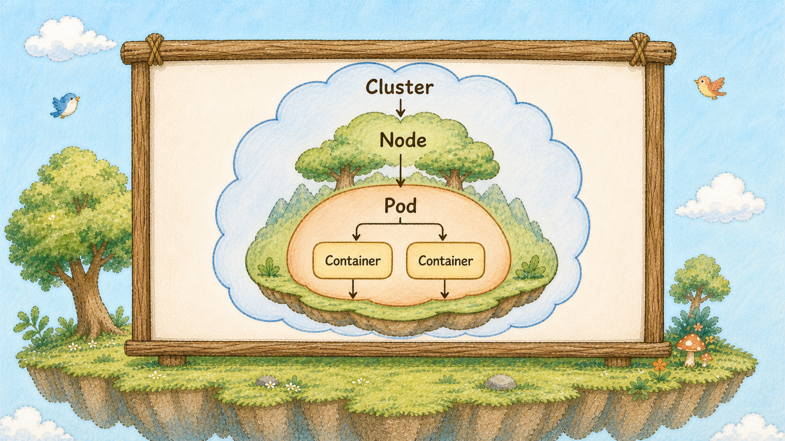
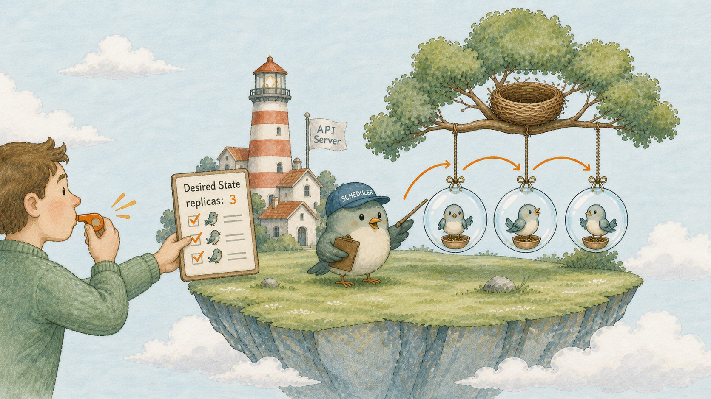

# Day 1：一台機器管不動了，為什麼會有 K8s？

## 痛點

三台機器、十個容器，哪個服務在哪台你開始用 Excel 記。
半夜機器一掛，你得先翻表格才知道上面跑了什麼。

IMG: 在尚未進入 Kubernetes 管理範圍的情境裡，一個人拿著有表格格線的 Excel，在三棵巢樹（Node）之間手動安排沒有泡泡（Pod）包裝的小鳥（Container）；其中一棵巢樹（Node）倒下，樹上的小鳥（Container）散落在地面與空中 ｜ 出場角色：巢樹（Node）、小鳥（Container） ｜ 亮橘重點：倒下的巢樹（Node）與失去棲身處的小鳥（Container）

## 系列文的規劃與預期

這 30 天，我要用一座島把 K8s 講完整，Node 是島上的巢樹（Node），Pod 是泡泡（Pod），泡泡（Pod）裡的小鳥（Container）才是 Container。

今天先看 K8s 出現前的 Docker 情境：小鳥（Container）還沒有進入泡泡（Pod）管理。

每天一張圖、一段能複製貼上的指令，跟著做，30 天後會有一個真的跑得起來的服務，還能畫圖講給同事聽。

## 為什麼會有 Kubernetes

首先，預設你已經會用 Docker 了。
一台機器上 `docker run` 起三個容器，順手得很。
問題是當機器變成三台、容器變成十個，有三件事會開始變成大麻煩。

**第一，機器掛了，上面的服務就沒了。**
單純在某台機器上用 `docker run` 啟動的容器，預設只會在該主機上執行。即使設定重啟策略，也只能嘗試在原主機重啟；主機失效後，不會自動到另一台機器建立替代實例。

必須人工登入另一台、翻出指令、重新跑一次，還要記得改掉對外的 IP，這段時間服務就是掛的。

**第二，新服務要放哪台，是你在決定。**

你得自己記住每台機器配置了多少資源、已經承諾給哪些服務，以及哪些工作負載不能放在一起。這些資訊沒有寫在任何地方，只存在你腦袋和那張 Excel 裡。
同事接手的第一天，就是災難的第一天。

**第三，擴容要人工。** 流量上來了，你要多開兩個容器。
開完還得去改前面的 Nginx 設定、把新的 IP 加進去、reload。流量退了，再手動關掉、再改一次設定。半夜三點做這件事，錯一個字就是全站掛掉。

IMG: 一個人吹響哨子（kubectl），把寫著「hello Pod replicas：3」的期望清單交給燈塔櫃台（API Server）；雲之島（Cluster）建立三顆各住著一隻小鳥（Container）的泡泡（Pod），選樹官（Scheduler）替每顆泡泡（Pod）挑選巢樹（Node） ｜ 出場角色：哨子（kubectl）、燈塔櫃台（API Server）、雲之島（Cluster）、巢樹（Node）、泡泡（Pod）、小鳥（Container）、選樹官（Scheduler） ｜ 亮橘重點：清單上的 `replicas: 3`

在有多個節點、並且已配置好控制器、網路與儲存等能力的叢集中，Kubernetes 會把上面這三類決策交給一套持續協調的系統；它不是單靠一條指令就能保證跨機器高可用。

換句話說，你不再說「去 B 機器上跑一個容器」，你改成說「我要三份 hello 服務一直活著」。

在 Kubernetes 裡，這通常會表達成 Deployment 的期望狀態：
維持三個 Pod replicas，每個 Pod 裡執行 hello Container。
剩下的事情由不同元件協作：挑機器、建立工作負載、掛掉就嘗試補回；之後再透過 Service，把流量導向目前可用的 Pod。

這個轉變有個名字叫**宣告式**。
你描述你要的結果，不描述達成結果的步驟。
這是整個 K8s 最重要的觀念之一，其他元件會把它落實在不同地方。

Day 4 我們會看到島上是誰在負責比對「你要的」跟「現在的」有什麼差別。

所以先講清楚 K8s Container Image 與 Dockerfile 的觀念仍然適用，但 Kubernetes 底層不一定使用 Docker Engine，也可以透過 containerd、CRI-O 等 Container Runtime 執行容器。

它是站在容器上面那一層，專門決定工作負載要放哪、掛了怎麼辦、有幾份的那個東西。

也順便說清楚它的代價：要多學一套詞彙、多維護一組設定檔，一台機器跑一個小服務用不上它。K8s 划算的時機，是當手上的機器和容器多到「哪個在哪」已經記不住的那一刻，也就是開始紀錄在 Excel 的那一刻，我們就是今天該學它。

我們預期用 Kind 在筆電上蓋出第一座島，跑起這 30 天都會用到的 hello 頁服務。

最後佈局這 30 天的地圖，讓我們知道自己走到哪裡。

**第一幕（Day 1-5）登島**：蓋出一座叢集、認識島上的地形和你手上的工具。
**第二幕（Day 6-12）泡泡（Pod）與小鳥（Container）**：把服務跑起來、讓它掛了會自己回來、學會查它為什麼起不來。**第三幕（Day 13-18）流量找得到人**：讓外面的人連得進來。
**第四幕（Day 19-23）帶著東西活下去**：設定、密碼、資料的存放。
**第五幕（Day 24-28）讓島自己運轉**：健康檢查、資源限制、自動擴縮。
**第六幕（Day 29-30）收成**：一張全圖，加上履歷和面試怎麼講。

每一幕都接在前一幕的成果上，用的是同一個服務。你不會學到一半發現要換範例重來。

## 帶走一句話

**你宣告想要的結果，K8s 持續讓目前狀態向它靠近。**

## 參考資源

- [Kubernetes 概念總覽](https://kubernetes.io/docs/concepts/overview/)
- [Kubernetes 架構](https://kubernetes.io/docs/concepts/architecture/)
