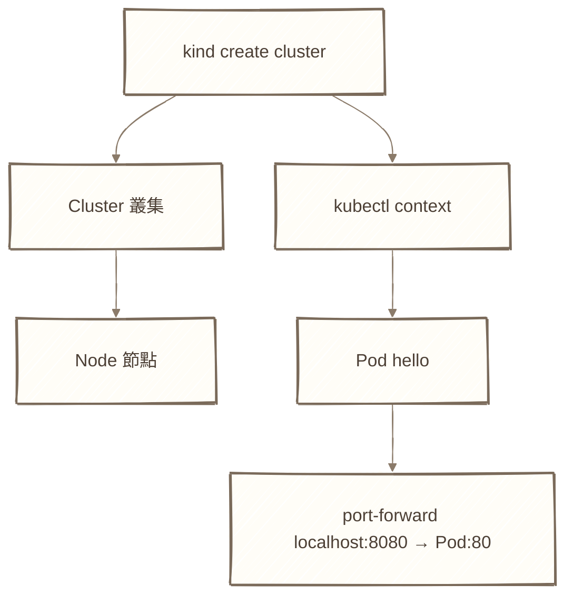
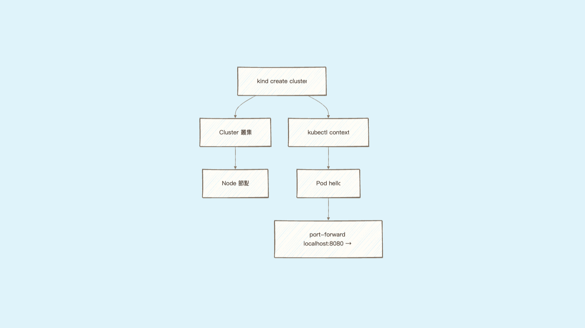
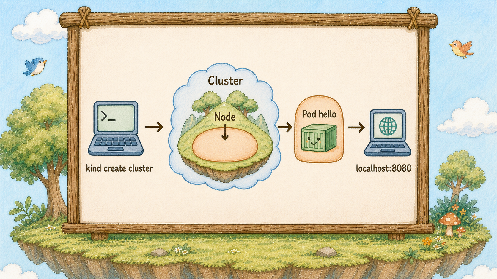
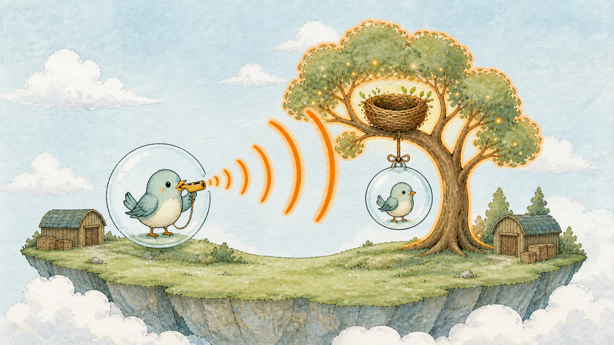
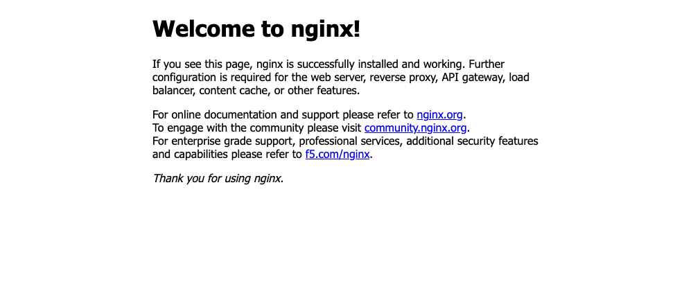

# Day 2：5 分鐘登島 ── 用 Kind 蓋出你的第一座雲之島

## 痛點

你不想為了學 K8s 先去開一台雲主機、綁一張信用卡。
你只想在自己筆電上，五分鐘內看到東西跑起來。







IMG: 一座空盪盪的島上長出第一棵巢樹，樹枝上掛著一顆剛吹出來的泡泡，泡泡裡有一隻小鳥 ｜ 出場角色：雲之島、巢樹、泡泡、小鳥 ｜ 亮橘重點：樹上那顆新長出來的泡泡

Kind 的名稱來自 Kubernetes IN Docker。它把 Kubernetes 節點以容器方式在本機跑起來；本篇以 Docker 作為容器執行環境，所以你需要 Docker 和 Kind。Kind 也支援其他相容的容器執行環境，但那不是今天的重點。

這件事之所以重要，是因為它把「一座叢集」變成免洗的。蓋壞了砍掉重蓋，三十秒的事。學東西最怕的就是不敢亂動，Kind 讓你可以放心亂動。

對照圖上：整座島是叢集，島上那棵樹是節點，樹上掛的泡泡是 Pod，泡泡裡的小鳥是容器。今天我們要讓這座島從空無一物，變成有一棵樹、樹上有一顆泡泡。

還有一個角色你今天就會用到：**哨子**。哨子就是 `kubectl`，你對島上下的每一個指令都從它發出去。島是 Kind 蓋的，但之後你跟島做日常操作，通常靠哨子。

這裡有個新手常卡的點：Kind 和 kubectl 是兩個不同的東西，各裝各的。
Kind 只負責蓋島跟拆島，蓋完就退到一邊；kubectl 負責之後所有的日常操作。

Kind 蓋完島會自動幫你把 kubectl 指到這座新島上，所以你不用做任何連線設定，裝完就能用。



IMG: 一支哨子朝著島吹出聲波，島上的巢樹被聲波點亮 ｜ 出場角色：哨子、雲之島、巢樹 ｜ 亮橘重點：哨子吹出的聲波

## 動手 5 分鐘

今天從零開始，結束時你會有一座叢集和一個能在瀏覽器打開的 hello 服務。

先確認 Docker 有開，這是整篇的前提：

```bash
docker ps
```

有正常吐出表格就代表 Docker 活著。
如果看到 `Cannot connect to the Docker daemon`，去把 Docker Desktop 打開再回來。

裝 Kind 和 kubectl（macOS 用 Homebrew，其他平台看官方安裝頁）：

```bash
brew install kind kubectl
kind version
kubectl version --client
```

兩個版本號都印出來就可以往下走。

蓋島：

```bash
kind create cluster --name hello
```

這行會跑一到兩分鐘，畫面上會一行行印出 Preparing nodes、Writing configuration、Starting control-plane。最後看到 `Set kubectl context to "kind-hello"`，島就蓋好了。

看看島上有什麼樹：

```bash
kubectl get nodes
```

你會看到一列 `hello-control-plane`，STATUS 是 `Ready`。這就是圖上那棵巢樹。如果 STATUS 是 `NotReady`，等十秒再打一次，它還在開機。

吹出第一顆泡泡，跑起這 30 天都會用的 Nginx hello 服務：

```bash
kubectl run hello --image=nginx:alpine
kubectl get pods
```

第一次打 `get pods` 可能看到 `ContainerCreating`，那是正在拉 image。過幾秒再打一次，STATUS 變成 `Running` 就成功了。

把它接到你的瀏覽器：

```bash
kubectl port-forward pod/hello 8080:80
```

畫面會停在 `Forwarding from 127.0.0.1:8080 -> 80` 不動，這是正常的，別關掉它。打開瀏覽器輸入 `http://localhost:8080`，你會看到 Nginx 的 Welcome 頁。



這頁長得很陽春，但它是從你剛蓋好的叢集裡送出來的 ── 島上第一顆泡泡開始工作了。

如果它說 `address already in use`，代表 8080 被別的程式佔了，把指令改成 `8081:80`，網址也跟著改成 8081。前面那個數字是你電腦上的埠、後面那個是泡泡裡的埠，改前面不會影響服務本身。

另外兩個常見狀況先寫在這裡，省得你自己撞：Pod 一直停在 `ContainerCreating` 超過一分鐘，通常是網路太慢還在拉 image，先等；瀏覽器打不開但 port-forward 沒報錯，先確認網址打的是 `http` 不是 `https`，Nginx 這裡只開 80。

要收工的時候，`Ctrl+C` 停掉 port-forward。叢集留著，明天還要用。真的想砍掉重來就打 `kind delete cluster --name hello`。

最後講清楚 Kind 的定位，免得你誤會。

**Kind 是拿來學和測試的，不是拿來上線的。** 它的樹是 Docker 容器假扮的，整座島跑在你一台筆電上，這台電腦關機島就沒了。正式環境的島會有好幾棵真的機器當樹，而且燈塔村本身也會開好幾份互相備援。

但這不影響你學：**你這 30 天打的每一個指令、寫的每一份 YAML，搬到正式環境時，核心資源寫法大致相同，但儲存、網路、權限與叢集設定通常要調整。** 差別主要在底下有幾棵樹、樹是什麼做的，以及環境相關設定。這也是 K8s 最值錢的地方 ── 你的操作方式跟底下跑在誰家的機房完全無關。

還有一件事順手做掉。你電腦上可以同時有好幾座島，哨子靠 context 決定要對哪一座說話：

```bash
kubectl config get-contexts
```

前面有星號的那一行，就是哨子現在對著的島。之後你如果同時開了公司的叢集和自己的 Kind，記得先看這行再打指令。

## 帶走一句話

**島是 Kind 蓋的，之後都靠哨子說話。**

## 參考資源

- [kind Quick Start](https://kind.sigs.k8s.io/docs/user/quick-start/)
- [安裝 kubectl](https://kubernetes.io/docs/tasks/tools/)
