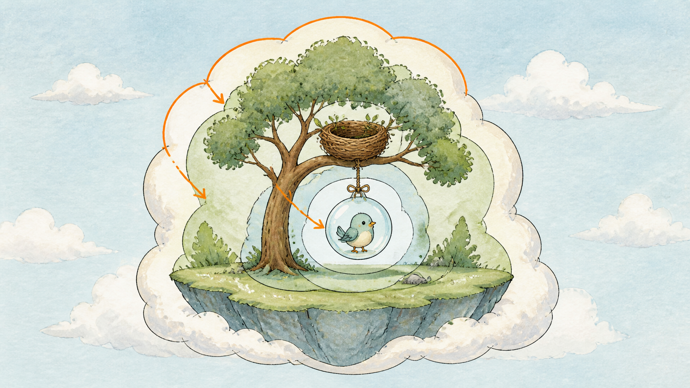
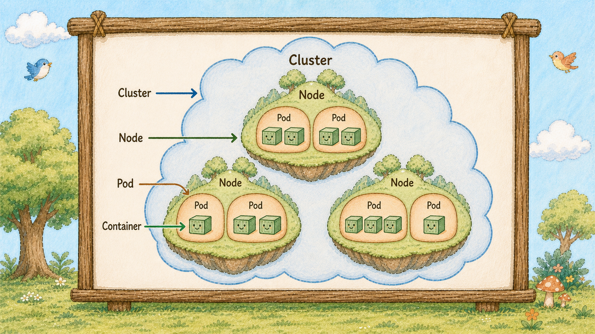
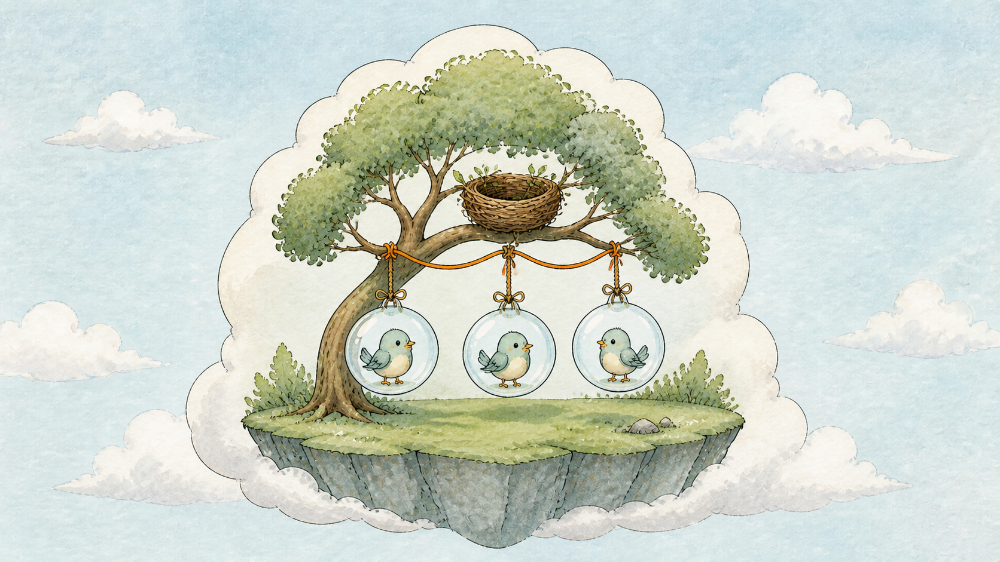
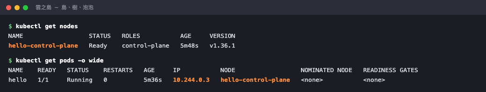

# Day 3：雲之島全景圖， 一張圖說完 Cluster、Node、Pod 


## 痛點

昨天東西是跑起來了，但 Cluster、Node、Pod 這三個詞在你腦中還是糊成一團，誰包誰你講不出來。




## Cluster 的全景剖面


這是整個系列最重要的一張圖：島上長著巢樹（Node）、樹上掛著泡泡（Pod）、泡泡（Pod）裡站著小鳥（Container），四層由外而內一次看完，看懂了，後面幾天都在往上疊東西而已。

今天先不重複背定義，直接把圖上的四層對到終端機裡的指令：

- **雲之島（Cluster）**：用 `kubectl cluster-info` 看整座島的連接狀況。
- **巢樹（Node）**：用 `kubectl get nodes` 看島上有幾棵樹。
- **泡泡（Pod）**：用 `kubectl get pods -o wide` 看樹上掛了哪些泡泡與它們的 IP。
- **小鳥（Container）**：用 jsonpath 指令把泡泡（Pod）肚子裡的小鳥名字叫出來。

這些指令不是四個孤立的查詢，而是同一張圖從外到內的四次對照。昨天 `kind create cluster` 蓋的就是這座島。

## 巢樹（Node 節點）

島上的每一棵樹都是一台可以提供 CPU 和記憶體的機器，可以是實體機器，也可以是虛擬機器。正式環境的島上會有五棵、十棵樹；Kind 預設只給你一棵，因為它是拿一個 Docker 容器模擬的。樹是實際幹活的地方。

掛在樹枝上的泡泡（Pod），是 K8s 排程的最小單位，不是小鳥（Container）。在 Deployment、ReplicaSet 這類工作負載裡，你看到的副本數是在數泡泡（Pod）；其他資源有自己的數量與狀態。


## 小鳥（Container 容器）
Container 是 Pod 裡實際執行程式的隔離程序。

我們熟悉的 Docker 容器是其中一種容器實作，但 Kubernetes 不限定只能使用 Docker。
看圖上小鳥（Container）的位置，明天就能懂為什麼要多包一層。

把這四層跟指令對起來，你會發現 K8s 不是直接把小鳥塞到樹上，而是先用泡泡（Pod）把它包起來。**Pod 是 K8s 用來打包小鳥（Container）的暫時性外殼；程式壞掉時，外殼可以直接換新，不用重買整棵樹。**

我們昨天各打過一次，只是當時不知道自己在看什麼。
為什麼要分這麼多層？因為每一層的壽命不一樣。

島可以活好幾年，樹會壞掉也會換新，泡泡（Pod）是隨時可以破掉重吹的消耗品。
分層的意義就在這裡：讓短命的東西破掉時，長命的東西不受影響。

這條線貫穿整個系列，之後我們會看到泡泡（Pod）一直破、一直被重吹，而島跟樹幾乎不動。

## 動手 5 分鐘

昨天我們有一座島、一棵樹、一顆跑著 Nginx 的泡泡（Pod）。
今天不加東西，只做一件事：把圖上的四層，在終端機裡一層一層指出來。

先看整座島的連接狀況：

```bash
kubectl cluster-info
```

你應該會看到 Kubernetes control plane 與 CoreDNS 的網址，代表哨子（kubectl）已經連上這座島。

先看島上有幾棵樹：

```bash
kubectl get nodes
```

一列 `hello-control-plane`，STATUS `Ready`。這是圖上唯一那棵巢樹（Node）。

看樹的細節：

```bash
kubectl get nodes -o wide
```

多出來的欄位裡有 `INTERNAL-IP`、`OS-IMAGE`、`CONTAINER-RUNTIME`。這棵樹有自己的 IP、自己的作業系統 ── 它就是一台機器。

現在看樹上掛了哪些泡泡（Pod）：

```bash
kubectl get pods -o wide
```

你應該會看到類似這樣的結果：`hello` 的 STATUS 是 `Running`，並且同一列有它的 `IP` 與 `NODE`。

`-o wide` 是關鍵。會看到兩欄：`IP` 是這顆泡泡（Pod）自己的門牌，`NODE` 是它掛在哪棵樹上。NODE 那欄印出來的名字，跟上面 `get nodes` 看到的是同一個，這就是圖上「泡泡（Pod）掛在樹枝上」那條線，在終端機裡的樣子。



橘色那兩處是同一棵樹的名字，一個在樹的清單上、一個在泡泡（Pod）的 NODE 欄。

再往裡看一層，看泡泡（Pod）裡有哪隻小鳥（Container）：

```bash
kubectl get pod hello -o jsonpath='{.spec.containers[*].name}'
```

你應該會看到類似這樣的結果：`hello`。

印出 `hello`。這是泡泡（Pod）裡那個 Container 的名字。路徑是 `spec.containers`，複數 ── 一顆泡泡（Pod）裡可以有好幾個 Container，明天講為什麼。

最後看整座島上所有 Namespace 的泡泡（Pod）：

```bash
kubectl get pods -A
```

冒出一堆你沒建過的泡泡（Pod）：coredns、kube-proxy、etcd、kube-apiserver。
這些是島自己的常駐居民，明天 Day 4 我們去認識它們。

最後補一件事，會在正式環境看到但今天看不到的：**樹是可以有很多棵的。**

Kind 預設只給你一棵，但你隨時可以多種幾棵。在 `kind-config.yaml` 裡多寫幾行 `- role: worker`，重蓋一次島就有三棵樹了（Day 16 我們就會為了另一個理由做這件事）。

樹一多，一個問題就變得有意思：**你的三顆泡泡（Pod）會被放到哪幾棵樹上？** 
這件事不是你決定的，是選樹官（Scheduler）決定的， 明天可以認識它。

順便看一下這棵樹能裝多少東西：

```bash
kubectl describe node hello-control-plane | grep -A9 Capacity
```

CPU、記憶體、還有 `pods: 110` 這一行 。**一棵樹預設最多掛 110 顆泡泡（Pod）**。這是選樹官（Scheduler）排位子時的其中一條規則，Day 25 我們會再回來看它怎麼算的。

另外要知道：**這四層裡，Pod 是最常觀察和管理的執行單位；但在正式環境，你通常會透過 Deployment、Job 或 StatefulSet 間接建立 Pod。**

島是一次性蓋好的、樹是機器（增減是另一件事）；Image 則是事先做好的執行環境模板，Container 是 K8s 根據 Pod 設定從這個模板啟動出的實際程序。

這 30 天絕大部分的時間，都在對著「泡泡（Pod）」這一層下指令 ── 要幾顆、使用什麼 Image、Container 怎麼執行、破了怎麼辦、流量怎麼進來。

下次看到一份 K8s 的 YAML 覺得很陌生，先問自己一句：**這份東西最後是為了讓哪幾顆泡泡（Pod）長成什麼樣子？** 
九成的資源都是在回答這個問題，只是從不同角度回答。

## 帶走一句話

**島包樹、樹掛泡泡（Pod）、泡泡（Pod）裝小鳥（Container）。**

## 參考資源

- [Kubernetes 架構](https://kubernetes.io/docs/concepts/architecture/)
- [Nodes](https://kubernetes.io/docs/concepts/architecture/nodes/)
