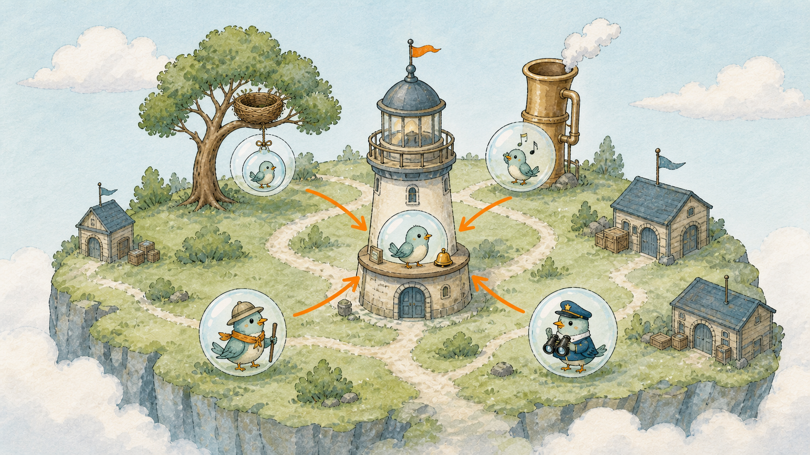
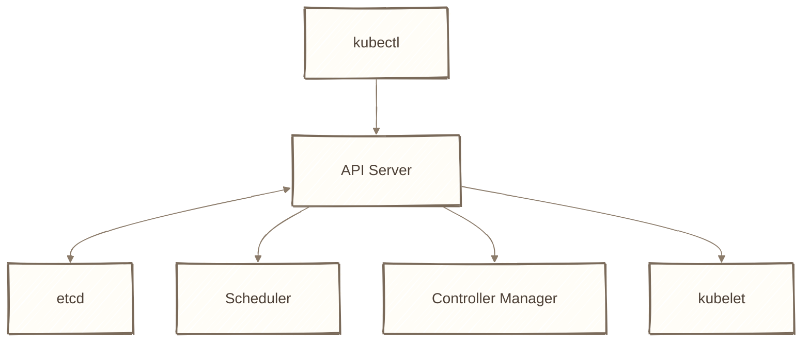
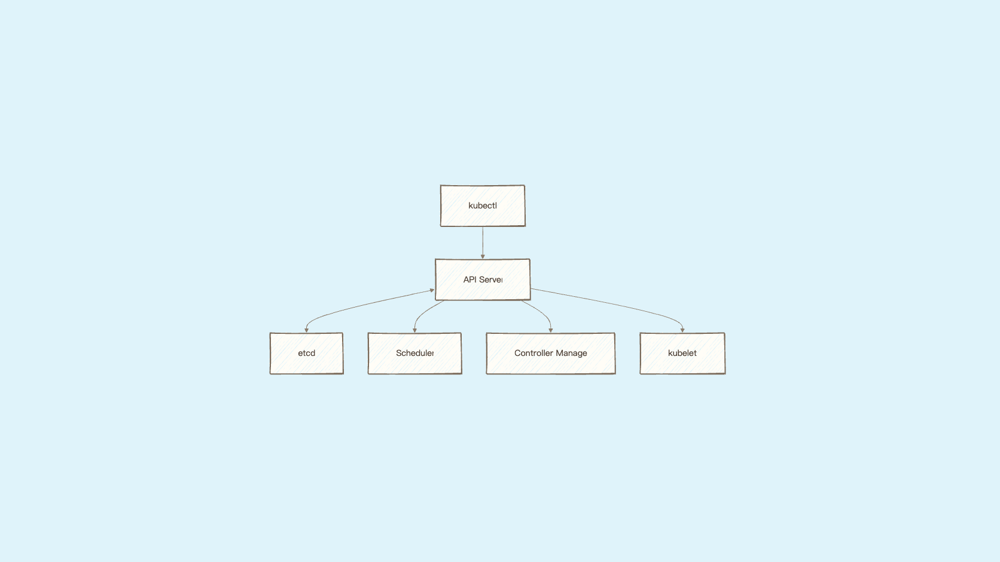
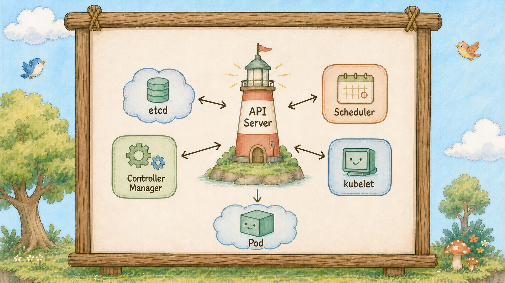
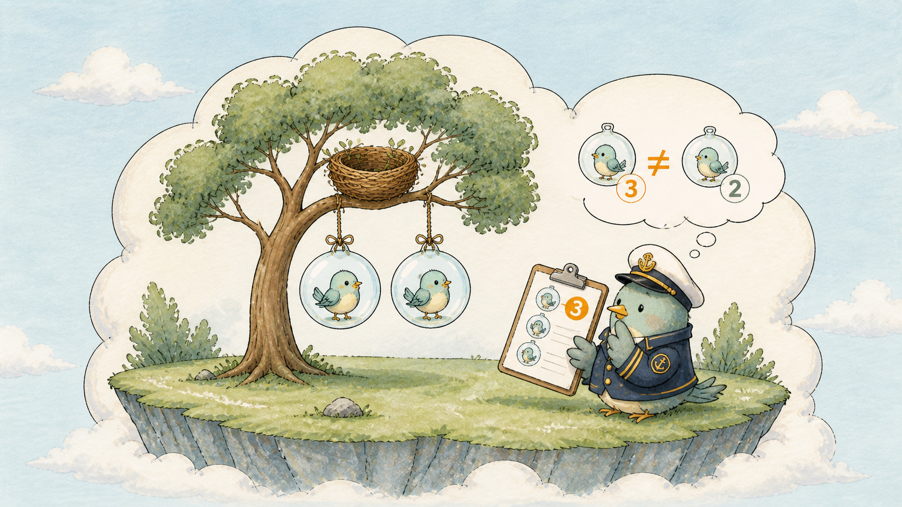
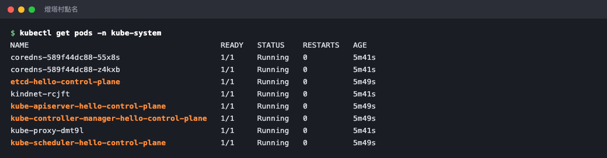

# Day 4：燈塔村在忙什麼 ？櫃台、記憶樹、選樹官、巡邏隊長

## 痛點

昨天你打了 `kubectl get pods -A`，看到一堆自己沒建過的泡泡。那些是誰？誰在管這座島？








IMG: 燈塔村的平面圖，哨子、記憶樹、選樹官、巡邏隊長的箭頭全部先指向中央的燈塔櫃台 ｜ 出場角色：燈塔櫃台、記憶樹、選樹官、巡邏隊長、哨子 ｜ 亮橘重點：中央的燈塔櫃台

島上有一區叫燈塔村，住著四個角色。它們主要負責協調與決策；真正執行容器、掛載儲存和處理網路，還需要巢樹上的元件配合。

**燈塔櫃台（API Server）。** 島上唯一的窗口。你吹哨子下的控制面指令，先到櫃台；其他控制面角色通常也透過櫃台讀寫叢集狀態。看圖上的箭頭：沒有任何一條線是繞過櫃台的。這件事的實際意義是，你只要能跟櫃台說話，就能操作整座島。

**記憶樹（etcd）。** Kubernetes API 物件主要持久化在這裡。你要什麼、現在有什麼，核心狀態都記在這棵樹上。櫃台自己不記，它每次都去問記憶樹。記憶樹倒了，島就失憶了 ── 正式環境備份 etcd 就是在備份這個。

**選樹官（Scheduler）。** 專門處理一件事：有新泡泡要掛，但還沒決定掛哪棵樹。選樹官看每棵樹可配置的資源與其他條件，挑一棵，把答案寫回櫃台。就這樣，它不負責真的把泡泡掛上去。

**巡邏隊長（Controller Manager）。** 拿著清單一直繞島巡邏，比對「你說要的」跟「島上實際有的」。你說要三顆泡泡，現在只有兩顆，它就補一顆。這個比對動作永不停止。

這帶出今天真正要記住的觀念：**宣告式**。

你說的是「我要三顆泡泡」，不是「去吹一顆泡泡」。前者是描述結果，後者是描述動作。差別在哪？描述動作的話，泡泡破了就沒了，因為你的指令早就執行完了。描述結果的話，泡泡破了巡邏隊長會發現數字不對，自己補回來。

你之後寫的每一份 YAML，都是在跟櫃台描述結果。Day 9 你會親眼看到，手動刪掉一顆泡泡，它自己長回來。



IMG: 巡邏隊長舉著寫有「要 3 顆」的清單，對照樹上只有 2 顆泡泡 ｜ 出場角色：巡邏隊長、巢樹、泡泡 ｜ 亮橘重點：清單上的數字和樹上泡泡數量的落差

最後補一句分工：燈塔村只出一張嘴。選樹官決定泡泡掛哪棵樹，但它不會親手去掛；巡邏隊長發現少一顆，也只是去櫃台登記「要補一顆」。真正把泡泡吹出來的是樹上的**管家松鼠**（kubelet），每棵樹上都住著一隻，盯著櫃台看有沒有自己這棵樹的活。決定跟執行是分開的，這也是為什麼燈塔村掛掉的時候，已經在跑的服務不會馬上跟著死。

## 動手 5 分鐘

昨天我們看完了島、樹、泡泡三層。今天不加資源，只去燈塔村點名。

燈塔村的成員全住在 `kube-system` 這個區域：

```bash
kubectl get pods -n kube-system
```

你會在清單裡看到 `kube-apiserver-hello-control-plane`（櫃台）、`etcd-hello-control-plane`（記憶樹）、`kube-scheduler-hello-control-plane`（選樹官）、`kube-controller-manager-hello-control-plane`（巡邏隊長）。四個角色，四顆泡泡，都是 `Running`。

原來燈塔村自己也是用泡泡跑的。



橘色標出來的四顆，就是櫃台、記憶樹、選樹官、巡邏隊長。

看看選樹官當初把你的 hello 泡泡派去哪：

```bash
kubectl describe pod hello | sed -n '/Events:/,$p'
```

Events 裡有一行 `Successfully assigned default/hello to hello-control-plane`，發出這行的角色是 `default-scheduler`。這就是選樹官做完決定的簽名。

驗證「所有事情都經過櫃台」：

```bash
kubectl get pods -v=6
```

`-v=6` 會把 kubectl 背後的動作印出來。你會看到一行 `GET https://127.0.0.1:xxxxx/api/v1/namespaces/default/pods`。哨子做的事情，其實就是對櫃台發 HTTP 請求。

最後看櫃台跟記憶樹健不健康：

```bash
kubectl get --raw='/readyz?verbose' | head -20
```

一連串 `ok`，其中有一行 `[+]etcd ok`。櫃台正在回報：我問得到記憶樹。

最後回答一個你現在一定會想到的問題：**燈塔村掛掉會怎樣？**

分兩種情況。已經在跑的服務**通常還能繼續** ── 樹上的管家松鼠不需要櫃台就能繼續照顧現有的泡泡，道路管理員整理好的地道規則也還在，是否無感要看 kubelet、Runtime、網路與應用程式狀態。

但你會失去「改變」的能力：不能部署、不能擴容，泡泡破了也**沒有人會補**，因為負責發現這件事的巡邏隊長不在了。所以正式環境通常會替燈塔村與記憶樹做高可用與備份，而記憶樹是所有東西裡最需要定期備份的 ── 它一失憶，整座島就不知道自己該長什麼樣子。

你也可以親眼看看記憶樹裡存了什麼形狀的東西：

```bash
kubectl get pod hello -o yaml | head -20
```

`metadata`、`spec`、`status` ── 你要的（spec）跟現況（status）並排放在同一份紀錄裡。**巡邏隊長一輩子就在比對這兩段。**

## 帶走一句話

**你只描述結果，巡邏隊長負責追平。**

## 參考資源

- [Kubernetes Components](https://kubernetes.io/docs/concepts/architecture/components/)
- [Controllers](https://kubernetes.io/docs/concepts/architecture/controller/)
