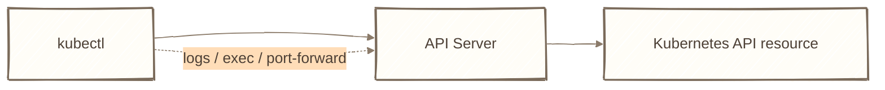
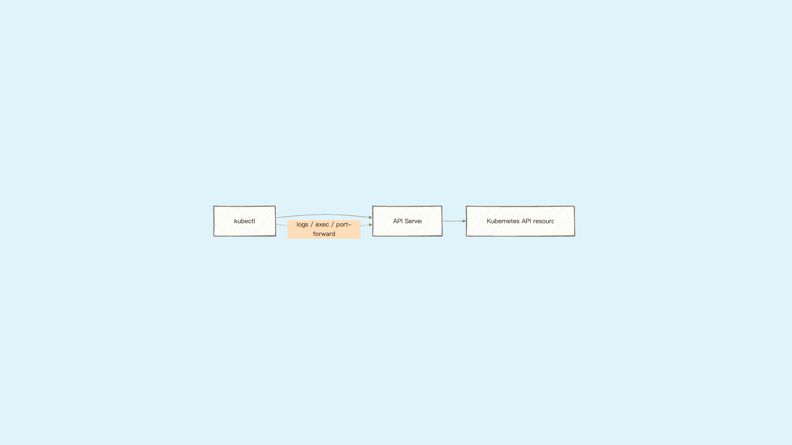
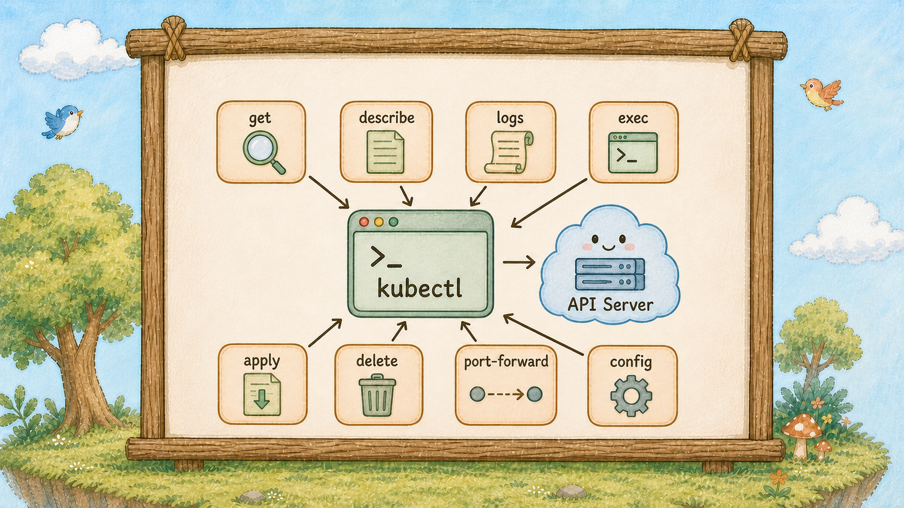
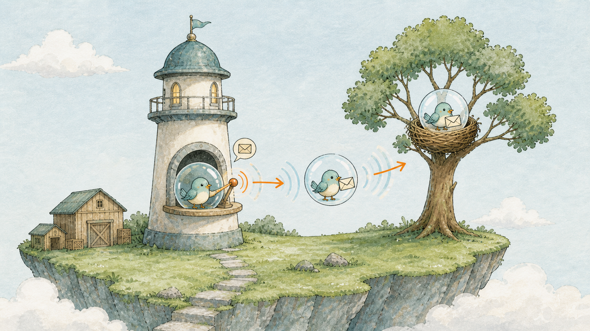
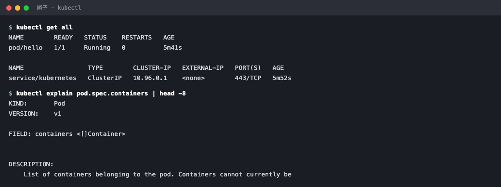

# Day 5：你手上的哨子 ，kubectl 最常用的 8 個指令

## 痛點

kubectl 的指令有上百個，官方文件一頁列不完。
但你日常會用到的其實就那幾個，剩下的用到再查。







IMG: 一隻人類的手拿著哨子吹出聲波，聲波傳到遠處的燈塔櫃台 ｜ 出場角色：哨子、燈塔櫃台 ｜ 亮橘重點：從哨子傳到櫃台的聲波

哨子是你唯一的溝通工具。昨天我們看過，它做的事情就是把你打的字翻成 HTTP 請求送到燈塔櫃台。

今天這篇是給你收藏當小抄的。八個指令，記住的順序不是字母，是你實際工作的順序：**先看、再查、再讀、再改、再刪**。

看是 `get`，查是 `describe`，讀是 `logs`，改是 `apply`，刪是 `delete`。另外三個是進階但很常用的 `exec`、`port-forward`、`get -o yaml`。

八個記熟，你就能應付九成的日常狀況。至於為什麼是這八個，因為 Day 12 教你查問題的時候，用的就是其中前三個。

還有兩件事先講，可以省你很多打字時間。第一，常見資源支援縮寫：`pods` 可以打 `po`、`deployments` 打 `deploy`、`services` 打 `svc`。第二，所有指令預設只看 `default` 這個區域，要看別區加 `-n <名字>`，要看全部加 `-A` ── 你昨天在燈塔村用過。



IMG: 哨子吹出的聲波先抵達燈塔櫃台，櫃台再把訊息轉往島上的巢樹 ｜ 出場角色：哨子、燈塔櫃台、巢樹 ｜ 亮橘重點：櫃台這一站的轉手動作

## 動手 5 分鐘

前四天我們有一座島、一顆叫 hello 的泡泡。今天不加東西，把八個指令在它身上各打一次。

**1. get ── 看有什麼、狀態如何。** 最常打的指令，沒有之一。

```bash
kubectl get pods
kubectl get pods -o wide
kubectl get all
```

`get all` 會把這個 Namespace 裡的主要資源一次列出來。現在只有一顆泡泡，之後會越來越熱鬧。

**2. describe ── 查一個資源的完整狀況，重點是最下面的 Events。**

```bash
kubectl describe pod hello
```

輸出很長，先看最後面的 Events 區塊。它按時間記錄了這顆泡泡發生過什麼事：被派到哪棵樹、image 拉了沒、容器起來了沒。

**3. logs ── 讀容器裡面印出來的東西。**

```bash
kubectl logs hello
kubectl logs hello -f
```

`-f` 是持續跟著看，跟 `tail -f` 一樣，`Ctrl+C` 離開。

**4. apply ── 套用一份 YAML，是你之後最主要的操作方式。**

```bash
kubectl apply -f hello-pod.yaml
```

現在還沒有這個檔案，明天就會寫。記住 apply 的個性：檔案改了再 apply 一次，它只更新有差的部分，不會重來一遍。

**5. delete ── 刪掉資源。**

```bash
kubectl delete pod hello
kubectl get pods
```

刪完再 get 一次，`No resources found`。它不會自己回來 ── 這是伏筆，Day 9 我們讓它回來。

先把它建回來，後面三個指令要用：

```bash
kubectl run hello --image=nginx:alpine
```

**6. exec ── 鑽進小鳥肚子裡。**

```bash
kubectl exec -it hello -- sh
```

提示字元變成 `/ #`，你人就在容器裡了。打 `ls /usr/share/nginx/html` 看得到 `index.html`。`exit` 出來。

**7. port-forward ── 把泡泡的埠接到你的電腦上。**

```bash
kubectl port-forward pod/hello 8080:80
```

Day 2 用過。開發時期最方便的偷看方式，正式環境不會這樣用。

**8. get -o yaml ── 看 K8s 眼中這個資源的完整樣貌。**

```bash
kubectl get pod hello -o yaml
```

印出來的東西比你建立時多很多 ── 多出來的是 K8s 自己補上的預設值和現況。想知道某個欄位怎麼寫，來這裡抄最準，比翻文件快。



同一套動詞，換個名詞就能問島上任何一種資源。

最後補一個查文件的指令，它不在八個裡面，但會救你很多次：

```bash
kubectl explain pod.spec.containers
```

它會直接告訴你這個欄位底下能放什麼、每個是什麼型別。以後想不起來某個欄位叫什麼名字，先問它。

最後兩個讓你打字變快的設定，現在做，之後三十天都受用。

第一，設定縮寫。把這行加進你的 `~/.zshrc` 或 `~/.bashrc`：

```bash
alias k=kubectl
```

之後 `k get pods` 就好。你一天會打幾百次這四個字母。

第二，開啟自動補全。這個比縮寫更有用，因為它會幫你補資源名稱那一長串亂碼：

```bash
echo 'source <(kubectl completion zsh)' >> ~/.zshrc
```

（bash 使用者把 `zsh` 換成 `bash`。）重開終端機之後，打 `kubectl get pod hel` 按 Tab，它會自動補完整個泡泡名字。

最後提醒一件小事但很重要：**幾乎每個指令後面都可以加 `--help`**，而且 K8s 的 help 寫得非常好，範例都能直接複製貼上。

```bash
kubectl get --help
```

你不需要記住所有參數，你只需要記住去哪裡找。

最後再補一個觀念，它能解釋為什麼八個指令就夠用。

**這八個指令涵蓋大量日常資源操作，但 `logs`、`exec`、`rollout` 等指令各有適用範圍。** `kubectl get` 不只能看 Pod，也能看 Deployment、Service、Ingress、Secret ── 只要把後面的名詞換掉就好。`describe`、`delete`、`get -o yaml` 也一樣。

```bash
kubectl get pods
kubectl get svc
kubectl get all
```

這是 K8s 刻意的設計：**大量 Kubernetes 物件都能用同一套基本動詞操作；特殊子資源仍有自己的指令與限制。** 所以你之後學新資源時，真正要學的只有「它的 YAML 怎麼寫」，指令的部分你今天就已經全部學完了。

想知道島上總共有幾種資源可以操作，打這行：

```bash
kubectl api-resources | wc -l
```

六、七十種。但你今天學的八個動詞，對它們全部有效。

## 帶走一句話

**先看狀態、再看事件、最後看日誌。**

## 參考資源

- [kubectl 指令參考](https://kubernetes.io/docs/reference/kubectl/)
- [kubectl Cheat Sheet](https://kubernetes.io/docs/reference/kubectl/cheatsheet/)
