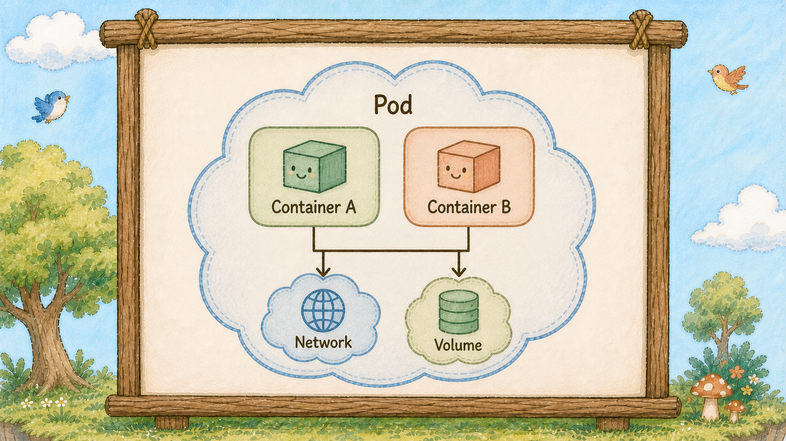
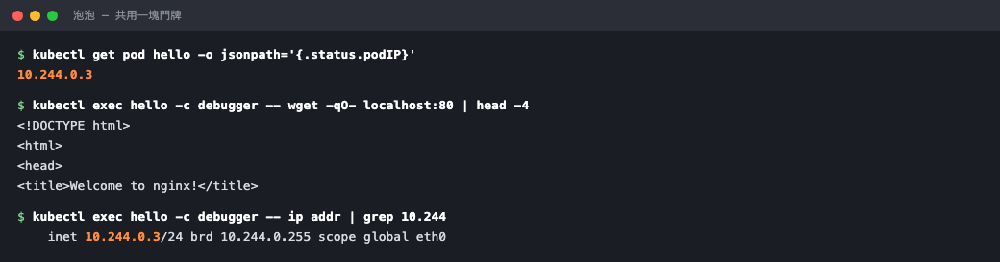

# Day 6：泡泡（Pod），為什麼容器要多包一層？


## 痛點

我們已經會用 Docker 跑容器了。
那為什麼 K8s 不直接管容器，非要在外面套一層叫 Pod 的東西？


## 一顆泡泡的剖面


泡泡（Pod）裡站著兩隻小鳥（Container），共用中央的共享食物桶（emptyDir），各自透過面前的食盆（Volume Mount）取用，而泡泡（Pod）外壁上只有唯一一塊門牌。

**門牌只有一塊，掛在泡泡（Pod）上；同一個 Pod 裡的小鳥（Container）共用它。**

這代表同一顆泡泡（Pod）裡的小鳥（Container）共用一個 IP。

A 小鳥（Container）要找 B 小鳥（Container），直接打 `localhost` 就到，不需要知道對方的位置、不需要服務發現。

它們也共用同一組埠號空間，所以同一顆泡泡（Pod）裡兩隻小鳥（Container）不能都佔 80 埠，會撞號。

除了網路，儲存也是共用的。
看圖上食盆（Volume Mount）的位置，兩隻小鳥（Container）吃同一盆。



## 什麼時候要放兩隻小鳥

那什麼時候需要一顆泡泡（Pod）放兩隻小鳥（Container）？

最常見的情境叫 **sidecar**：主容器跑自己的服務，旁邊放一個小容器專門幫它做雜事。

假設有個主容器是 Nginx，旁邊放一個 log 收集器，直接讀主容器寫出來的日誌檔往外送。
這件事之所以做得到，正是因為它們共用儲存和網路。


一隻小鳥（Container）專心唱歌，另一隻小鳥（Container）把牠掉出來的紙屑收成一疊往泡泡（Pod）外遞，這疊往外遞的紙屑就是 sidecar 在做的事。

判斷準則很簡單：**這兩個東西要不要一起生、一起死、一起搬家？**
要的話放同一顆泡泡（Pod），不要的話拆成兩顆。

網站和資料庫顯然不該一起死，所以它們是兩顆泡泡（Day 23 我們就會這樣做）。

K8s 排程的是一整顆泡泡（Pod）。主容器與 sidecar 放在同一顆 Pod，才能共用網路與儲存。

把它們綁成一包，這個決定才做得下去。


## 動手 5 分鐘

我們有一顆叫 hello 的泡泡（Pod），裡面一隻跑 Nginx 的小鳥（Container）。今天把泡泡（Pod）的門牌找出來，然後往同一顆泡泡（Pod）裡塞第二隻小鳥（Container），證明它們真的共用門牌 （IP）。

先看門牌（IP）：

```bash
kubectl get pod hello -o yaml | grep -A3 podIP
```

印出 `podIP: 10.244.0.x` 這種位址。這就是圖上那塊門牌，整顆泡泡（Pod）共用一個。

用 `-o jsonpath` 只挑你要的欄位，看得更清楚：

```bash
kubectl get pod hello -o jsonpath='{.status.podIP}{"\n"}{range .spec.containers[*]}{.name}{"\n"}{end}'
```

上面一行是 IP，下面列出泡泡（Pod）裡所有小鳥（Container）的名字。現在只有一隻 `hello`。**一個 IP、一份容器清單** ── 這就是 Pod 的結構。

現在往同一顆泡泡（Pod）裡臨時加一隻小鳥（Container）：

```bash
kubectl debug -it hello --image=busybox:1.36 --profile=general -- sh
```

`kubectl debug` 會在既有泡泡（Pod）裡插入一隻臨時小鳥（Container），不動到原本那隻（`--profile=general` 不加也會動，但新版 kubectl 會跳一行棄用警告）。等個幾秒，提示字元變成 `/ #`，你人就在第二隻小鳥（Container）裡面了。

在裡面打這行：

```bash
wget -qO- localhost:80
```

Nginx 的 HTML 直接吐出來了。

停一下想清楚這件事有多怪：這隻 busybox 小鳥（Container）完全沒裝 Nginx，它打 `localhost` 卻打得到 Nginx。因為它跟 Nginx 那隻小鳥（Container）站在同一顆泡泡（Pod）裡，共用那塊門牌。



橘色那個位址出現兩次：一次是外面看到的 podIP，一次是臨時小鳥（Container）自己的網卡。

換個角度再確認一次：

```bash
ip addr | grep 10.244
```

印出來的 IP，跟你剛剛在外面看到的 `podIP` 是同一個。打 `exit` 出來。

出來後看看泡泡（Pod）的成員名單變了沒：

```bash
kubectl get pod hello -o jsonpath='{.spec.ephemeralContainers[*].name}{"\n"}'
```

多了一隻臨時小鳥（Container）的名字。它會跟著泡泡（Pod）一起活、一起死，你沒辦法單獨把它抽掉 ── 這正是「泡泡（Pod）才是最小單位」的意思。

最後補一種你早晚會用到的小鳥（Container），它也住在泡泡（Pod）裡，但行為完全不同：**initContainers（開場小鳥（Container））**。

一般的小鳥（Container）是**同時**起飛的，誰先誰後不一定。但有些事情必須先做完：等資料庫準備好、下載設定檔、跑一次資料庫遷移。這些放進 `initContainers`，它們會**依序跑完、而且全部成功**，主要的小鳥（Container）才會開始啟動。

```yaml
spec:
  initContainers:
    - name: wait-db
      image: busybox:1.36
      command: ["sh", "-c", "echo checking...; sleep 3"]
  containers:
    - name: hello
      image: nginx:alpine
```

它跟 sidecar 的差別很好記：**開場小鳥（Container）跑完就離開，sidecar 陪著主角一直活到最後。** 一顆泡泡（Pod）裡兩種都可以有。

你現在也看得懂 `kubectl get pods` 那個 `Init:0/1` 狀態了 ── 開場小鳥（Container）還沒跑完，主角還沒上台。

最後把一個很容易搞混的問題釐清：**泡泡（Pod）自己會不會重啟？**

這裡說的「重啟」是同一個泡泡（Pod）內的 container 重啟；**控制器也可能刪除原本的泡泡（Pod），再建立一顆新的。**

一顆泡泡（Pod）從被建立的那一刻起，對同一顆泡泡（Pod）來說，它掛在哪棵樹上、拿到哪個門牌，在生命週期內通常不會改變；需要換樹時，控制器通常會建立新的泡泡（Pod）。

裡面的小鳥（Container）死掉了，管家松鼠（kubelet）會在**同一顆泡泡（Pod）裡**重新啟動該 Container（是否重新拉 image 取決於 `imagePullPolicy` 與本機快取）── 你在 `kubectl get pods` 看到的 RESTARTS 欄位加一，就是這件事。

但如果是整顆泡泡（Pod）出問題（那棵樹掛了、資源不夠被趕走），它不會「搬家」，它會**直接消失**，然後由別人建一顆全新的泡泡（Pod）出來。
新泡泡（Pod）是新的名字、新的門牌，跟舊的完全沒有關係。

**Deployment 管理的 Pod 需要換樹時，控制器會建立新的 Pod 取代原本的 Pod。**

## 帶走一句話

**同一顆泡泡（Pod）的小鳥（Container），共用一塊門牌（IP）。**

## 參考資源

- [Pods](https://kubernetes.io/docs/concepts/workloads/pods/)
- [Init Containers](https://kubernetes.io/docs/concepts/workloads/pods/init-containers/)
