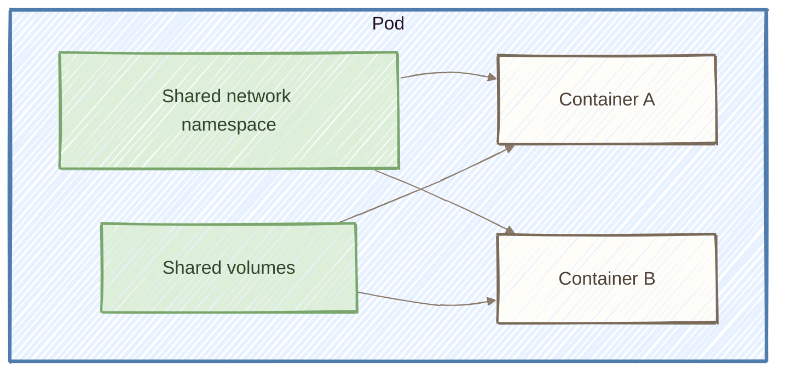
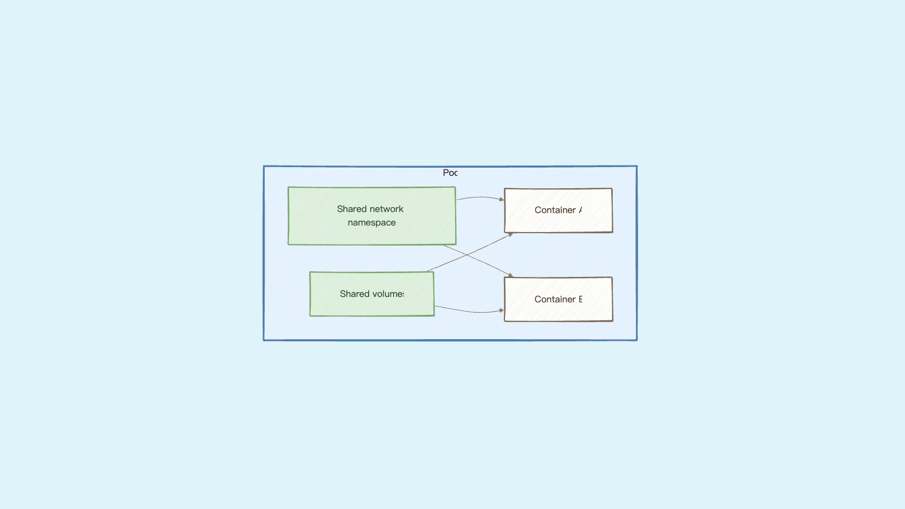

# Day 6：泡泡巢 Pod ── 為什麼容器要多包一層？

## 痛點

你已經會用 Docker 跑容器了。那為什麼 K8s 不直接管容器，非要在外面套一層叫 Pod 的東西？







IMG: 一顆泡泡的剖面，裡面站著兩隻小鳥，共用中央的共享食物桶，各自透過面前的食盆取用，泡泡外壁上有唯一一塊門牌 ｜ 出場角色：泡泡、小鳥、共享食物桶、食盆 ｜ 亮橘重點：泡泡外壁上那塊門牌

答案就在圖上那塊門牌：**門牌只有一塊，掛在泡泡上，不是掛在小鳥身上。**

這代表同一顆泡泡裡的小鳥共用一個 IP。A 小鳥要找 B 小鳥，直接打 `localhost` 就到，不需要知道對方的位置、不需要服務發現。它們也共用同一組埠號空間 ── 所以同一顆泡泡裡兩隻小鳥不能都佔 80 埠，會撞號。

除了網路，儲存也是共用的。看圖上食盆的位置，兩隻小鳥吃同一盆。這件事 Day 21 會實際操作。

那什麼時候需要一顆泡泡放兩隻小鳥？
最常見的情境叫 **sidecar**：主容器跑你的服務，旁邊放一個小容器專門幫它做雜事。

例如主容器是 Nginx，旁邊放一個 log 收集器，直接讀主容器寫出來的日誌檔往外送。
這件事之所以做得到，正是因為它們共用儲存和網路。


IMG: 一顆泡泡裡，一隻小鳥專心唱歌，另一隻小鳥把牠掉出來的紙屑收成一疊往泡泡外遞 ｜ 出場角色：泡泡、小鳥 ｜ 亮橘重點：往泡泡外遞出去的那疊紙屑

判斷準則很簡單：**這兩個東西要不要一起生、一起死、一起搬家？** 要的話放同一顆泡泡，不要的話拆成兩顆。你的網站和資料庫顯然不該一起死，所以它們是兩顆泡泡（Day 23 我們就會這樣做）。

順帶回答為什麼是「泡泡」不是「小鳥」當最小單位：因為 K8s 要決定的是「這團東西放哪棵樹上」，而 sidecar 跟主容器必須在同一棵樹才能共用網路和硬碟。把它們綁成一包，這個決定才做得下去。

## 動手 5 分鐘

前五天我們有一顆叫 hello 的泡泡，裡面一隻跑 Nginx 的小鳥。今天把泡泡的門牌找出來，然後往同一顆泡泡裡塞第二隻小鳥，證明它們真的共用門牌。

先看門牌：

```bash
kubectl get pod hello -o yaml | grep -A3 podIP
```

印出 `podIP: 10.244.0.x` 這種位址。這就是圖上那塊門牌，整顆泡泡共用一個。

用 `-o jsonpath` 只挑你要的欄位，看得更清楚：

```bash
kubectl get pod hello -o jsonpath='{.status.podIP}{"\n"}{range .spec.containers[*]}{.name}{"\n"}{end}'
```

上面一行是 IP，下面列出泡泡裡所有小鳥的名字。現在只有一隻 `hello`。**一個 IP、一份容器清單** ── 這就是 Pod 的結構。

現在往同一顆泡泡裡臨時加一隻小鳥：

```bash
kubectl debug -it hello --image=busybox:1.36 --profile=general -- sh
```

`kubectl debug` 會在既有泡泡裡插入一隻臨時小鳥，不動到原本那隻（`--profile=general` 不加也會動，但新版 kubectl 會跳一行棄用警告）。等個幾秒，提示字元變成 `/ #`，你人就在第二隻小鳥裡面了。

在裡面打這行：

```bash
wget -qO- localhost:80
```

Nginx 的 HTML 直接吐出來了。

停一下想清楚這件事有多怪：這隻 busybox 小鳥完全沒裝 Nginx，它打 `localhost` 卻打得到 Nginx。因為它跟 Nginx 那隻小鳥站在同一顆泡泡裡，共用那塊門牌。


橘色那個位址出現兩次：一次是外面看到的 podIP，一次是臨時小鳥自己的網卡。

換個角度再確認一次：

```bash
ip addr | grep 10.244
```

印出來的 IP，跟你剛剛在外面看到的 `podIP` 是同一個。打 `exit` 出來。

出來後看看泡泡的成員名單變了沒：

```bash
kubectl get pod hello -o jsonpath='{.spec.ephemeralContainers[*].name}{"\n"}'
```

多了一隻臨時小鳥的名字。它會跟著泡泡一起活、一起死，你沒辦法單獨把它抽掉 ── 這正是「泡泡才是最小單位」的意思。

最後補一種你早晚會用到的小鳥，它也住在泡泡裡，但行為完全不同：**initContainers（開場小鳥）**。

一般的小鳥是**同時**起飛的，誰先誰後不一定。但有些事情必須先做完：等資料庫準備好、下載設定檔、跑一次資料庫遷移。這些放進 `initContainers`，它們會**依序跑完、而且全部成功**，主要的小鳥才會開始啟動。

```yaml
spec:
  initContainers:
    - name: wait-db
      image: busybox:1.36
      command: ["sh", "-c", "echo checking...; sleep 3"]
  containers:
    - name: hello
      image: nginx:alpine
```

它跟 sidecar 的差別很好記：**開場小鳥跑完就離開，sidecar 陪著主角一直活到最後。** 一顆泡泡裡兩種都可以有。

你現在也看得懂 `kubectl get pods` 那個 `Init:0/1` 狀態了 ── 開場小鳥還沒跑完，主角還沒上台。

最後把一個很容易搞混的問題釐清：**泡泡自己會不會重啟？**

這裡說的「重啟」是同一個泡泡內的 container 重啟；**控制器也可能刪除原本的泡泡，再建立一顆新的。**

一顆泡泡從被建立的那一刻起，對同一顆泡泡來說，它掛在哪棵樹上、拿到哪個門牌，在生命週期內通常不會改變；需要換樹時，控制器通常會建立新的泡泡。裡面的小鳥死掉了，管家松鼠會在**同一顆泡泡裡**重新啟動該 Container（是否重新拉 image 取決於 `imagePullPolicy` 與本機快取）── 你在 `kubectl get pods` 看到的 RESTARTS 欄位加一，就是這件事。

但如果是整顆泡泡出問題（那棵樹掛了、資源不夠被趕走），它不會「搬家」，它會**直接消失**，然後由別人建一顆全新的泡泡出來。新泡泡是新的名字、新的門牌，跟舊的完全沒有關係。

**一般由 Deployment 管理的泡泡不會被搬到另一棵樹，而是由新的泡泡取代。** 這句話請記牢，第二幕後面每一天都會用到它。

## 帶走一句話

**同一顆泡泡的小鳥，共用一塊門牌。**

## 參考資源

- [Pods](https://kubernetes.io/docs/concepts/workloads/pods/)
- [Init Containers](https://kubernetes.io/docs/concepts/workloads/pods/init-containers/)
