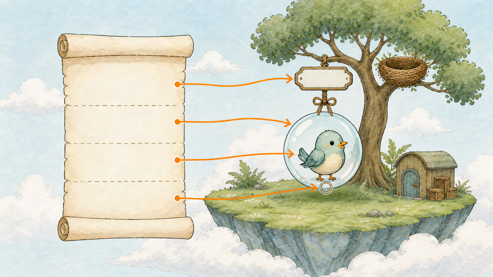
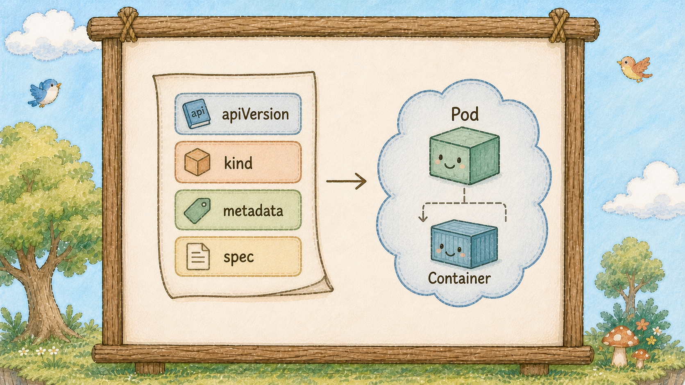
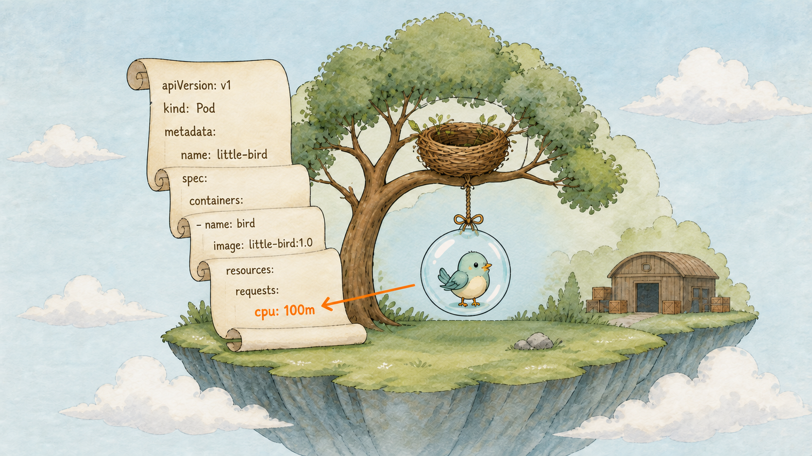
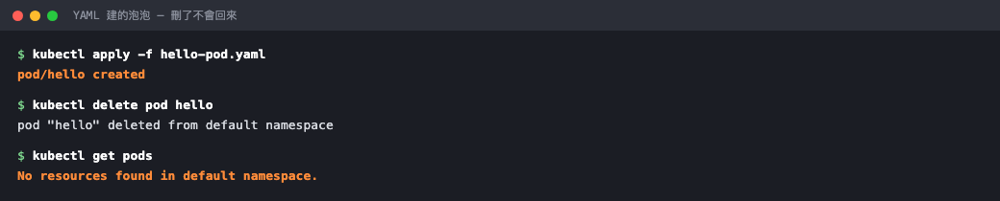

# Day 7：手寫第一個 Pod YAML，把服務放進泡泡（Pod）


## 痛點

`kubectl run` 很方便，但沒辦法把它交給同事、放進 git，或是隔三個月後看懂當時設定了什麼。


左邊是一張攤開的 YAML 卷軸，右邊是一顆泡泡（Pod），四條對照線把卷軸上的四個段落分別連到泡泡（Pod）的名牌、外壁、內部的小鳥（Container），以及小鳥（Container）身上的埠號。


## YAML 的四個欄位



YAML 只是把原本用指令講的話，改成寫下來。
看圖上那四條線，今天的 Pod YAML 先從四個常見的最上層欄位開始。

**apiVersion：要用哪一版的規格書**
Pod 這種最基本的資源寫 `v1`。
之後會看到 `apps/v1`、`networking.k8s.io/v1`，各有各的家族。這欄寫錯，櫃台第一關就退件。

**kind：要建的是什麼東西**
今天是 `Pod`，之後會有 `Deployment`、`Service`。
注意大小寫，K8s 認得很嚴格。

**metadata：這個東西叫什麼、有什麼標記**
至少要有 `name`。
之後 `labels` 也放這裡，那是 Day 8 的主角。

**spec：希望它長什麼樣子**
這是最長的一段，也是每種資源長得最不一樣的一段。
Pod 的 spec 裡最重要的就是 `containers`：泡泡（Pod）裡要放哪幾隻小鳥（Container）、各自跑什麼 image、開哪個埠。

記住這個順序：**規格書、種類、名牌、內容。**
之後看的每一份 YAML，不管多長，拆開來都是這四塊。


## 縮排

寫 YAML 只有一個地方要超級注意：**縮排**。

K8s 的 YAML 一律用空格，不能用 Tab，貼上去前先確認編輯器沒幫你轉成 Tab。

縮排代表從屬關係，縮進去就是「屬於上面那一層」，所以 `containers` 縮在 `spec` 底下，`image` 又縮在 `containers` 底下。


YAML 卷軸由上而下是四段階梯狀縮排，最深的一階正好對到泡泡（Pod）裡的小鳥（Container），圖上那四條線的高低差畫的就是縮排。

還有一件事今天要親眼看到：用 YAML 建出來的泡泡（Pod），刪掉之後**不會自己回來**。

這份 YAML 只描述「請建一顆泡泡 Pod」。

差別在哪，Day 9 揭曉。


## 動手 5 分鐘

前六天我們的 hello 泡泡（Pod）是用 `kubectl run` 隨手建的。
今天把它砍掉，改用一份可以存進 git 的 YAML 重建。

先把舊的清掉：

```bash
kubectl delete pod hello
```

建立 `hello-pod.yaml`，這是這 30 天第一個檔案：

```yaml
apiVersion: v1
kind: Pod
metadata:
  name: hello
spec:
  containers:
    - name: hello
      image: nginx:alpine
      ports:
        - containerPort: 80
```

十一行，四個最上層欄位都在裡面。`containers` 是一個清單（前面有 `-`），因為一顆泡泡（Pod）可以裝好幾隻小鳥（Container） ── 昨天證明過了。

套用它：

```bash
kubectl apply -f hello-pod.yaml
kubectl get pods
```

看到 `pod/hello created`，然後 STATUS 變成 `Running`。跟 `kubectl run` 出來的結果一樣，但這次過程寫在檔案裡。

確認它真的是照你寫的建的：

```bash
kubectl get pod hello -o jsonpath='{.spec.containers[0].image}{"\n"}'
```

印出 `nginx:alpine`。

現在做那個關鍵實驗，刪掉它：

```bash
kubectl delete pod hello
kubectl get pods
```

`No resources found in default namespace.`

等十秒再打一次 `kubectl get pods`。還是沒有。它不會回來。



建得起來、刪得掉、刪完就真的沒了 ── 沒有人在幫你盯著它。

想拿回來，只能你自己再 apply 一次：

```bash
kubectl apply -f hello-pod.yaml
```

這就是今天最重要的體感：**這份 YAML 描述一顆泡泡（Pod）的建立內容，沒有控制器持續維持數量。**

順便試一個 apply 的好習慣，先看會改到什麼再真的改：

```bash
kubectl apply -f hello-pod.yaml --dry-run=server
```

它會跑一遍櫃台的檢查但不真的動手，YAML 打錯字這時候就會被抓出來。故意把 `kind` 改成小寫的 `pod` 再跑一次，你會看到櫃台直接退件；改回來就過了。這招之後改正式環境的設定時很有用。

從今天起，`hello-pod.yaml` 就是你這座島的第一份財產，記得存進 git。之後每天我們都會在同一個目錄下多一兩個檔案，全部圍繞同一個 hello 服務長出來。

最後教你一招，讓你以後不用從空白檔案開始寫 YAML。

還記得 `kubectl run` 嗎？它可以只產生 YAML 而不真的建立：

```bash
kubectl run hello --image=nginx:alpine --dry-run=client -o yaml
```

**一份完整的 Pod YAML 直接印在螢幕上**，四個欄位一個不少。存成檔案再修改，比你自己回想欄位名稱快十倍：

```bash
kubectl run hello --image=nginx:alpine --dry-run=client -o yaml > hello-pod.yaml
```

（產生的檔案會多幾行 `creationTimestamp: null`、`status: {}` 之類的東西，那是 K8s 自己補的空欄位，刪掉不影響。）

這招之後每一種資源都能用：Deployment 用 `kubectl create deployment`、Service 用 `kubectl expose`，全部加 `--dry-run=client -o yaml`。**用指令生骨架、用檔案管版本**，這是實務上最常見的寫法。

最後講一件會讓你少走很多冤枉路的事：**`apply` 和 `create` 不一樣。**

`create` 是「建一個新的」，東西已經存在就報錯。`apply` 是「讓它變成這個樣子」── 不存在就建、已存在就改成檔案寫的樣子。

差別聽起來很小，但意義完全不同：**`create` 是動作，`apply` 是結果。** 這正是 Day 4 那個宣告式的落地方式。所以這 30 天你會看到我幾乎只用 `apply`，因為同一行指令可以重複執行，通常會把它管理的欄位維持在相同目標狀態。

這個特性叫**冪等**，是自動化部署的前提。CI 不必記住部署次數，API Server 會依宣告內容對齊狀態。

## 帶走一句話

YAML 只有四塊：規格書（apiVersion）、種類（kind）、名牌（metadata）、內容（spec）。

## 參考資源

- [Kubernetes Objects](https://kubernetes.io/docs/concepts/overview/working-with-objects/kubernetes-objects/)
- [Object Management](https://kubernetes.io/docs/concepts/overview/working-with-objects/object-management/)
