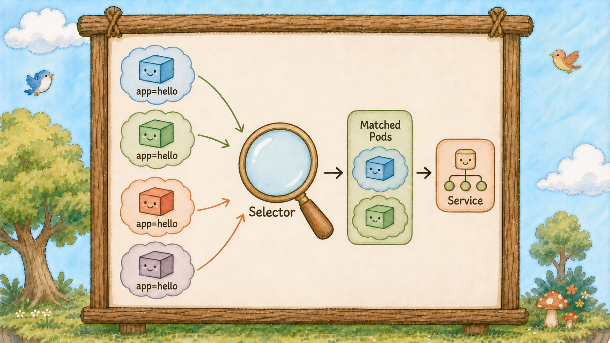
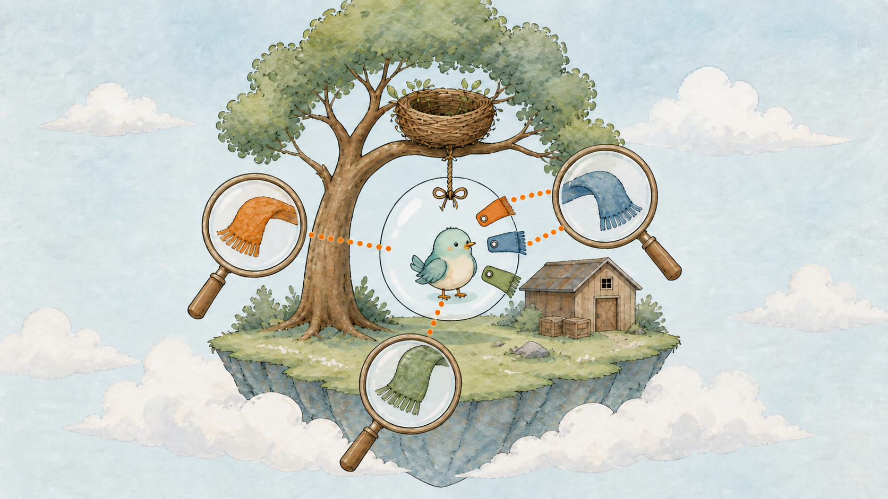
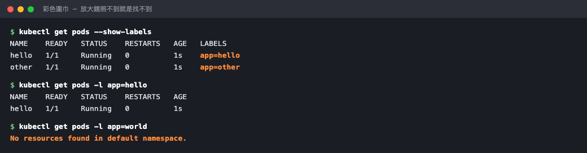

# Day 8：彩色貼紙 Label，K8s 到底怎麼認出誰是誰？

## 痛點

島上很快就會有幾十顆泡泡（Pod）。
K8s 沒有資料夾、沒有目錄結構，那它到底怎麼分辨哪幾顆是自己的服務？


一群貼著不同顏色貼紙（Label）的泡泡（Pod）散在樹上，放大鏡（Selector）照出來的光圈裡只有貼紅色貼紙的那三顆。


## Label 與 Selector



答案是貼紙（Label）。
在 Service、Deployment、ReplicaSet 這些 selector 場景，K8s 主要靠**每顆泡泡（Pod）外壁上的貼紙（Label）** 找目標；Namespace、名字和 owner reference 也各自有用途。

**彩色貼紙（Label）**
格式是 `key: value`，例如 `app: hello`。
一顆泡泡（Pod）可以貼很多張：`app: hello`、`env: dev`、`tier: frontend`，各代表一個分類角度。

**放大鏡（Selector）**
拿著放大鏡（Selector）去找特定貼紙（Label）的動作叫 Selector。
「幫我找出所有貼著 `app: hello` 的泡泡（Pod）」，就這麼一句話，回傳一組泡泡（Pod）。

看圖上那個光圈：光圈主要由 selector 與貼紙（Label）決定，但 Namespace 和 selector 的種類也會影響搜尋範圍。

今天這件事看起來平凡，但它是後面所有東西的基礎：

- 貓頭鷹（ReplicaSet）靠貼紙（Label）數泡泡（Pod）夠不夠（Day 9）
- 部署管家（Deployment）靠 selector 與 owner references 管理它建立的 ReplicaSet 與泡泡（Pod）（Day 10）
- 圖騰柱（Service）靠貼紙（Label）決定流量要送給誰（Day 14）


同一顆泡泡（Pod）外壁可以同時貼著三張不同顏色的貼紙（Label），三支放大鏡（Selector）各自照出其中一張。

貼紙（Label）要怎麼取名？
沒有硬規定，但有一組大家都在用的慣例，照抄就好：`app` 放服務名稱、`env` 放環境（dev/staging/prod）、`tier` 放層級（frontend/backend）、`version` 放版本。

重點在於**整個團隊使用同一套命名**；Selector 比對字串，大小寫差一個字就會失配。

這三個角色沒有一個是靠名字找目標的，全部靠貼紙（Label）。
所以貼紙（Label）貼錯 = 找不到人 = 服務掛掉，而且掛得無聲無息，這是新手最常踩、也最難查的坑，今天我們就故意踩一次。


## 動手 5 分鐘

昨天我們有一份 `hello-pod.yaml` 建出來的泡泡（Pod），但它身上沒貼紙（Label）。今天幫它貼上，然後用放大鏡（Selector）找它。

先看現在有沒有貼紙（Label）：

```bash
kubectl get pods --show-labels
```

LABELS 那欄是空的（或只有 `<none>`）。這顆泡泡（Pod）目前誰都找不到它。

改 `hello-pod.yaml`，在 `metadata` 底下加兩行：

```yaml
apiVersion: v1
kind: Pod
metadata:
  name: hello
  labels:
    app: hello
spec:
  containers:
    - name: hello
      image: nginx:alpine
      ports:
        - containerPort: 80
```

套用並確認：

```bash
kubectl apply -f hello-pod.yaml
kubectl get pods --show-labels
```

LABELS 欄變成 `app=hello`。貼紙（Label）貼上去了。

現在拿放大鏡（Selector）照它，`-l` 就是 Selector：

```bash
kubectl get pods -l app=hello
```

hello 出現在清單裡。

故意照一張不存在的貼紙（Label）：

```bash
kubectl get pods -l app=world
```

`No resources found in default namespace.` 泡泡（Pod）明明還在跑，只是不在光圈裡。**記住這個畫面**，之後你的 Service 沒流量、Deployment 數字對不上，這是很常見、值得先檢查的原因之一。



泡泡（Pod）好好地跑著，放大鏡（Selector）卻照不到 ── 而且沒有任何錯誤訊息。

再多建一顆貼著不同貼紙（Label）的泡泡（Pod），感受一下分類：

```bash
kubectl run other --image=nginx:alpine --labels="app=other"
kubectl get pods --show-labels
```

兩顆泡泡（Pod）、兩張不同貼紙（Label）。分別照照看：

```bash
kubectl get pods -l app=hello
kubectl get pods -l 'app in (hello,other)'
```

第一行只出現 hello，第二行兩顆都出現。Selector 除了 `=`，還吃 `in`、`!=`、`!key`（沒貼這張貼紙的）這幾種條件。

也可以不改檔案，直接在跑著的泡泡（Pod）上加貼紙（Label）：

```bash
kubectl label pod hello env=dev
kubectl get pods -l env=dev --show-labels
```

臨時查東西很好用，但正式的貼紙（Label）一定要寫回 YAML。因為 apply 是照著檔案內容對齊現況的，這個欄位如果由目前這份 apply 設定管理，檔案裡拿掉後，下次 apply 可能會把它移除 ── 而且不會有任何警告。

最後一個實用招式，把貼紙（Label）拉出來當表格欄位看：

```bash
kubectl get pods -L app,env
```

`-L`（大寫）跟 `-l`（小寫）不一樣：小寫是拿放大鏡（Selector）篩選，大寫是把指定的貼紙（Label）多印成一欄。泡泡（Pod）一多的時候，這行比 `--show-labels` 好讀很多。

收工前把測試用的泡泡（Pod）清掉：

```bash
kubectl delete pod other
```

最後把貼紙（Label）跟另一個長得很像的東西分清楚：**Annotation（附註）**。

兩者格式一模一樣，都是掛在 `metadata` 底下的 `key: value`。差別只有一個，但很關鍵：

**貼紙（Label）是拿來被找的，附註是拿來被讀的。**

Selector 不會使用 Annotation 來篩選。所以任何你需要用來篩選、分組、被 Service 或 Deployment 選中的資訊，一律放 Label；那些「給人看」或「給工具看」但沒人需要拿它來搜尋的東西，放 Annotation。

你 Day 11 會用到的 `kubernetes.io/change-cause`、Day 16 會用到的 Ingress 設定，全部都是 Annotation。

也因為 Label 要能被快速搜尋，它有格式限制：長度上限 63 字元、只能用英數與 `-_.`，不能有空格和中文。Annotation 沒有這些限制，塞一整段說明文字都可以。

```bash
kubectl annotate pod hello owner="platform-team"
kubectl get pod hello -o jsonpath='{.metadata.annotations}{"\n"}'
```

再補一個貼紙（Label）的實際用途，它比你想的更常用到：**批次操作。**

放大鏡（Selector）也能用來**一次對一群泡泡（Pod）下手**：

```bash
kubectl delete pods -l app=other
kubectl logs -l app=hello --tail=5
```

第一行刪掉所有貼著 `app=other` 貼紙（Label）的泡泡（Pod），不管它們叫什麼名字、有幾顆。第二行一次撈出一整組泡泡（Pod）的日誌。

這在正式環境非常實用 ── 你不會想在三十顆泡泡（Pod）的環境裡，一個一個複製貼上那串亂碼名字。**貼紙（Label）貼好，整組操作就是一行的事；貼紙沒貼好，你只能一顆一顆手動處理。**

## 帶走一句話

**K8s 靠貼紙（Label）找人，不靠名字。**

## 參考資源

- [Labels and Selectors](https://kubernetes.io/docs/concepts/overview/working-with-objects/labels/)
- [Annotations](https://kubernetes.io/docs/concepts/overview/working-with-objects/annotations/)
