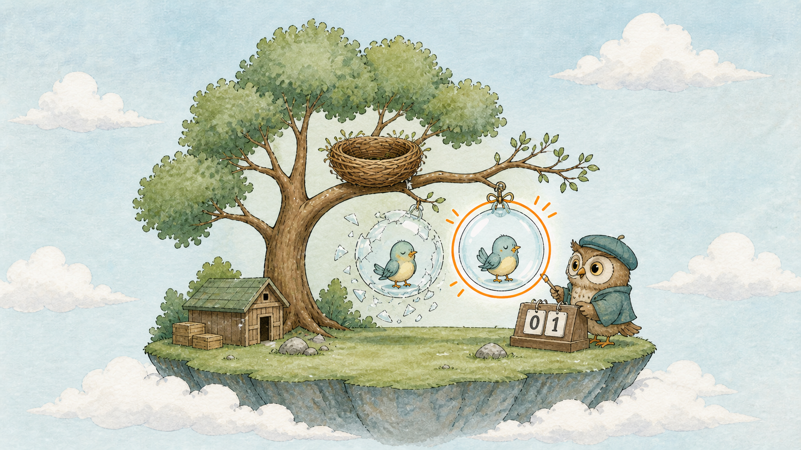
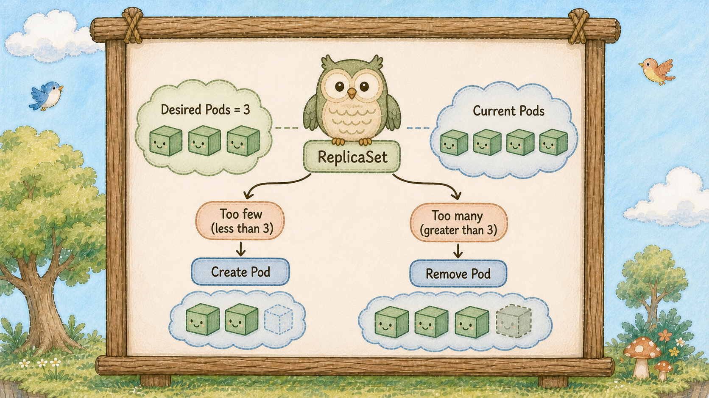
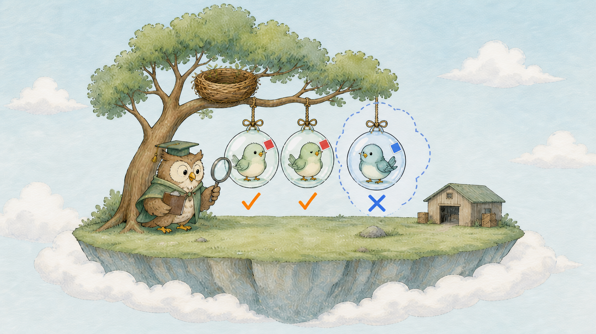
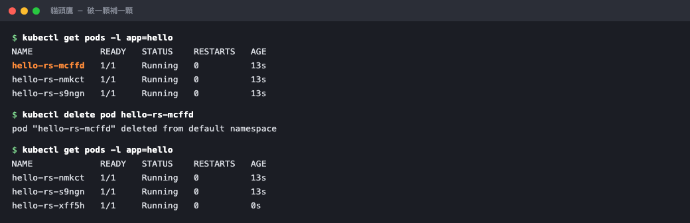

# Day 9：Pod 破了誰來補？ 會數泡泡 Pod 的貓頭鷹 ReplicaSet


## 痛點

泡泡（Pod）刪掉就是沒了，沒有人幫你補。

正式環境不能這樣，機器半夜掛掉很難爬起來手動補。


貓頭鷹（ReplicaSet）拿著計數器盯著樹枝，一顆泡泡（Pod）剛破掉，旁邊立刻有一顆新的被吹出來


## 貓頭鷹（ReplicaSet）在數什麼



貓頭鷹（ReplicaSet）只做一件事，而且做一輩子：**數泡泡（Pod）**

它手上有兩個數字：

- **期望數量**：你告訴它的，寫在 `replicas` 欄位
- **實際數量**：它自己數出來的

兩個數字只要不一樣，它就動手把它們弄一樣，少了就吹一顆，多了就戳破一顆。

**它怎麼數？靠貼紙（Label）**

昨天貼上的那張 `app: hello`，就是貓頭鷹（ReplicaSet）的計數依據。
它主要依 selector 找符合的泡泡（Pod），並同時考慮 Namespace 與 controller ownership；Pod 名字只是其中一項資訊。


貓頭鷹（ReplicaSet）透過放大鏡（Selector）只數貼紅色貼紙（Label）的泡泡（Pod），旁邊那顆貼藍色貼紙的沒被算進去

這帶出一個很多人第一次會撞到的行為：**手動建的泡泡（Pod），如果不小心貼了同一張貼紙（Label），會被貓頭鷹（ReplicaSet）算進去**

數字超了，它就隨機戳破一顆，可能戳的是你手動建的，也可能是它自己吹的。所以貼紙（Label）不要亂貼。

K8s 的宣告式：貓頭鷹（ReplicaSet）持續維持「我要三顆」這個**結果**。
動作做完就結束了，結果會被一直維持。

刪掉一顆後，ReplicaSet 會非同步建立替代泡泡（Pod），因為它觀察到目前只剩兩顆。

最後講清楚一件事：實務上無狀態服務通常交給 Deployment 管理 ReplicaSet。
今天寫它只是為了看懂它在幹嘛，明天 Deployment 登場後，貓頭鷹（ReplicaSet）就退到幕後由部署管家（Deployment）指揮了。

## 動手 5 分鐘

昨天我們有一顆貼著 `app: hello` 貼紙（Label）、但沒人照顧的泡泡（Pod）。今天把它交給貓頭鷹（ReplicaSet）管。

先把單獨的泡泡（Pod）刪掉，免得被算進去：

```bash
kubectl delete pod hello
```

建立 `hello-replicaset.yaml`：

```yaml
apiVersion: apps/v1
kind: ReplicaSet
metadata:
  name: hello-rs
spec:
  replicas: 3
  selector:
    matchLabels:
      app: hello
  template:    # 這是 replicaset 的 Pod 範本(貓頭鷹的吹泡泡模型)
    metadata:
      labels:
        app: hello
    spec:
      containers:
        - name: hello
          image: nginx:alpine
          ports:
            - containerPort: 80
```

`template` 底下那一整段，就是上一篇寫的 Pod YAML 去掉 `apiVersion` 和 `kind` 之後的樣子。

## 注意兩件事
- 第一，`apiVersion` 從 `v1` 變成 `apps/v1` ── 不同家族。
- 第二，`selector.matchLabels` 是貓頭鷹（ReplicaSet）拿的放大鏡（Selector），`template.metadata.labels` 是它吹出來的泡泡（Pod）要貼什麼貼紙（Label），**selector.matchLabels 必須能匹配 template.metadata.labels**，不然它會吹出自己找不到的泡泡（Pod），然後無限吹下去。


套用：

```bash
kubectl apply -f hello-replicaset.yaml
kubectl get rs
kubectl get pods
```

`get rs` 顯示 DESIRED 3、CURRENT 3、READY 3。`get pods` 出現三顆泡泡（Pod），名字是 `hello-rs-` 加一串亂碼 ── 貓頭鷹（ReplicaSet）吹出來的泡泡（Pod）名字是隨機的，因為它們可以互相替換。

現在做今天的重頭戲，挑一顆戳破：

```bash
kubectl delete pod $(kubectl get pods -l app=hello -o jsonpath='{.items[0].metadata.name}')
kubectl get pods
```

你會看到一顆處於 `Terminating`，同時**已經有一顆全新名字的泡泡（Pod）在 `ContainerCreating`**。等兩秒再打一次，又是三顆 `Running`。

看貓頭鷹（ReplicaSet）的說法：

```bash
kubectl describe rs hello-rs | sed -n '/Events:/,$p'
```

Events 裡一行 `Created pod: hello-rs-xxxxx`，時間就是你剛剛刪掉那一刻。



橘色那顆被刪掉的同時，一顆全新名字的泡泡（Pod）已經在 ContainerCreating 了。

再玩一次，這次改數量。把檔案裡的 `replicas` 改成 5 再 apply：

```bash
kubectl apply -f hello-replicaset.yaml
kubectl get pods -l app=hello
```

多吹兩顆。改回 3 再 apply 一次，它會戳破兩顆 ── 戳哪兩顆你無法指定，因為對貓頭鷹（ReplicaSet）來說每顆泡泡（Pod）都一樣。

不改檔案也可以直接調整數量，臨時擴容很好用：

```bash
kubectl scale rs hello-rs --replicas=2
kubectl get rs
```

但記得跟昨天的貼紙（Label）一樣，這種現場改的數字下次 apply 就會被檔案蓋回去。

今天的 ReplicaSet 先留著，明天我們讓部署管家（Deployment）接手它。

最後講一個很多人第一次刪東西會嚇到的行為：**刪掉貓頭鷹（ReplicaSet），泡泡（Pod）會跟著全部消失。**

因為貓頭鷹（ReplicaSet）吹出來的每一顆泡泡（Pod），身上都記著「我的主人是誰」。

你可以親眼看到：

```bash
kubectl get pod -l app=hello -o jsonpath='{.items[0].metadata.ownerReferences}{"\n"}'
```

印出 `"kind":"ReplicaSet","name":"hello-rs"` 之類的內容。這叫 **ownerReference（歸屬紀錄）**，主人被刪掉，島上就會自動把它名下的東西一起清掉。

這是好事 ── 你不用一個一個追著刪。
但如果你**只想換掉貓頭鷹（ReplicaSet）、保留泡泡（Pod）**，加這個參數：

```bash
kubectl delete rs hello-rs --cascade=orphan
kubectl get pods
```

貓頭鷹（ReplicaSet）不見了，三顆泡泡（Pod）還在，只是變成沒人管的孤兒。
這招在正式環境臨時搶救時偶爾會用到，但平常不要這樣做 ── 沒人數的泡泡（Pod），破了就真的沒了。

記得再 apply 一次把貓頭鷹（ReplicaSet）建回來，明天要用。

## 帶走一句話

**貓頭鷹（ReplicaSet）只數數字，不認得哪顆 Pod 是哪顆。**

## 參考資源

- [ReplicaSet](https://kubernetes.io/docs/concepts/workloads/controllers/replicaset/)
- [Owners and Dependents](https://kubernetes.io/docs/concepts/overview/working-with-objects/owners-dependents/)
