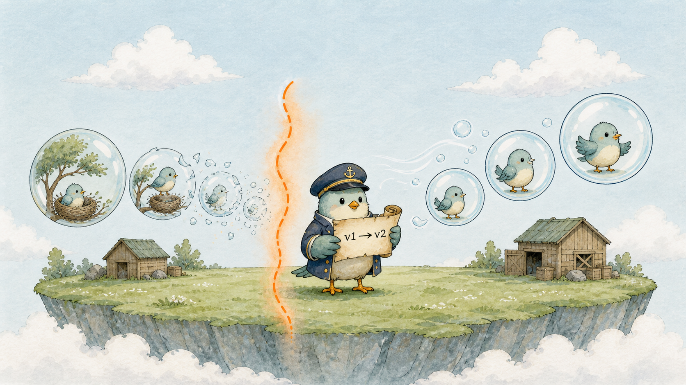
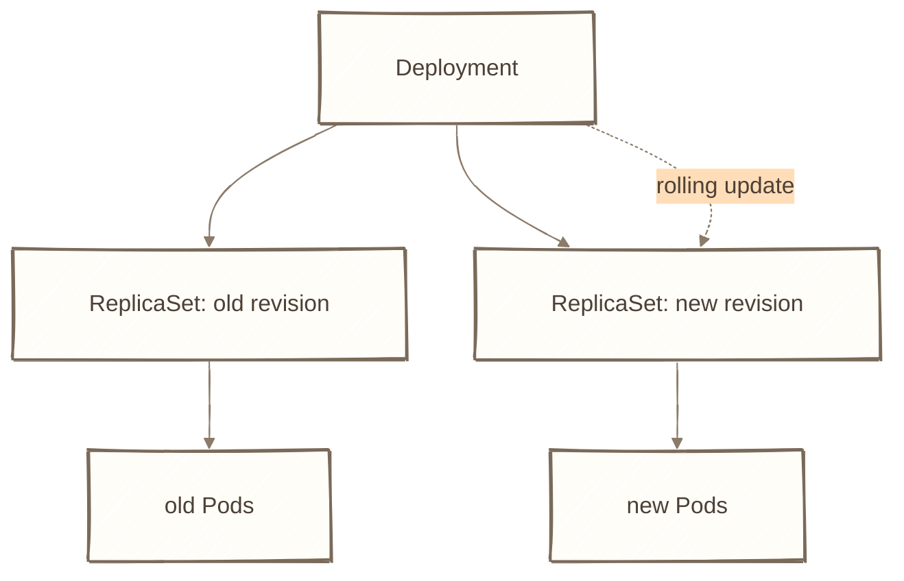
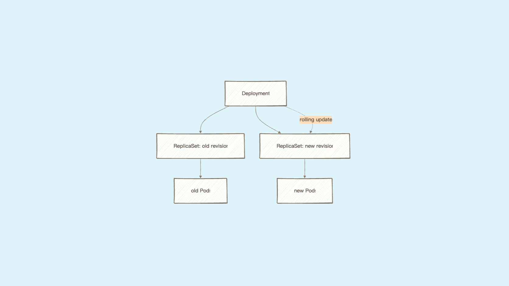
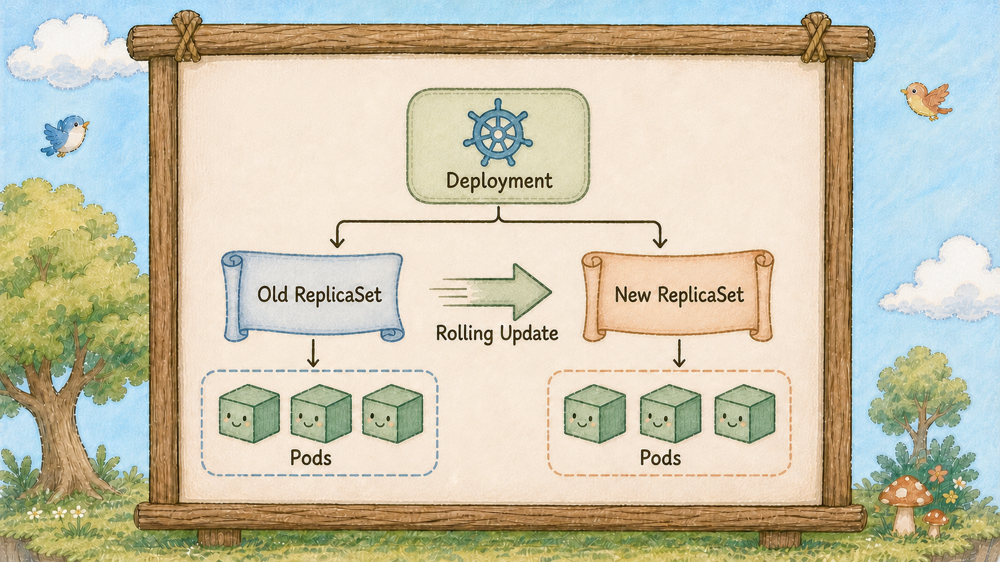
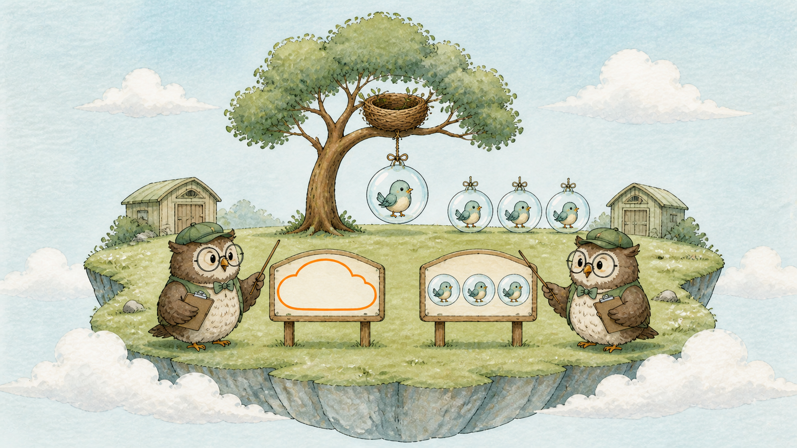
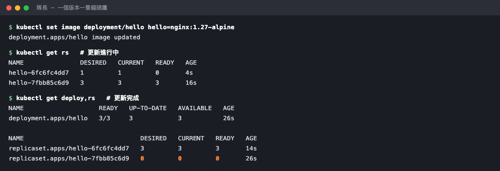

# Day 10：隊長的版本卷軸，Deployment 怎麼滾動更新

## 痛點

貓頭鷹會幫你維持三顆泡泡，但你要換新版 image 的時候呢？把三顆一起戳破再吹新的，中間那幾秒服務就是掛的。








IMG: 隊長手持版本卷軸站在中央，左邊舊版泡泡一顆顆消失、右邊新版泡泡一顆顆吹出來 ｜ 出場角色：隊長、泡泡、小鳥、巢樹 ｜ 亮橘重點：新舊泡泡交界處那一格

隊長手上拿的是**版本卷軸**，卷軸上記著你要的每一個版本。它自己不數泡泡 ── 數泡泡是貓頭鷹的事。隊長做的是**指揮貓頭鷹**。

所以島上的指揮鏈是三層：

**隊長（Deployment）→ 貓頭鷹（ReplicaSet）→ 泡泡（Pod）**

一個版本一隻貓頭鷹。你今天跑 v1，隊長手下有一隻貓頭鷹，被交代「維持 3 顆 v1 泡泡」。明天你換 v2，隊長不會叫原本那隻改吹 v2 ── 它**另外找一隻新貓頭鷹**來管 v2，然後同時對兩隻下指令：

新貓頭鷹，數字加一（吹出一顆 v2）。舊貓頭鷹，數字減一（收掉一顆 v1）。
再加一。再減一。再加一。再減一。

直到新的變 3、舊的變 0。這就是**滾動更新**，看圖上交界處那一格 ── 整個過程中，在舊版仍健康、Readiness 設定正確，而且更新策略保留足夠舊副本時，能服務的泡泡數量可以維持不掉到 0。



IMG: 隊長左手邊一隻貓頭鷹的計數器停在 0、右手邊另一隻停在 3，兩隻各自看著自己那一區的泡泡 ｜ 出場角色：隊長、數泡泡的貓頭鷹、泡泡、小鳥 ｜ 亮橘重點：左邊那隻計數器上的 0

舊貓頭鷹不會被刪掉，它會留著、數字停在 0。這件事有個很實際的好處：你後悔的時候，隊長只要把數字倒著調回去就好，不必手動記住舊 tag；但如果新 Pod 被排到沒有快取的 Node，仍可能重新拉 image。這就是明天要玩的 rollback。

那為什麼不直接用貓頭鷹就好？因為貓頭鷹只認得一組設定。你改了它的 image，它會把手上的泡泡全部處理掉重來，中間沒有任何緩衝。**貓頭鷹管數量，隊長管版本更替的節奏** ── 這是兩件事。

一般無狀態服務通常寫 Deployment，昨天的 ReplicaSet 只是為了讓你今天看得懂中間那一層。

## 動手 5 分鐘

昨天我們有一個 `hello-rs` 貓頭鷹管著三顆泡泡。今天把它換成隊長來管。

先把光桿貓頭鷹清掉：

```bash
kubectl delete rs hello-rs
```

建立 `hello-deployment.yaml`：

```yaml
apiVersion: apps/v1
kind: Deployment
metadata:
  name: hello
spec:
  replicas: 3
  selector:
    matchLabels:
      app: hello
  template:
    metadata:
      labels:
        app: hello
    spec:
      containers:
        - name: hello
          image: nginx:1.25-alpine
          ports:
            - containerPort: 80
```

跟昨天的 ReplicaSet 幾乎一模一樣，只有 `kind` 換成 `Deployment`。這不是巧合 ── 隊長就是拿這份 `template` 去交代給貓頭鷹的。

注意 image 這次寫死版本 `nginx:1.25-alpine`，不寫 `latest`。正式環境永遠釘死版本，不然你根本不知道現在跑的是什麼。

套用，然後看三層：

```bash
kubectl apply -f hello-deployment.yaml
kubectl get deploy,rs,pods
```

一個 Deployment、一個 ReplicaSet、三顆 Pod。看名字：ReplicaSet 是 `hello-` 加一串雜湊，Pod 又是 `hello-<雜湊>-` 加一串亂碼 ── 名字直接把三層關係印給你看了。

現在換版本，這是今天的重點：

```bash
kubectl set image deployment/hello hello=nginx:1.27-alpine
```

立刻打這行看新舊並存：

```bash
kubectl get rs
```

你會看到**兩個 ReplicaSet**：舊的那個 DESIRED 正在往下掉，新的那個往上爬。手腳夠快的話能看到 2/1、1/2 這種中間狀態。

過幾秒再看一次：

```bash
kubectl get rs
kubectl get pods
```

舊貓頭鷹的數字停在 0，但它**還在清單上**。新貓頭鷹是 3。泡泡全部換成新名字了。



中間那段是更新進行中：兩隻貓頭鷹並存，一隻往上爬、一隻往下掉。

確認跑的真的是新版：

```bash
kubectl get deploy hello -o jsonpath='{.spec.template.spec.containers[0].image}{"\n"}'
```

印出 `nginx:1.27-alpine`。

最後補一個好習慣。`kubectl set image` 改的是島上的現況，你桌上那份 `hello-deployment.yaml` 還停在 1.25 ── 兩邊不一致了。記得把檔案裡的 image 也改成 1.27 存起來，不然下次 apply 會把版本降回去。今天用指令改是為了讓你看到滾動過程，正式流程一律改檔案再 apply。

順帶看一下舊貓頭鷹留了幾隻：

```bash
kubectl get rs -l app=hello
```

兩隻貓頭鷹並排，一隻 0、一隻 3。舊的那隻沒被清掉是刻意的，明天你就會知道它留著要做什麼。

最後補一個很多人不知道、但關鍵時刻能救命的指令：**更新到一半按暫停。**

```bash
kubectl rollout pause deployment/hello
```

暫停之後，隊長會停在當下的狀態不再往前推 ── 假設它已經換了一顆新版泡泡，那就是「一顆新的、兩顆舊的」同時在服務。這只是暫停 rollout，不等於完整的**金絲雀測試**；若要讓少量流量先打到新版，還需要額外的流量切分策略：讓少量流量先打到新版上，你去看日誌、看錯誤率，確認沒問題再放行。

```bash
kubectl rollout resume deployment/hello
```

繼續把剩下的換完。覺得不對勁的話，明天你會學到怎麼一鍵倒回去。

順帶一提，隊長預設保留最近 10 個版本的貓頭鷹，你可以在 YAML 裡調：

```yaml
spec:
  revisionHistoryLimit: 5
```

留太多會讓 `kubectl get rs` 一長串很難看，留太少則是你能回滾的步數變少。五個是很常見的折衷。

## 帶走一句話

**一個版本一隻貓頭鷹，隊長只調數字。**

## 參考資源

- [Deployments](https://kubernetes.io/docs/concepts/workloads/controllers/deployment/)
- [Rolling Update Deployment](https://kubernetes.io/docs/tasks/run-application/run-stateless-application-deployment/)
