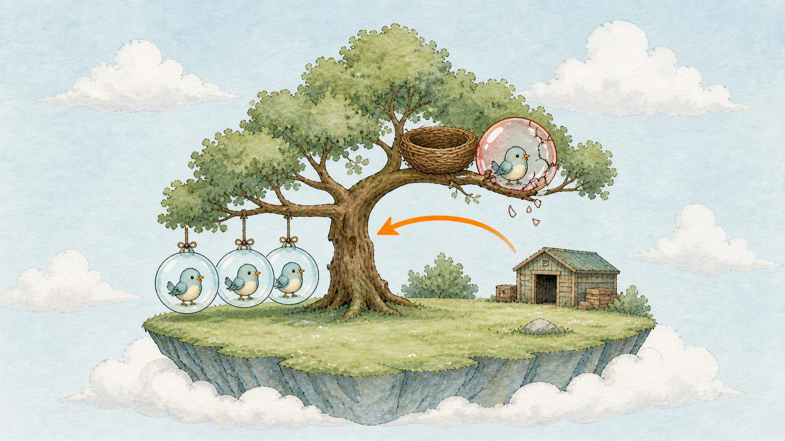
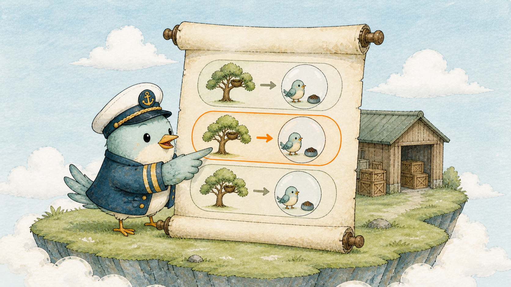
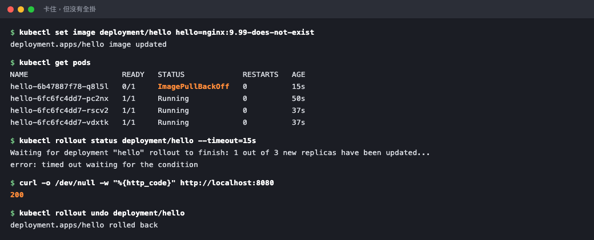

# Day 11：零停機實戰 ── 更新到一半後悔，一鍵 rollback

## 痛點

你按下更新，然後發現新版是壞的。手抖那一刻你腦中只有一個問題：現在服務是不是已經全掛了，我要多久才能救回來？



IMG: 一顆紅色的壞掉泡泡卡在樹枝半路上不上不下，旁邊三顆舊版泡泡照常運作，一支箭頭從紅泡泡指回舊版那一區 ｜ 出場角色：泡泡、小鳥、巢樹、隊長 ｜ 亮橘重點：從紅泡泡指回舊版的那支箭頭

好消息是：**在舊副本仍健康、更新策略保留可用副本時，通常會卡住而不是全掛。**

這是昨天那套滾動更新順便送你的保護。回想隊長的動作 ── 新的加一顆、舊的減一顆、再加一顆、再減一顆。關鍵在於隊長不是無腦往下推的，它每推一顆就會停下來確認：這顆新泡泡真的活起來了嗎？

沒活起來，隊長就**不往下走**。舊版那幾顆一顆都不會收。所以你看到的畫面會是「一顆紅泡泡卡在那裡，其他照常服務」，而不是「全站 502」。看圖上那顆紅泡泡的位置，它卡住的地方就是隊長的煞車點。

隊長的煞車力道由兩個旋鈕決定，你在 YAML 裡調：

**maxUnavailable ── 更新過程中，最多可以有幾顆不能服務。** 設 0 就是「一顆都不准少」，隊長只能先吹新的再收舊的。

**maxSurge ── 更新過程中，最多可以多出幾顆。** 設 1 就是「總數最多比你要的多一顆」，也就是隊長一次只搬一顆。

兩個都可以填數字或百分比，預設都是 25%。你只要記住這句：**maxUnavailable 決定你敢掉多少，maxSurge 決定你願意多付多少資源換速度。**

那卡住之後怎麼救？隊長身上有那卷版本卷軸。卷軸上一行一個版本，每一行對應昨天講的一隻貓頭鷹 ── 舊貓頭鷹沒被刪掉，只是數字停在 0。所謂 rollback，就是叫隊長把卷軸往回捲一格，然後把兩隻貓頭鷹的數字對調回去。

**所以回滾不需要重新拉 image、不需要你記得舊版 tag、不需要翻 git。** 東西本來就還在島上，一個指令的事。



IMG: 隊長手上的版本卷軸攤開，上面由上而下列著三行版本紀錄，其中一行被手指按住 ｜ 出場角色：隊長、數泡泡的貓頭鷹 ｜ 亮橘重點：被手指按住的那一行版本紀錄

最後提醒一件事，它會影響你今天的體感：**卷軸只記得「泡泡長什麼樣子」，不記得「有幾顆」。** 改 image 會產生新的一行紀錄，改 replicas 不會。這是很多人第一次用 `rollout history` 會困惑的地方。

## 動手 5 分鐘

昨天我們有一個叫 hello 的隊長，手下三顆 `nginx:1.27-alpine` 的泡泡。今天故意把它更新壞，再救回來。

先看看卷軸現在有幾行：

```bash
kubectl rollout history deployment/hello
```

你會看到 REVISION 1 和 2（1 是最初的 1.25，2 是昨天改的 1.27），CHANGE-CAUSE 那欄是 `<none>`。

CHANGE-CAUSE 是可以自己寫的，寫了之後卷軸才看得懂：

```bash
kubectl annotate deployment/hello kubernetes.io/change-cause="upgrade to nginx 1.27" --overwrite
kubectl rollout history deployment/hello
```

現在最新那一行有說明了。養成這個習慣，三個月後回頭看你會感謝自己。

現在做壞事，更新到一個根本不存在的 image：

```bash
kubectl set image deployment/hello hello=nginx:9.99-does-not-exist
```

立刻看發生什麼事：

```bash
kubectl get pods
```

你會看到四顆泡泡：三顆舊的還是 `Running`，多出來一顆新的是 `ErrImagePull` 或 `ImagePullBackOff`。這就是圖上那顆紅泡泡 ── 它卡住了，但隊長沒有動舊的那三顆。

問隊長進度：

```bash
kubectl rollout status deployment/hello --timeout=30s
```

畫面停在 `Waiting for deployment "hello" rollout to finish: 1 out of 3 new replicas have been updated...`，三十秒後 timeout 退出。**卡住，但沒有崩潰。**



壞版本卡在 ImagePullBackOff，但同一時間 curl 拿到的是 200 ── 使用者什麼都沒感覺到。

現在做今天最重要的驗證 ── 服務到底還活著沒有：

```bash
kubectl port-forward deployment/hello 8080:80
```

打開 `http://localhost:8080`，Nginx 的 Welcome 頁照常出現。你剛剛推了一個完全壞掉的版本上去，在這個設定與舊副本仍健康的前提下，使用者通常不會感覺到。`Ctrl+C` 離開。

看隊長怎麼說：

```bash
kubectl describe deployment hello | grep -A3 Conditions
```

`Progressing` 那行會變成 `ReplicaSetUpdated`，久一點會變 `ProgressDeadlineExceeded` ── 隊長在回報「我推不動」。

救回來，一行：

```bash
kubectl rollout undo deployment/hello
kubectl rollout status deployment/hello
```

這次很快就印出 `deployment "hello" successfully rolled out`。

確認現場：

```bash
kubectl get pods
kubectl get deploy hello -o jsonpath='{.spec.template.spec.containers[0].image}{"\n"}'
```

紅泡泡不見了，三顆 `Running`，image 回到 `nginx:1.27-alpine`。

如果要回到更早的版本，先看卷軸再指定行號：

```bash
kubectl rollout history deployment/hello
kubectl rollout undo deployment/hello --to-revision=1
```

這會回到最初的 1.25。再 undo 一次就能回到 1.27，卷軸是可以來回捲的。

最後把煞車旋鈕設成最保守的樣子。編輯 `hello-deployment.yaml`，在 `spec.replicas` 下面加這段：

```yaml
  strategy:
    type: RollingUpdate
    rollingUpdate:
      maxUnavailable: 0
      maxSurge: 1
```

套用後再更新一次，這次是好的版本：

```bash
kubectl apply -f hello-deployment.yaml
kubectl set image deployment/hello hello=nginx:1.27-alpine
kubectl rollout status deployment/hello
```

`maxUnavailable: 0` 會要求更新期間不可少於期望的可用副本數；實際能否維持服務，仍取決於舊副本、Readiness 和節點資源。代價是更新會慢一點、過程中會多佔一顆泡泡的資源。

記得把檔案裡的 image 也對齊成 `nginx:1.27-alpine` 再存進 git，別讓檔案跟島上打架。

## 帶走一句話

**在保留健康舊副本時，推壞版本通常會卡住等你回捲。**

## 參考資源

- [Deployment 更新策略](https://kubernetes.io/docs/concepts/workloads/controllers/deployment/)
- [Deployment rollback](https://kubernetes.io/docs/concepts/workloads/controllers/deployment/#rolling-back-a-deployment)
