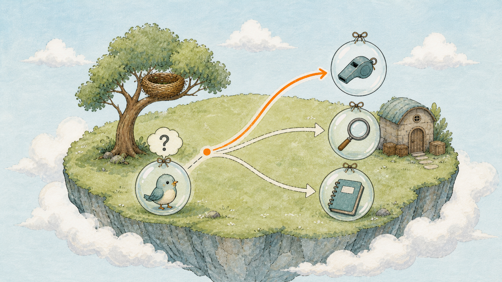
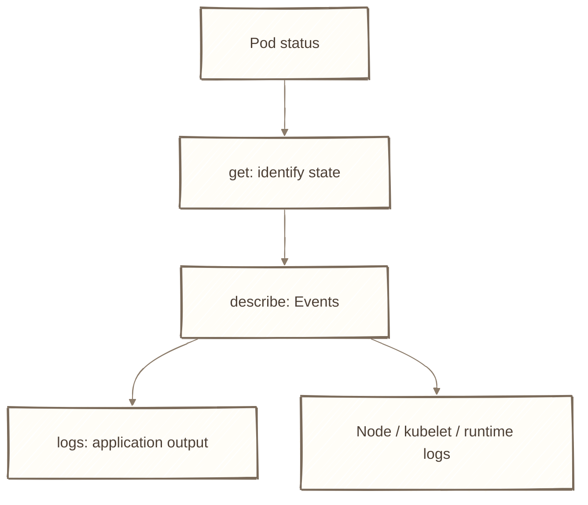
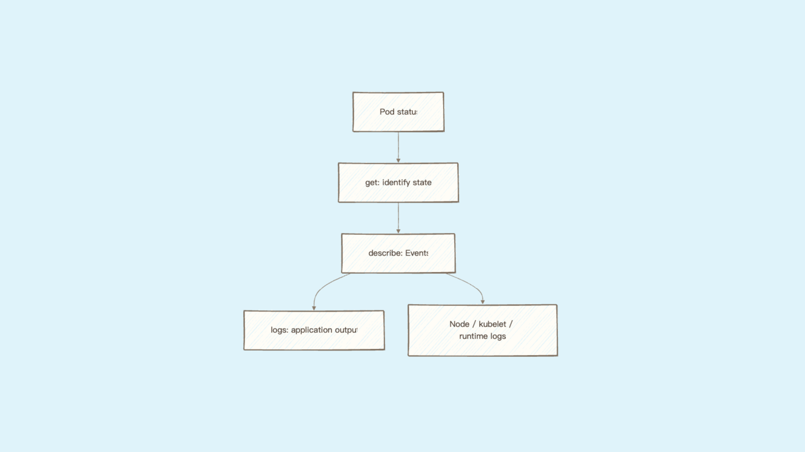
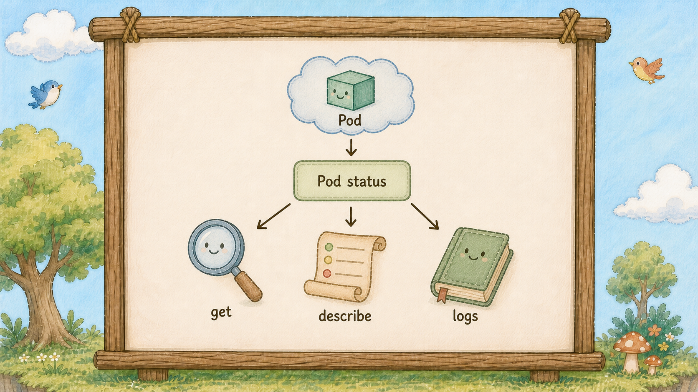
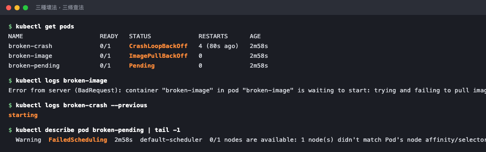

# Day 12：泡泡（Pod）起不來怎麼辦 ── describe、logs、events 三件套


## 痛點

`kubectl get pods` 顯示一串你沒看過的紅字狀態。你不知道該打哪個指令，只好開始亂試、亂重啟、亂 Google。








IMG: 一顆掛著問號的泡泡（Pod），底下分出三條路徑，分別通往三個工具 ｜ 出場角色：泡泡（Pod）、小鳥（Container）、哨子（kubectl） ｜ 亮橘重點：三條路徑最左邊那條的起點

這篇是整季最實用的一篇。面試官問「Pod 起不來你會怎麼查」，這篇可以當成基本排查骨架。

先講**判讀順序**，通常比只背指令更重要。看圖上三條路的起點，你永遠從最左邊那條開始，一條走完才走下一條：

**第一步 `get` ── 看狀態字串。** 狀態字串本身就是最強的線索，它幾乎已經告訴你問題出在哪一層了。跳過這步直接看 logs 是新手最常見的浪費。

**第二步 `describe` ── 看最下面的 Events。** Events 是這顆泡泡（Pod）的病歷，按時間記錄了排程、拉 image、掛載、啟動的每一步。**如果容器根本沒起來，通常要先看 Events；若仍找不到原因，再查 Node、kubelet、Runtime 或儲存系統的 logs。**

**第三步 `logs` ── 讀容器自己印出來的東西。** 只有當容器**曾經跑起來過**，logs 才有內容。容器都還沒啟動，logs 當然是空的。

一句話記住這個順序背後的邏輯：**Events 是 K8s 對這顆泡泡（Pod）做了什麼，logs 是你的程式自己說了什麼。** 分不清這兩者，你就會一直在錯的地方找答案。

接著是三個你一定會遇到的狀態，各自的意思和解法：

**ImagePullBackOff / ErrImagePull ── 拉不到 image。** K8s 連容器都還沒開始跑。原因大概三種：tag 打錯、image 不存在、私有 registry 沒給帳密。昨天你已經親手製造過這個狀態了。查法：`describe` 的 Events 會直接寫 `Failed to pull image`，後面接原因。

**CrashLoopBackOff ── 容器起得來，但一直死。** 這代表容器反覆退出並進入 backoff；常見原因是程式、command、設定或 probe，但不能只靠這個狀態判定 K8s 沒問題。`BackOff` 的意思是 K8s 重啟它、它又死、K8s 等更久再試，間隔會越拉越長。這是三種狀態裡最常需要看 logs 的一種。查法：`kubectl logs <pod> --previous` ── 加 `--previous` 才看得到**上一次死掉那輪**的輸出，這是關鍵，不加你只會看到剛重啟的空白。

**Pending ── 泡泡（Pod）還沒被掛到任何一棵樹上。** 問題不在你的程式，在島上。選樹官（Scheduler）找不到合適的樹：資源不夠、沒有符合條件的節點、或是在等一個還沒準備好的倉庫（PVC，Day 22 會遇到）。查法：`describe` 的 Events 會有 `FailedScheduling`，後面寫得很清楚是哪個條件不滿足。


IMG: 三顆泡泡（Pod）並排，第一顆外面掛著一個空的 image 標籤，第二顆裡面的小鳥（Container）反覆倒下又站起，第三顆懸在半空還沒碰到樹枝 ｜ 出場角色：泡泡（Pod）、小鳥（Container）、巢樹（Node） ｜ 亮橘重點：第三顆泡泡（Pod）和樹枝之間那段沒接上的空隙

再補一個判斷技巧：看 `get pods` 的 **RESTARTS 欄位**。數字一直往上跳，代表容器有起來過但活不久，往 CrashLoopBackOff 那條路查；數字是 0 但狀態不是 Running，代表根本還沒跑起來，往 Events 那條路查。

## 動手 5 分鐘

前面十一天我們有一個健康的 hello 部署管家（Deployment）。今天故意做出三種壞掉的泡泡（Pod），把三種狀態各查一次。**這些都是拋棄式的測試泡泡（Pod），跟 hello 無關，查完就刪。**

先製造 ImagePullBackOff：

```bash
kubectl run broken-image --image=nginx:this-tag-does-not-exist
kubectl get pods
```

STATUS 是 `ErrImagePull`，過幾秒變 `ImagePullBackOff`。RESTARTS 是 0 ── 記住這個組合。

第一步已經給你答案了，走第二步：

```bash
kubectl describe pod broken-image | tail -15
```

Events 最後一行：`Failed to pull image "nginx:this-tag-does-not-exist": ... not found`。答案直接寫在臉上。

試試看第三步有沒有用：

```bash
kubectl logs broken-image
```

`Error from server (BadRequest): container "broken-image" in pod ... is waiting to start: trying and failing to pull image`。**沒有 logs，因為容器從來沒跑過。** 這就是為什麼順序不能顛倒。

接著製造 CrashLoopBackOff：

```bash
kubectl run broken-crash --image=busybox:1.36 -- sh -c "echo starting; sleep 2; exit 1"
kubectl get pods -w
```

`-w` 是持續盯著看。你會看到它 `Running` → `Error` → `Running` → `CrashLoopBackOff`，RESTARTS 一路往上加。`Ctrl+C` 離開。

這個狀態要看 logs：

```bash
kubectl logs broken-crash --previous
```

印出 `starting`。你的程式印了什麼、死前留下什麼，都在這裡。實務上這行會直接給你 stack trace 或設定檔讀不到的錯誤訊息。



三顆壞泡泡（Pod）各自的狀態、以及對應那條路查出來的答案。順帶一提，`--previous` 要等它**真的重啟過一輪**才有東西可看 ── 剛壞掉的頭幾秒打會拿到 `unable to retrieve container logs`，等它進入 `CrashLoopBackOff` 再打就對了。

順便看它的重啟間隔：

```bash
kubectl describe pod broken-crash | grep -E "Restart|Back-off"
```

`Back-off restarting failed container` ── 這就是 BackOff 這個字的來源。

最後製造 Pending：

```bash
kubectl run broken-pending --image=nginx:alpine --overrides='{"spec":{"nodeSelector":{"disk":"ssd"}}}'
kubectl get pods
```

STATUS 停在 `Pending` 不動，因為島上沒有任何一棵樹繫著 `disk=ssd` 這條圍巾。

```bash
kubectl describe pod broken-pending | tail -8
```

Events：`0/1 nodes are available: 1 node(s) didn't match Pod's node affinity/selector`。選樹官（Scheduler）在跟你說「我找不到樹」。

三個查完了，收工清乾淨：

```bash
kubectl delete pod broken-image broken-crash broken-pending
kubectl get pods
```

只剩下三顆健康的 hello 泡泡（Pod）。

最後給你一個查問題時很好用的視角。Events 除了掛在單一泡泡（Pod）上，也可以整座島一起看，按時間排：

```bash
kubectl get events --sort-by=.lastTimestamp
```

這行會把最近島上發生過的所有事情倒出來，包含剛剛那三顆測試泡泡（Pod）的死亡紀錄。當你不確定是哪個資源出事、或是懷疑「剛剛到底發生了什麼」的時候，先打這行看全景，再回頭 describe 特定對象，會比一個一個猜快很多。

一個小提醒：Events 預設只保留一小時左右就會被清掉。所以出事當下先把畫面存起來，別想說等一下再回來查 ── 等一下它就不見了。

## 帶走一句話

**Events 是 K8s 說的，logs 是程式說的。**

## 參考資源

- [Debug Running Pods](https://kubernetes.io/docs/tasks/debug/debug-running-pod/)
- [Pod Lifecycle](https://kubernetes.io/docs/concepts/workloads/pods/pod-lifecycle/)
