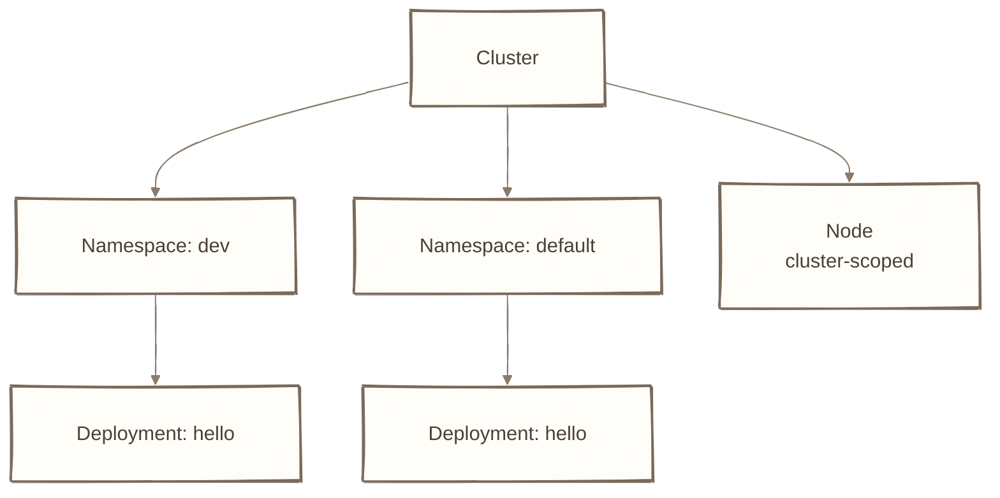
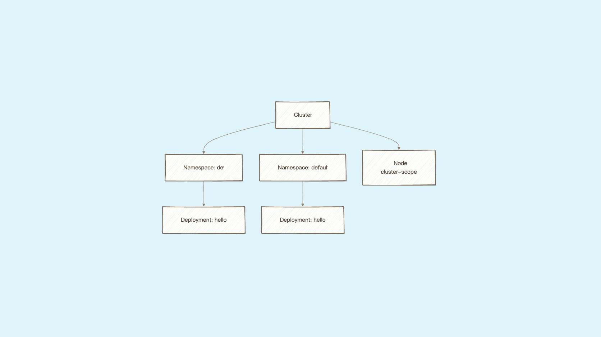
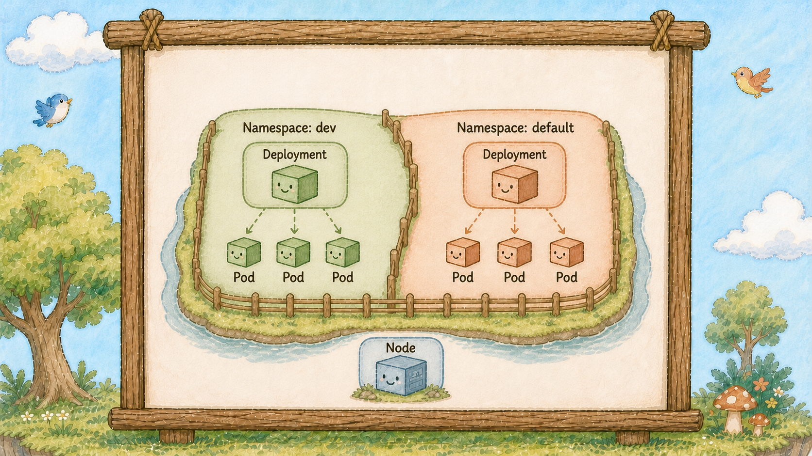
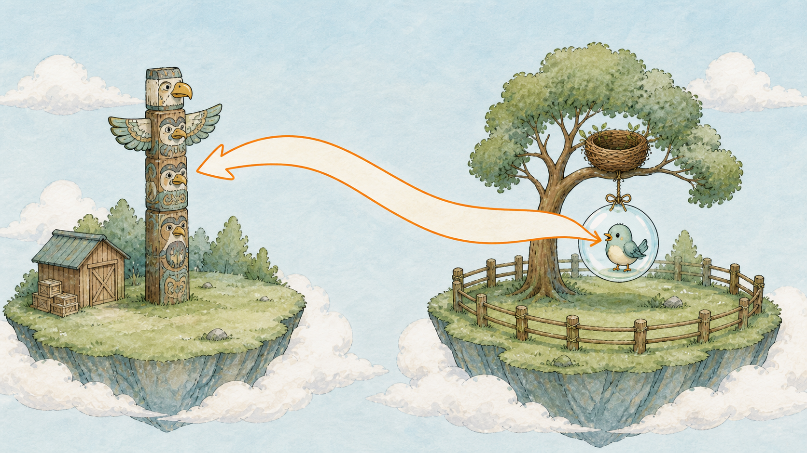
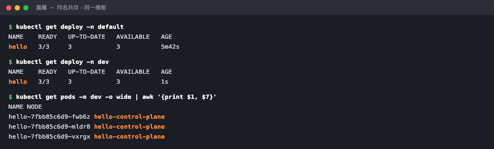

# Day 13：圍籬 Namespace ── 把不同團隊的樹分開種


## 痛點

島上東西越來越多，`kubectl get all` 一打出來滿滿一頁。而且隔壁團隊的服務也叫 hello，你們開始搶名字。







IMG: 島上一道木籬把樹分成左右兩區，兩區各有一棵名字一模一樣的巢樹（Node） ｜ 出場角色：圍籬、巢樹（Node）、泡泡（Pod）、小鳥（Container）、雲之島（Cluster） ｜ 亮橘重點：木籬兩側那兩棵同名的樹

圍籬做的事情很單純：**在同一座島上，畫出幾個各自獨立的命名區域。**

有三個重點：

**第一，圍籬是邏輯隔離，不是實體隔離。**

看圖 ── 木籬左右兩區的樹還是種在同一座島上。泡泡（Pod）跑在哪棵樹上，完全由選樹官（Scheduler）決定，跟它屬於哪個圍籬無關。所以你不能靠 Namespace 來達成「這個團隊只准用這幾台機器」，那是另外的機制。

**更關鍵的是：預設情況下，圍籬擋不住網路。** dev 區的泡泡（Pod）打得到 prod 區的泡泡（Pod）。圍籬隔的是「名字」和「權限管理的範圍」，不是封包。這是新手最大的誤解，一定要記牢。

**第二，同名資源可以在不同圍籬共存。** 這正是圍籬存在的理由。你有一個 `hello` Deployment 在 dev、另一個 `hello` 在 prod，兩者互不相干，可以是不同版本、不同設定。K8s 眼中資源的完整身分是「圍籬 + 種類 + 名字」，三個加起來才唯一。

**第三，`default` 就是你這十二天一直待著的地方。** 你從來沒指定過圍籬，所以哨子（kubectl）把所有指令都送到 `default` 去了。從今天起你會意識到自己站在哪一區。

那什麼東西**不屬於**任何圍籬？巢樹（Node）。樹是實體機器，它是整座島共用的，不會屬於任何一區。所以 `kubectl get nodes` 加不加 `-n` 結果都一樣。PV（Day 22 的倉庫（PersistentVolume，PV））也是島級的，理由一樣。



IMG: 一顆泡泡（Pod）站在木籬右區，對著左區的一根圖騰柱（Service）喊話，喊出的話上寫著完整的區名 ｜ 出場角色：圍籬、泡泡（Pod）、小鳥（Container）、圖騰柱（Service） ｜ 亮橘重點：喊話內容裡的區名部分

最後講**跨圍籬怎麼叫人**。同一區裡面，你叫 `hello` 就找得到。要叫隔壁區的，必須喊完整名字：`hello.dev`，也就是「名字.圍籬」。這個規則明天 Service 登場後會變得非常重要 ── 圖騰柱（Service）的完整地址是 `<服務名>.<圍籬>.svc.cluster.local`，同區才可以只喊前面那一段。

一個實務建議：**環境用圍籬分（dev / staging / prod），團隊也用圍籬分，但不要拿圍籬當資料夾用。** 每個服務一個圍籬會讓跨服務呼叫的地址變得又臭又長，得不償失。

## 動手 5 分鐘

前十二天所有東西都堆在 `default` 裡。今天建一道圍籬，把 hello 搬一份進去，然後感受同名共存。

先確認你現在站在哪：

```bash
kubectl config view --minify -o jsonpath='{..namespace}{"\n"}'
```

印出空的，代表就是 `default`。

看看島上現在有哪些圍籬：

```bash
kubectl get namespaces
```

四個內建的：`default`（你的東西）、`kube-system`（燈塔村，Day 4 去過）、`kube-public`、`kube-node-lease`。後兩個是島自己用的，不用管。

建一道新圍籬：

```bash
kubectl create namespace dev
kubectl get ns
```

`dev` 出現了。

現在把 hello 也部一份到 dev 區。**不用改 YAML 檔案**，加 `-n` 就好：

```bash
kubectl apply -f hello-deployment.yaml -n dev
kubectl get pods -n dev
```

三顆新泡泡（Pod），名字跟 default 區那三顆長得很像但不是同一批。

證明同名共存：

```bash
kubectl get deploy -n default
kubectl get deploy -n dev
```

**兩區各有一個叫 `hello` 的部署管家（Deployment）。** 名字一樣，完全獨立。你在 dev 改壞了，default 一點事都沒有。



兩個 `hello` 各自獨立，但最後那行的 NODE 欄位透露了真相 ── 它們種在同一棵樹上。

看看它們是不是真的種在同一座島上：

```bash
kubectl get pods -n dev -o wide
kubectl get pods -n default -o wide
```

NODE 欄位兩邊都是 `hello-control-plane` ── 同一棵樹。這就是「邏輯隔離不是實體隔離」的實際樣子。

驗證圍籬擋不住網路。先進 dev 區的一顆泡泡（Pod）：

```bash
kubectl exec -it -n dev deploy/hello -- sh
```

在裡面直接打 default 區某顆泡泡（Pod）的 IP（先在另一個終端機用 `kubectl get pods -o wide` 抄一個下來）：

```bash
wget -qO- <default區泡泡的IP>
```

Nginx 的頁面吐出來了。**跨區暢通無阻。** 打 `exit` 出來。

順便記住一件之後會咬你的事：**便條本（ConfigMap）和小盒是綁在圍籬上的。** 你把一份 Deployment 複製到另一個圍籬，它引用的 ConfigMap／Secret **不會**跟著過去。泡泡（Pod）會卡在 `ContainerCreating`，`describe` 會寫 `configmap "xxx" not found`。搬服務到新環境時，記得連設定一起搬。

最後兩個省打字的技巧。第一，看全島所有區：

```bash
kubectl get pods -A
```

第二，如果你要在 dev 區待一陣子，直接把哨子（kubectl）的預設區切過去：

```bash
kubectl config set-context --current --namespace=dev
kubectl get pods
```

不加 `-n` 也看到 dev 的東西了。**切完記得知道自己在哪** ── 忘記自己站在 prod 區然後打 delete，是真實會發生的意外。

今天先切回來：

```bash
kubectl config set-context --current --namespace=default
```

dev 區的東西留著，明天還會用到。

補一個最後才會咬你的坑：**刪圍籬會連裡面的東西一起刪光。**

```bash
kubectl delete namespace dev
```

這行不只刪掉那道木籬，圍籬裡的部署管家（Deployment）、貓頭鷹、泡泡（Pod）、之後會學到的便條本（ConfigMap）和借用單（PersistentVolumeClaim，PVC），全部一起消失，而且不會問你第二次。今天先不要真的打這行，知道它的威力就好。

反過來說，這也是最乾淨的清場方式。之後你測試某個東西，開一道新圍籬把所有東西丟進去，測完整道砍掉，島上一點殘渣都不會留。這比一個一個 delete 可靠太多了。

## 帶走一句話

**圍籬隔開名字，隔不開網路。**

## 參考資源

- [Namespaces](https://kubernetes.io/docs/concepts/overview/working-with-objects/namespaces/)
- [DNS for Services and Pods](https://kubernetes.io/docs/concepts/services-networking/dns-pod-service/)
