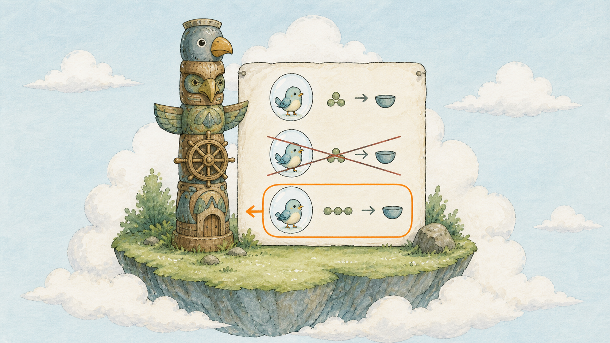

# Day 14：泡泡會破，柱子不會 ── Service 圖騰柱登場

## 痛點

你的三顆泡泡各有各的 IP，而且滾動更新一次全部換掉。前面的人到底要打哪一個？


IMG: 一根完整的圖騰柱站在中央，旁邊三顆泡泡其中一顆正在破掉、同時有一顆新泡泡補上，柱頂的視線跟著移到新泡泡上 ｜ 出場角色：圖騰柱、泡泡、小鳥、巢樹 ｜ 亮橘重點：完整站著的圖騰柱

這是整個第三幕的核心問題，先把它講死：

**泡泡的 IP 是消耗品。** 泡泡破一次、換一個 IP。滾動更新一次、三個 IP 全換。擴容一次、多出來的 IP 你事先不可能知道。任何把 Pod IP 寫死在設定檔裡的做法，都會在你下次部署時炸掉。

**圖騰柱的 IP 是固定的。** 柱子建立的那一刻拿到一個 IP，直到你刪掉它為止都不會變。看圖上那根柱子 ── 旁邊的泡泡破了又補、補了又破，柱子動都沒動。

所以規則變成：**所有人都對柱子說話，柱子負責找到現在還活著的泡泡。**

那柱子怎麼知道要找誰？靠 Day 8 那條**彩色圍巾**。你在 Service 的 `selector` 裡寫 `app: hello`，柱子就拿著放大鏡，隨時把所有繫這條圍巾、而且**目前健康**的泡泡收進自己的名單。

這份名單有名字，叫 **Endpoints**。它是 K8s 自動維護的一個物件，內容就是一串 IP。泡泡破了，這串 IP 少一個；新泡泡起來了，這串 IP 多一個。整個過程沒有人需要通知任何人 ── 柱子一直在數，跟貓頭鷹一樣。

**Endpoints 是查 Service 沒流量的第一站。** 記住這句話，它會在你未來三年裡救你很多次。柱子打不通，八成不是柱子壞了，是名單空的；名單空的，八成是圍巾標錯了。



IMG: 圖騰柱旁邊立著一張名單，名單上三行地址其中一行正在被劃掉、下面補上一行新的 ｜ 出場角色：圖騰柱、泡泡、放大鏡 ｜ 亮橘重點：名單上被劃掉又補上的那兩行

還有一件事要講清楚：**柱子不只是轉址，它還負責分流。** 三顆泡泡在名單上，流量會被分散送到三顆去。所以柱子同時解決了兩件事：一個穩定的入口，加一個免費的負載平衡。

最後補一個你今天就會用到的甜頭：**柱子有名字，可以直接當網址用。** 島上有一個內建的 DNS，你建了一根叫 `hello` 的柱子，同一個圍籬裡的任何泡泡打 `http://hello` 就通了。不用查 IP、不用寫設定檔。這就是為什麼 Day 23 你的網站要連資料庫時，只要寫 `hello-db` 這個名字就好。

## 動手 5 分鐘

前十三天我們有一個 hello 隊長帶著三顆泡泡，但外面沒有任何穩定的入口。今天立一根柱子。

先看看現在泡泡的 IP 有多不可靠：

```bash
kubectl get pods -o wide
```

把三個 IP 抄下來。

建立 `hello-service.yaml`：

```yaml
apiVersion: v1
kind: Service
metadata:
  name: hello
spec:
  selector:
    app: hello
  ports:
    - port: 80
      targetPort: 80
```

三個欄位要看清楚。`selector` 是柱子的放大鏡，要跟泡泡身上的圍巾一致。`port` 是柱子自己開的埠，`targetPort` 是泡泡那邊的埠 ── 兩個可以不一樣，柱子會幫你轉。

套用：

```bash
kubectl apply -f hello-service.yaml
kubectl get svc
```

`hello` 出現了，CLUSTER-IP 是 `10.96.x.x` 這種位址。**把這個 IP 抄下來，等一下要比對。**

看柱子的名單：

```bash
kubectl get endpoints hello
```

ENDPOINTS 欄位有三個 `IP:80`，正好就是你剛剛抄的三顆泡泡。柱子已經認得它們了。

（新版 K8s 也可以看更細的版本：`kubectl get endpointslices -l kubernetes.io/service-name=hello`，內容一樣。）

現在做今天最重要的實驗。開一顆臨時泡泡當客人，從島內打柱子：

```bash
kubectl run client --rm -it --image=busybox:1.36 -- sh
```

`--rm` 是離開就自動刪掉。進去之後打柱子的名字：

```bash
wget -qO- http://hello
```

Nginx 頁面出來了。**你打的是名字，不是 IP。** 再打幾次：

```bash
for i in 1 2 3 4 5 6; do wget -qO- http://hello | grep -o "<title>.*</title>"; done
```

六次都通。這六次其實被分散送到三顆不同的泡泡去了。先別關掉這個 shell。

現在開另一個終端機，去戳破一顆泡泡：

```bash
kubectl delete pod $(kubectl get pods -l app=hello -o jsonpath='{.items[0].metadata.name}')
kubectl get endpoints hello
```

名單上的 IP **換了一個**（貓頭鷹補了新泡泡，柱子自動更新名單）。

回到客人那個 shell，再打一次：

```bash
wget -qO- http://hello
```

照樣通。柱子的 IP 一秒都沒變，但流量已經自動導到新泡泡去了。這就是圖上那根柱子在做的事。

最後確認柱子的 IP 真的沒動：

```bash
kubectl get svc hello
```

CLUSTER-IP 跟你一開始抄的完全一樣。打 `exit` 離開客人泡泡。

最後練一次「柱子沒流量」的排查，這是你未來最常遇到的狀況。故意把柱子的放大鏡改錯：

```bash
kubectl patch svc hello -p '{"spec":{"selector":{"app":"wrong"}}}'
kubectl get endpoints hello
```

ENDPOINTS 欄位變成 `<none>`。**泡泡明明全部健康，柱子卻誰都找不到。** 這時候你去 describe 柱子也不會看到任何錯誤訊息 ── K8s 不覺得這是錯，它只是照你說的圍巾去找，找不到就是空的。

改回來：

```bash
kubectl apply -f hello-service.yaml
kubectl get endpoints hello
```

三個 IP 回來了。以後只要有人說「服務打不通」，你的第一個指令就是 `kubectl get endpoints`，兩秒鐘分辨出是柱子的問題還是泡泡的問題。

## 帶走一句話

**泡泡的 IP 是消耗品，柱子的不是。**
