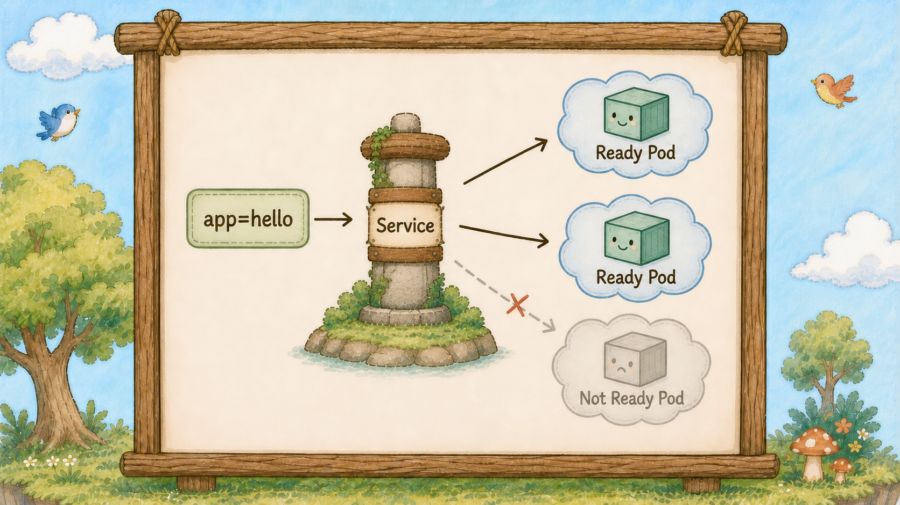
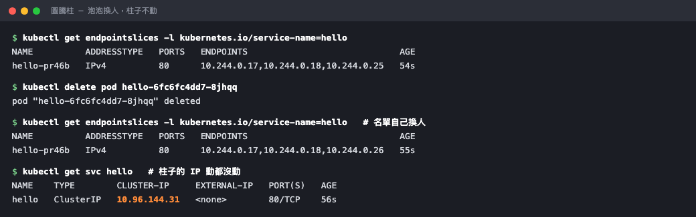

# Day 14：重要角色登場，泡泡 Pod 會破，柱子 Service 不會


## 痛點

三顆泡泡（Pod）各有各的 IP，而且滾動更新一次全部換掉。
前面的人到底要打哪一個？


柱子（Service）站在中央，旁邊的泡泡（Pod）破了一顆、又補上一顆新的，Service 後方的名單（Endpoints）短暫變成沒有 Ready 泡泡（Pod），但柱子本身動都沒動。


## 柱子 Service 在，泡泡 Pod 才可以一直破



這是整個第三幕的核心問題，先把它講死：

**Pod 的 IP 是消耗品** 
① Pod 破一次、換一個 IP。 
② 滾動更新一次、三個 IP 全換。 
③ 擴容一次、多出來的 IP 事先不可能知道。 

任何把 Pod IP 寫死在設定檔的做法，下次部署一定炸。

**Service 提供穩定的入口 IP**

規則很簡單：所有人都只對 Service 說話，Service 負責把流量送給活著的 Pod。

只要 Service 沒被刪除，這個 ClusterIP 就不會變。就算後端的 Pod 全死光、名單暫時空了，入口依然穩穩站著，等新的 Pod 長出來接客。

## 柱子靠貼紙找人，名單叫 Endpoints

柱子（Service）怎麼知道要找誰？靠之前提過的那張**彩色貼紙（Label）**。

只要在 Service 的 `selector` 裡指定 `app: hello`，它就會拿著放大鏡（Selector），隨時把帶有這個 Label、且通過健康檢查的 Pod 收進名單。 
這份名單就是 Endpoints（新版 K8s 叫 EndpointSlice）。
它本質就是一串動態 IP 清單：Pod 破了少一個，新 Pod 長出來自動補一個。
整個過程完全由 Controller 自動維護，不用任何人手動改設定。


柱子（Service）旁邊立著一張名單（Endpoints），上面三行地址其中一行正在被劃掉、下面補上一行新的，這一劃一補就是 Endpoints 每天在做的事。

**Endpoints 是查 Service 沒流量的第一站。**
記住這句話，它會在未來三年裡救你很多次。
柱子（Service）打不通時，先查名單（Endpoints）；名單為空時，再檢查 selector 與 Pod label。


## 柱子順便做了負載平衡，還有名字可以打

**柱子（Service）除了轉址，也負責分流。**
三顆泡泡（Pod）在名單（Endpoints）上，流量會被分散送到三顆去。
所以柱子（Service）同時解決了兩件事：一個穩定的入口，加一個免費的負載平衡。

**柱子（Service）有名字，可以直接當網址用。**
叢集內建 CoreDNS。只要建了名叫 `hello` 的 Service，同一個 Namespace 裡的 Pod 就能直接打 `http://hello` 連線。

不用查 IP、不用寫設定檔。
這就是為什麼 Day 23 網站要連資料庫時，只要寫 `hello-db` 這個名字就好。

## 動手 5 分鐘

前十三天我們有一個 hello 部署管家（Deployment）帶著三顆泡泡（Pod），但外面沒有任何穩定的入口。今天立一根柱子（Service）。

先看看現在泡泡（Pod）的 IP 有多不可靠：

```bash
kubectl get pods -o wide
```

把三個 IP 抄下來。

建立 `hello-service.yaml`：

```yaml
apiVersion: v1
kind: Service
metadata:
  name: hello
spec:
  selector:
    app: hello
  ports:
    - port: 80
      targetPort: 80
```

三個欄位要看清楚。`selector` 是柱子 Service 的 Selector，要跟 Pod 身上的 Label 一致。`port` 是柱子自己開的埠，`targetPort` 是 Pod 的埠 ── 兩個可以不一樣，Service 會幫你轉。

套用：

```bash
kubectl apply -f hello-service.yaml
kubectl get svc
```

`hello` 出現了，CLUSTER-IP 是 `10.96.x.x` 這種位址。**把這個 IP 抄下來，等一下要比對。**


查看對應的 EndpointSlice：
```bash
kubectl get endpointslices -l kubernetes.io/service-name=hello
```

`ENDPOINTS` 欄位列出剛才那三顆 Pod 的 IP，對應的 `PORTS` 欄位是 80。Service 已經認得它們了。


指令有點長，但這是新版 Kubernetes 優先使用的寫法。舊文章常見的 `kubectl get endpoints hello` 仍可能可用；EndpointSlice 已成為主要的端點 API，柱子 Service 挑選 Pod 的邏輯維持不變。

現在做今天最重要的實驗。開一顆臨時 Pod 當客人，從島內打柱子（Service）：

```bash
kubectl run client --rm -it --image=busybox:1.36 -- sh
```

`--rm` 是離開就自動刪掉。進去之後打柱子（Service）的名字：

```bash
wget -qO- http://hello
```

Nginx 頁面出來了。**你打的是 Service 名字；叢集 DNS 會解析到 Service。** 再打幾次：

```bash
for i in 1 2 3 4 5 6; do wget -qO- http://hello | grep -o "<title>.*</title>"; done
```

六次都通。這六次其實被分散送到三顆不同的 Pod 去了。先別關掉這個 shell。

現在開另一個終端機，去戳破一顆泡泡 Pod：

```bash
kubectl delete pod $(kubectl get pods -l app=hello -o jsonpath='{.items[0].metadata.name}')
kubectl get endpointslices -l kubernetes.io/service-name=hello
```

端點上的 IP 已經換掉一個。ReplicaSet 補上新 Pod 的瞬間，Service 就把名單更新了。

回到客人那個 shell，再打一次：

```bash
wget -qO- http://hello
```

照樣通。柱子（Service）的 IP 在這次重建前都維持不變，但流量已經自動導到新泡泡（Pod）去了。這就是圖上那根柱子在做的事。



名單（Endpoints）裡換掉了一個位址，橘色那個柱子（Service）的 IP 從頭到尾一個字都沒變。

最後確認柱子（Service）的 IP 真的沒動：

```bash
kubectl get svc hello
```

CLUSTER-IP 跟你一開始抄的完全一樣。打 `exit` 離開 Pod。

最後練一次「Service 沒流量」的排查，這是未來最常遇到的狀況。故意把 Service 的 Selector 改錯：

```bash
kubectl patch svc hello -p '{"spec":{"selector":{"app":"wrong"}}}'
kubectl get endpointslices -l kubernetes.io/service-name=hello
```

ENDPOINTS 欄位變成 `<none>`。

**Pod 明明全部健康，柱子（Service）卻誰都找不到。**  

這時候你去 describe 柱子也不會看到任何錯誤訊息， K8s 不覺得這是錯，它只是照你說的 Label 去找，找不到就是空的。

改回來：

```bash
kubectl apply -f hello-service.yaml
kubectl get endpointslices -l kubernetes.io/service-name=hello
```

三個 IP 回來了。

以後只要有人報修「服務打不通」，第一個動作不要無腦重啟，先看這份 Endpoints：
① 名單是空的：代表 Label 沒對上，流量根本進不去。 
② 名單有 IP 卻連不上：代表連線有進去，是 Pod 裡面的應用程式自己掛了。 
兩秒鐘就能抓出戰犯，不用在錯的地方浪費時間。

## 帶走一句話

**Pod IP 會隨 Pod 替換；Service 提供穩定入口。**

## 參考資源

- [Service](https://kubernetes.io/docs/concepts/services-networking/service/)
- [EndpointSlices](https://kubernetes.io/docs/concepts/services-networking/endpoint-slices/)
