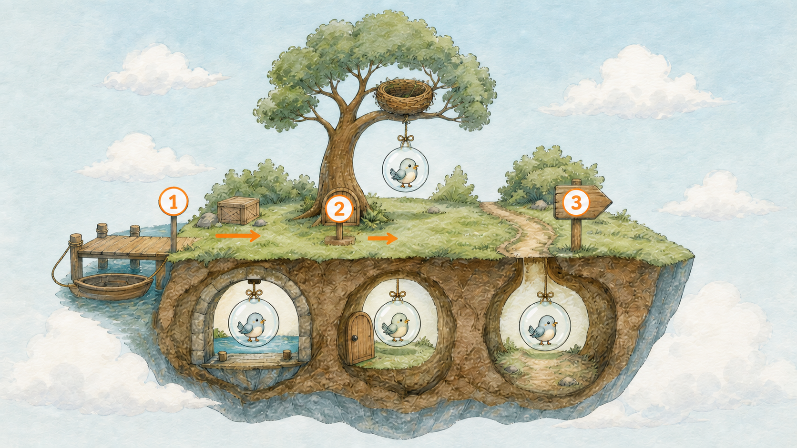
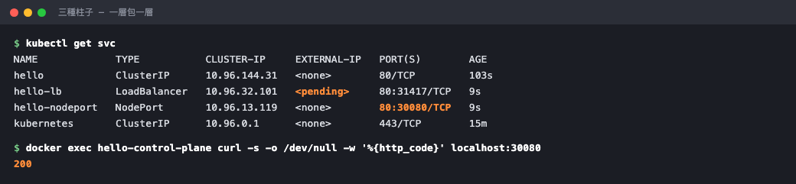

# Day 15：ClusterIP、NodePort、LoadBalancer 差在哪？

## 痛點

昨天的柱子只有島上的泡泡打得到。你想從自己的瀏覽器直接連進去，卻發現那個 IP 在你電腦上完全打不通。



IMG: 一張島的剖面圖，由外而內三個入口依序排開：海邊碼頭、樹幹上的小門、島內路標 ｜ 出場角色：海邊碼頭、樹幹上的小門、島內路標、圖騰柱、巢樹、雲之島 ｜ 亮橘重點：三個入口由外而內的排列順序

昨天那根柱子其實有型號。你沒指定，所以拿到預設款。ClusterIP、NodePort、LoadBalancer 是同一個 Service 的不同 `type`，不是三種平行獨立資源；差別主要在於**外面的人可以從多遠的地方打進來。**

看圖上由外而內三個入口：

**ClusterIP ── 島內路標。** 只有島上的泡泡看得到。你昨天建的就是這種。它拿到的 `10.96.x.x` 是一個**虛擬 IP**，在島外的世界根本不存在，所以你的瀏覽器當然打不通。這是預設值，也是許多內部服務常用的型號 ── 資料庫、內部 API、後端服務，通常不該直接讓外面看到。

**NodePort ── 樹幹上的小門。** 在每一棵巢樹的樹幹上，通常都會對同一個 NodePort 建立入口，號碼固定在 30000-32767 之間。只要你連得到任何一棵樹的 IP，打那個埠號就進得來。注意「每一棵」這三個字 ── 不是只有跑著你泡泡的那棵樹才開門，是**全部的樹都開同一個門**，打到沒有泡泡的那棵樹也會被轉進去。

**LoadBalancer ── 海邊碼頭。** 跟雲端業者要一個真正的對外 IP，讓海上的船直接靠岸。這個資源描述對外服務需求，實際由雲端或其他 LoadBalancer controller 建立負載平衡器。


IMG: 一棵巢樹的樹幹上開著一扇小門，門後的通道連到島內路標 ｜ 出場角色：樹幹上的小門、島內路標、巢樹、圖騰柱 ｜ 亮橘重點：小門後面那段通往路標的通道

這裡要講一個關鍵、而且很多人沒搞懂的事：**這三種是層層包起來的，不是三選一的平行選項。**

你建一個 NodePort，K8s 會**同時**給你一個 ClusterIP。你建一個 LoadBalancer，K8s 會同時給你 NodePort 和 ClusterIP。看圖上那條通道 ── 從碼頭進來的流量，走到小門，再走到路標，最後才到泡泡。外層只是多開一道門，裡面那套完全沒變。

所以「該用哪個」的答案是：**能用內層就別開外層。** 每多開一層，就多一個對外的攻擊面。

最後講今天你一定會撞到的事：**在沒有另外安裝 LoadBalancer controller 的 Kind 上，LoadBalancer 通常會維持 `Pending`。**

原因就在剛剛那句「它只是去請雲端業者幫你開」── 你的筆電上沒有雲端業者。沒有人接這張單，所以 EXTERNAL-IP 那欄會一直是 `<pending>`，通常也不會直接呈現成一個明顯錯誤。**這不是你設定錯，是環境上本來就沒有那個東西。** 正式環境若有正確的雲端 controller、權限與網路設定，通常會自動建立對外位址；失敗時仍要看 Events。

那本機要從瀏覽器打進去怎麼辦？用 NodePort，或是用你已經很熟的 `port-forward`。明天的 Ingress 則是另一條更漂亮的路。

## 動手 5 分鐘

昨天我們有一根 ClusterIP 型號的 hello 柱子。今天把同一個服務用三種型號各開一根，實際比較差在哪。

先確認昨天那根的型號：

```bash
kubectl get svc hello
```

TYPE 欄位是 `ClusterIP`，EXTERNAL-IP 是 `<none>` ── 島外沒有它的位址。

證明它在島外打不通。直接在你電腦上打它的 CLUSTER-IP：

```bash
curl --max-time 5 http://10.96.x.x
```

（換成你實際的 IP）結果是 timeout。這個 IP 只在島內有意義。

現在開第二根柱子，NodePort 型號。建立 `hello-nodeport.yaml`：

```yaml
apiVersion: v1
kind: Service
metadata:
  name: hello-nodeport
spec:
  type: NodePort
  selector:
    app: hello
  ports:
    - port: 80
      targetPort: 80
      nodePort: 30080
```

多了 `type` 和 `nodePort` 兩行。`nodePort` 不寫的話 K8s 會隨機給你一個，這裡寫死方便等一下測試。

```bash
kubectl apply -f hello-nodeport.yaml
kubectl get svc hello-nodeport
```

注意 PORT(S) 欄位變成 `80:30080/TCP` ── 冒號左邊是柱子的埠，右邊是樹幹小門的號碼。而且它**還是有 CLUSTER-IP**，證明剛剛講的「層層包起來」。

Kind 有個小限制：樹是 Docker 容器，小門預設沒有接到你的筆電上。所以要嘛重建叢集加設定，要嘛用最快的方式驗證 ── 直接鑽進樹裡打：

```bash
docker exec hello-control-plane curl -s localhost:30080 | head -5
```

Nginx 的 HTML 出來了。小門確實開在樹幹上。

第三根，LoadBalancer 型號。建立 `hello-lb.yaml`：

```yaml
apiVersion: v1
kind: Service
metadata:
  name: hello-lb
spec:
  type: LoadBalancer
  selector:
    app: hello
  ports:
    - port: 80
      targetPort: 80
```

跟第一根柱子只差 `type` 那一行。

```bash
kubectl apply -f hello-lb.yaml
kubectl get svc
```

`hello-lb` 的 EXTERNAL-IP 是 `<pending>`。等一分鐘再看，還是 `<pending>`。**這就是預期行為，不是你的錯。**

看它為什麼卡住：

```bash
kubectl describe svc hello-lb | grep -A3 Events
```

Events 是空的 ── 沒有任何角色出來認領這張單。島上根本沒有負責碼頭的人。

三種並排比較一次：

```bash
kubectl get svc
```

`hello` 只有 CLUSTER-IP；`hello-nodeport` 有 CLUSTER-IP 加一個 30080；`hello-lb` 多一個永遠等不到的 EXTERNAL-IP。**由內而外，一層包一層。**



注意 `hello-lb` 那行：它是 LoadBalancer，卻同時拿到了 CLUSTER-IP 和一個 NodePort（31417）── 三種型號真的是包起來的。

收工，把測試用的兩根柱子拆掉，留下昨天那根：

```bash
kubectl delete svc hello-nodeport hello-lb
kubectl get svc
```

## 帶走一句話

**三種柱子是一層包一層，不是三選一。**

## 參考資源

- [Service Types](https://kubernetes.io/docs/concepts/services-networking/service/#publishing-services-service-types)
- [kind LoadBalancer guide](https://kind.sigs.k8s.io/docs/user/loadbalancer/)
