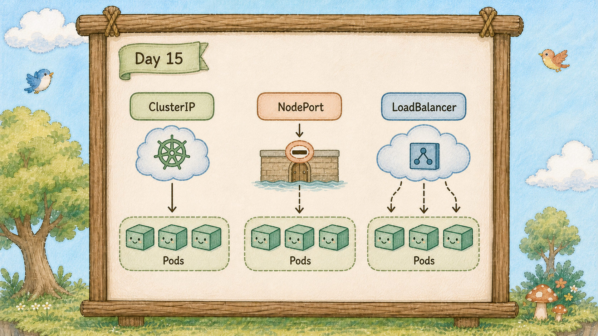

# Day 15：ClusterIP、NodePort、LoadBalancer 差在哪？


## Cluster 的剖面圖

昨天的柱子（Service）只有島上的泡泡（Pod）打得到。
想從自己的瀏覽器直接連進去，卻發現那個 IP 在自己電腦上完全打不通。


這是一張島的剖面圖，由外而內三個入口依序排開：
	海邊碼頭（LoadBalancer）、樹幹上的小門（NodePort）、島內路標（ClusterIP），排列順序就是能被打到的距離。


## 三個入口，由外而內排開



昨天那根柱子（Service）其實有型號，沒指定就拿到預設款。
ClusterIP、NodePort、LoadBalancer 是同一個 Service 的不同 `type`；差別主要在於**外部流量可以從哪個範圍進入**。

**ClusterIP：島內路標**

只有島上的泡泡（Pod）看得到，昨天建的就是這種。

它拿到的 `10.96.x.x` 是一個**虛擬 IP**，在島外的世界根本不存在，所以瀏覽器當然打不通。
這是預設值，也是許多內部服務常用的型號：資料庫、內部 API、後端服務，通常不該直接讓外面看到。

**NodePort：樹幹上的小門**

在每一棵巢樹（Node）的樹幹上，通常都會對同一個 NodePort 建立入口，號碼固定在 30000-32767 之間。
只要連得到任何一棵樹的 IP，打那個埠號就進得來。

注意「每一棵」這三個字：**所有巢樹（Node）都會開同一個 NodePort**，流量再由 Service 規則轉送到可用端點。

**LoadBalancer：海邊碼頭**

跟雲端業者要一個真正的對外 IP，讓海上的船直接靠岸。
這個資源描述對外服務需求，實際由雲端或其他 LoadBalancer controller 建立負載平衡器。


## 三種是層層包起來的


樹節點（Node）的樹幹上開著一扇小門（NodePort），小門後面還有一段通道才通到島內路標（ClusterIP），這段通道就是重點。

這三種型態通常逐層增加可達範圍；NodePort 包含 ClusterIP 的能力，LoadBalancer 通常再配置 NodePort。

建一個 NodePort，K8s 會**同時**給你一個 ClusterIP。
建一個 LoadBalancer，K8s 會同時給你 NodePort 和 ClusterIP。

在規格上，外層包含內層的所有設定；在實際轉發時，像郵差直達收件人一樣，kube-proxy 規則會直接把流量送進泡泡（Pod），kube-proxy 就是負責在每棵樹上設定轉發路徑的網路元件。

外層是多開一道對外的入口門，底層直達泡泡（Pod）的規則完全相同。

所以「該用哪個」的答案是：**能用內層就別開外層。**
每多開一層，就多一個對外的攻擊面。


## Kind 上的 LoadBalancer 會一直 Pending

**在沒有另外安裝 LoadBalancer controller 的 Kind 上，LoadBalancer 通常會維持 `Pending`。**

原因就在剛剛那句「它只是去請雲端業者幫你開」，筆電上預設沒有雲端負載平衡器。

沒有人接這張單，所以 EXTERNAL-IP 那欄會一直是 `<pending>`。若本機測試想拿到外部 IP，通常會額外安裝 MetalLB 或 Cloud Provider KIND 這些在本地模擬負載平衡器的工具。

**這通常反映環境沒有提供外部 LoadBalancer 實作。**
正式環境若有正確的雲端 controller、權限與網路設定，通常會自動建立對外位址；失敗時仍要看 Events。

那在筆電上想直接打開瀏覽器看網頁怎麼辦？

最方便的捷徑是用已經很熟的 `kubectl port-forward`，像一條專用的延長線直接把服務拉到筆電的瀏覽器前；至於更標準的對外門戶，則是明天的 Ingress。

## 動手 5 分鐘

昨天我們有一根 ClusterIP 型號的 hello 柱子（Service）。今天把同一個服務用三種型號各開一根，實際比較差在哪。

先確認昨天那根的型號：

```bash
kubectl get svc hello
```

TYPE 欄位是 `ClusterIP`，EXTERNAL-IP 是 `<none>` ── 島外沒有它的位址。

證明它在島外打不通。直接在你電腦上打它的 CLUSTER-IP：

```bash
curl --max-time 5 http://10.96.x.x
```

（換成你實際的 IP）結果是 timeout。這個 IP 只在島內有意義。

現在開第二根柱子（Service），NodePort 型號。建立 `hello-nodeport.yaml`：

```yaml
apiVersion: v1
kind: Service
metadata:
  name: hello-nodeport
spec:
  type: NodePort
  selector:
    app: hello
  ports:
    - port: 80
      targetPort: 80
      nodePort: 30080
```

多了 `type` 和 `nodePort` 兩行。`nodePort` 不寫的話 K8s 會隨機給你一個，這裡寫死方便等一下測試。

```bash
kubectl apply -f hello-nodeport.yaml
kubectl get svc hello-nodeport
```

注意 PORT(S) 欄位變成 `80:30080/TCP` ── 冒號左邊是柱子（Service）的埠，右邊是樹幹小門（NodePort）的號碼。而且它**還是有 CLUSTER-IP**，證明剛剛講的「層層包起來」。


Kind 有個小限制：巢樹（Node）本身就是跑在筆電上的 Docker 容器，預設沒有把容器內的 30080 埠對應到你筆電的實體連接埠。最快速的驗證方式是直接鑽進容器樹裡打：

```bash
docker exec hello-control-plane curl -s localhost:30080 | head -5
```

終端機印出 Nginx 的 HTML 開頭，確認小門（NodePort）確實開在樹節點（Node）上。
如果是真實伺服器或雲端主機，在電腦瀏覽器打這棵樹的實體 IP 加 30080 就能直接打開。

第三根，LoadBalancer 型號。建立 `hello-lb.yaml`：

```yaml
apiVersion: v1
kind: Service
metadata:
  name: hello-lb
spec:
  type: LoadBalancer
  selector:
    app: hello
  ports:
    - port: 80
      targetPort: 80
```

跟第一根 Service 只差 `type` 那一行。

```bash
kubectl apply -f hello-lb.yaml
kubectl get svc
```

`hello-lb` 的 EXTERNAL-IP 是 `<pending>`。等一分鐘再看仍然相同，這通常是 Kind 沒有外部 LoadBalancer 實作的預期結果。

看它為什麼卡住：

```bash
kubectl describe svc hello-lb | grep -A3 Events
```

Events 是空的，沒有任何角色出來認領這張單。島上根本沒有負責 LoadBalancer 的角色。

三種並排比較一次：

```bash
kubectl get svc
```

`hello` 只有 CLUSTER-IP；`hello-nodeport` 有 CLUSTER-IP 加一個 30080；`hello-lb` 多一個永遠等不到的 EXTERNAL-IP。**由內而外，一層包一層。**


注意 `hello-lb` 那行：它是 LoadBalancer，卻同時拿到了 CLUSTER-IP 和一個 NodePort（31417）── 三種型號真的是包起來的。

收工，把測試用的兩根柱子（Service）拆掉，留下昨天那根：

```bash
kubectl delete svc hello-nodeport hello-lb
kubectl get svc
```

## 帶走一句話

**ClusterIP 提供島內入口，NodePort 增加巢樹（Node）入口，LoadBalancer 再接上外部負載平衡器。**

## 參考資源

- [Service Types](https://kubernetes.io/docs/concepts/services-networking/service/#publishing-services-service-types)
- [kind LoadBalancer guide](https://kind.sigs.k8s.io/docs/user/loadbalancer/)
