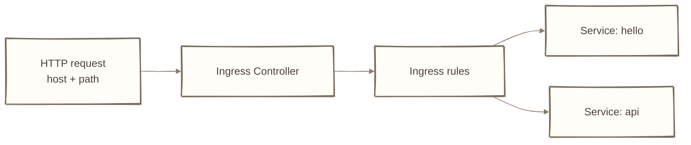
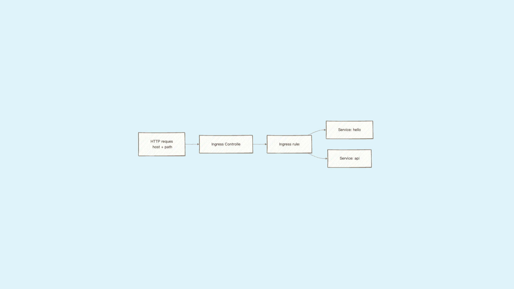
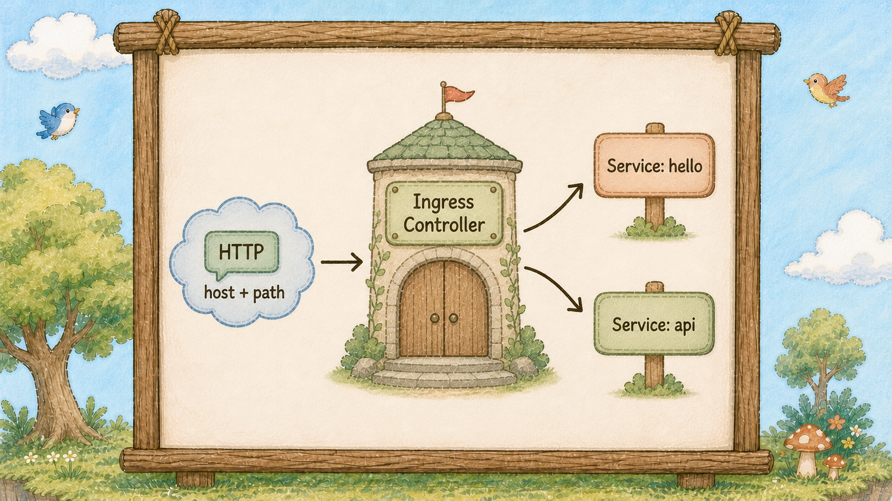
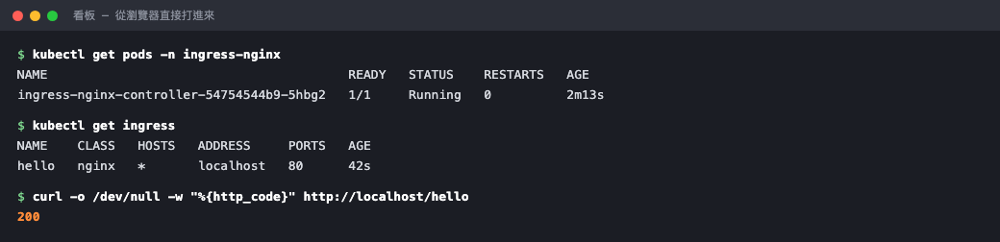
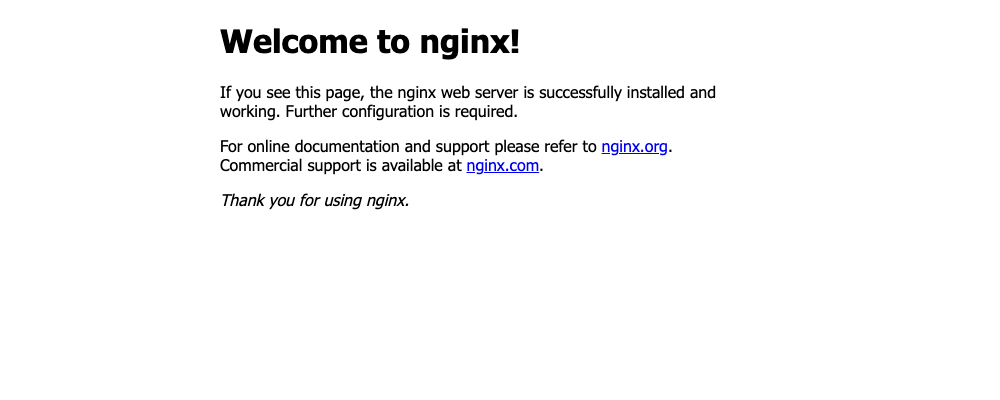

# Day 16：大門地圖看板 Ingress ── 一個網域分流到多個服務

## 痛點

你有五個服務要對外。開五個 NodePort，就是五個難記的埠號；開五個 LoadBalancer，就是五份帳單。







IMG: 島的大門旁立著一塊地圖看板，看板上兩條路線分別指向島內兩根不同的圖騰柱 ｜ 出場角色：大門與地圖看板、圖騰柱、雲之島 ｜ 亮橘重點：看板上分岔出去的那兩條路線

昨天那三種柱子有個共同的限制：**它們只認得埠號，不認得網址。**

從外面打進來的封包，柱子看到的是「有人敲 30080 這個門」。它沒辦法知道對方想去 `/hello` 還是 `/api`，也不知道對方輸入的網域是 `shop.com` 還是 `blog.com`。要分辨這些，得先把 HTTP 內容拆開來看，而柱子的層級太低，看不到那裡。

所以島的大門旁邊立了一塊**地圖看板**。它做的事情很單純：**先讀你要去哪，再告訴你走哪條路。**

看圖上那塊看板 ── 它自己不提供任何服務，它只是把「網址」翻譯成「哪一根柱子」。真正讀取規則並轉送流量的是旁邊的 **Ingress Controller（守門員）**。在常見的單一 Controller 配置裡，多個對外服務可以共用入口與位址，再靠網址分流；實際也可能有多個 Controller 或 443 HTTPS 入口。這一下就解決了開頭那個痛點：五個服務，一個入口，零份額外帳單。

看板認得兩種規則，通常混著用：

**path 規則 ── 看路徑。** `/hello` 送到 hello 柱子，`/api` 送到 api 柱子。適合同一個網域下拆功能。

**host 規則 ── 看網域。** `shop.example.com` 送到一根柱子，`blog.example.com` 送到另一根。適合一座島上放好幾個不同的網站。

接下來這件事**非常重要，是今天最大的坑**：

**Ingress 這個資源本身不會動。** 你寫的那份 YAML 只是一張規則表，它需要有人真的去讀它、然後真的去轉發封包。那個「有人」叫做 **Ingress Controller**，而它**預設不存在**，要你自己另外裝。

這跟你到目前為止學的所有東西都不一樣。隊長、貓頭鷹、柱子都是島上內建的，寫了就會動。Ingress 不是。**你寫完 Ingress 卻發現完全沒反應，沒裝或沒對上 Ingress Controller 是常見原因之一；也要檢查 class、Service、DNS 與 port mapping。**

Controller 有很多牌子，最常見的是 ingress-nginx（就是拿 Nginx 改的）。裝好之後它自己也是跑在島上的一組泡泡加一根柱子 ── 看板其實是島上的一位居民，不是憑空存在的設施。


IMG: 地圖看板後面站著一位讀看板的居民，居民手上的指示牌指向其中一根圖騰柱 ｜ 出場角色：大門與地圖看板、圖騰柱、泡泡 ｜ 亮橘重點：讀看板那位居民本身

還有一個界線要劃清楚：**標準 Ingress API 主要描述 HTTP/HTTPS 路由。** 資料庫、Redis 或自訂 TCP 流量要看 Controller 是否提供額外的 TCP/UDP 能力；gRPC 通常可透過 HTTP/2 支援，那些還是得走昨天的柱子。看板是「網站的入口」，不是「島的萬用入口」。

順帶一提，HTTPS 憑證也是掛在看板上的（`spec.tls` 欄位）。所有服務共用一個入口的另一個好處，就是憑證只要管一份。

最後一句話交代 `ingressClassName`：島上可以同時裝好幾牌 Controller，這個欄位就是在說「這張規則表歸誰管」。裝 ingress-nginx 就填 `nginx`。

## 動手 5 分鐘

前十五天我們有一根 ClusterIP 的 hello 柱子。今天要在大門立看板，讓你的**瀏覽器**能直接打進來。

先講一件事：Kind 的島預設沒有把 80 埠接到你的筆電上，所以我們得**重蓋一座島**。別緊張 ── 你的東西全在 YAML 檔案裡，這正是寫檔案的價值。

建立 `kind-config.yaml`：

```yaml
kind: Cluster
apiVersion: kind.x-k8s.io/v1alpha4
nodes:
  - role: control-plane
    kubeadmConfigPatches:
      - |
        kind: InitConfiguration
        nodeRegistration:
          kubeletExtraArgs:
            node-labels: "ingress-ready=true"
    extraPortMappings:
      - containerPort: 80
        hostPort: 80
        protocol: TCP
```

`extraPortMappings` 把樹的 80 埠接到你電腦的 80 埠；`ingress-ready=true` 是繫在樹上的圍巾，等一下 Controller 會拿放大鏡找它。

砍掉重蓋：

```bash
kind delete cluster --name hello
kind create cluster --name hello --config kind-config.yaml
kubectl get nodes
```

一分鐘後新島就緒。把你的服務搬回來：

```bash
kubectl apply -f hello-deployment.yaml
kubectl apply -f hello-service.yaml
kubectl get pods,svc
```

三顆泡泡加一根柱子，兩行指令復原。

現在裝 Controller：

```bash
kubectl apply -f https://raw.githubusercontent.com/kubernetes/ingress-nginx/main/deploy/static/provider/kind/deploy.yaml
```

等它起來（這行會卡住直到準備好，最多九十秒）：

```bash
kubectl wait --namespace ingress-nginx \
  --for=condition=ready pod \
  --selector=app.kubernetes.io/component=controller \
  --timeout=90s
```

看看那位居民：

```bash
kubectl get pods -n ingress-nginx
```

Controller 自己就是一顆泡泡，住在 `ingress-nginx` 這道圍籬裡。



看板是島上的一位居民，不是憑空存在的設施。

立看板。建立 `hello-ingress.yaml`：

```yaml
apiVersion: networking.k8s.io/v1
kind: Ingress
metadata:
  name: hello
  annotations:
    nginx.ingress.kubernetes.io/rewrite-target: /$2
spec:
  ingressClassName: nginx
  rules:
    - http:
        paths:
          - path: /hello(/|$)(.*)
            pathType: ImplementationSpecific
            backend:
              service:
                name: hello
                port:
                  number: 80
```

那個 `rewrite-target` 是在說「把 `/hello` 這段砍掉再往後送」── 因為你的 Nginx 根本沒有 `/hello` 這個頁面，它只有 `/`。不加這行你會拿到 404。

```bash
kubectl apply -f hello-ingress.yaml
kubectl get ingress
```

打開瀏覽器輸入 `http://localhost/hello`：

**Nginx 的 Welcome 頁出現了。** 沒有 port-forward、沒有奇怪的埠號、沒有雲端帳單。



網址列就是 `localhost/hello`，走的是 80 埠。

試試 host 規則。把 `spec.rules` 那段改成：

```yaml
  rules:
    - host: hello.local
      http:
        paths:
          - path: /
            pathType: Prefix
            backend:
              service:
                name: hello
                port:
                  number: 80
```

```bash
kubectl apply -f hello-ingress.yaml
curl -s -H "Host: hello.local" http://localhost | head -5
curl -s http://localhost | head -3
```

第一行通了，第二行回 404 ── 看板現在只認 `hello.local` 這個網域，其他一律不理。

那個 `-H "Host: hello.local"` 是在騙看板說「我是從這個網域來的」。實際上線時這一段由 DNS 負責，你把網域指到看板的 IP 就好，規則寫法完全一樣。想在本機用真的網址測，把 `hello.local` 加進你的 `/etc/hosts` 指到 `127.0.0.1`，瀏覽器就能直接開。

## 帶走一句話

**看板只是規則表，得有人讀它才會動。**

## 參考資源

- [Ingress](https://kubernetes.io/docs/concepts/services-networking/ingress/)
- [Ingress Controllers](https://kubernetes.io/docs/concepts/services-networking/ingress-controllers/)
