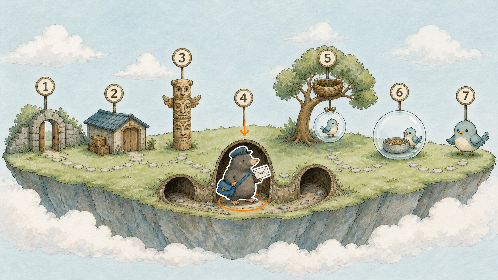
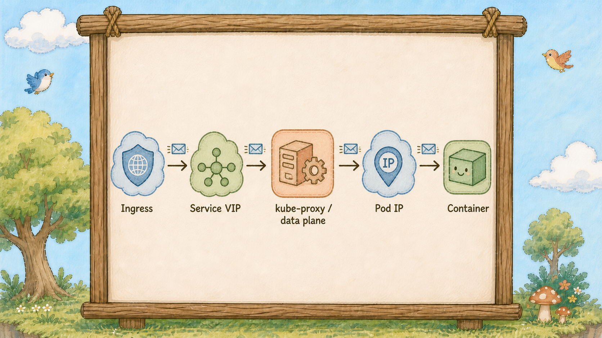
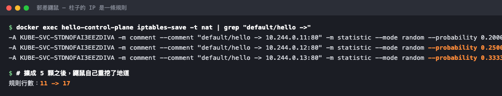

# Day 18：中場總覽，一張圖追完封包從大門到 Container 的旅程


## 請求的旅程

十七天下來認識了一堆角色，但如果有人現在問「一個請求進來到底經過哪些人」，大概還是講不順。


一條橫向長條旅程圖，七個站點由左到右依序排開，中段的地底通道口站著一位道路管理員（kube-proxy）。


## 七個站點排成一條線



今天不學新東西，把已經學過的排成一條線。

**第一站，訪客**
瀏覽器發出一個請求，打的是 `http://你的網域/hello`。
它對島上的一切一無所知，只知道一個網址。

**第二站，大門地圖看板（Ingress）**
看板（Ingress）的規則表只寫到柱子（Service）的名字，由管理員（Ingress Controller）照表執行。不少管理員會讀柱子背後的名單，直接把連線送往泡泡（Pod）；本圖為了排成一條線，採「經過柱子」的簡化路徑。下一站的地道，則是叢集內其他泡泡用柱子名字呼叫時走的路。

**第三站，圖騰柱（Service）**
柱子（Service）通常有穩定的虛擬位址與一份隨時更新的名單（EndpointSlice）；實際封包轉送由 kube-proxy、eBPF 或其他資料平面實作完成。
**柱子（Service）描述入口規則，實際轉送由資料平面元件執行。**

**第四站，道路管理員（kube-proxy），今天第一次登場**
這位負責維護封包轉送規則。

停下來想一個可能一直沒想過的問題：柱子（Service）那個 `10.96.x.x` 的 IP，一般 Node 的網卡不會直接擁有它，它不對應任何一張網卡。
那封包打過去，為什麼會通？

因為每一棵巢樹（Node）底下都有道路管理員（kube-proxy）。
它一直盯著燈塔櫃台（API Server）看，只要柱子（Service）的名單（EndpointSlice）有變動，就回到自己那棵樹底下**重新整理地道規則**：凡是要去 `10.96.x.x` 的封包，會依節點上的 Service 規則轉向符合條件的泡泡（Pod） IP；實際機制可能是 iptables、IPVS 或 eBPF。

所以柱子（Service）的 IP 是**虛擬 IP**：它代表一組轉送規則，不是某個 Pod 的網卡位址。

道路管理員（kube-proxy）站在地底，平常看不到這些規則；封包會依節點上的資料平面規則被轉向。
這也是為什麼 Day 15 說 ClusterIP 在島外打不通：島外的機器底下沒有道路管理員（kube-proxy），沒有地道。

**第五站，巢樹（Node）**
封包現在有了一個真實的泡泡（Pod） IP，透過島上的網路送到那顆泡泡（Pod）所在的樹。
**這棵樹不一定是收到請求的那棵。**
流量在島內橫向跨樹是很正常的事。

**第六站，泡泡（Pod）**
封包抵達泡泡（Pod）的門牌。
Day 6 講過，門牌是整顆泡泡（Pod）共用的。

**第七站，小鳥（Container）**
泡泡（Pod）把封包依埠號交給對應的那隻小鳥（Container）。
Nginx 終於收到請求，回一頁 HTML，然後原路退回去。


圖騰柱（Service）下方連著一條地道，地道另一端分岔出三個出口通往三顆泡泡（Pod），道路管理員（kube-proxy）就站在地道旁維護轉送規則。

整條路記住這個分工：**看板（Ingress）查路由、柱子（Service）定門牌、管理員（kube-proxy）刻路標、核心（Kernel）轉封包。**

## 動手 5 分鐘

前十七天我們有完整的看板（Ingress）、柱子（Service）、泡泡（Pod）。今天把七站在終端機裡走一遍，順便把道路管理員（kube-proxy）挖的地道挖出來看。

**第一、二站，看板（Ingress）。**

```bash
kubectl get ingress hello
kubectl describe ingress hello | grep -A4 Rules
```

規則表上 `/hello` 指向 `hello:80`。看板（Ingress）的工作到此為止。

**第三站，柱子（Service）。**

```bash
kubectl get svc hello
kubectl get endpointslices -l kubernetes.io/service-name=hello
```

一個固定 IP，加一份三筆的名單（EndpointSlice）。

**第四站，道路管理員（kube-proxy）。先確認每棵樹底下都有一位：**

```bash
kubectl get pods -n kube-system -l k8s-app=kube-proxy -o wide
```

一棵樹一隻。正式環境有十棵樹就有十隻，**它是每棵樹都跑一份的東西** ── Day 28 你會知道這種東西叫什麼。

現在把地道挖出來。這是今天最有意思的一行：

```bash
docker exec hello-control-plane iptables-save -t nat | grep "default/hello"
```

你會看到幾行規則，裡面有你柱子（Service）的 `10.96.x.x`，也有泡泡（Pod）的 `10.244.x.x`。**這就是道路管理員（kube-proxy）寫下的地道。** 柱子的 IP 在這裡從一個「地址」變成一條「轉向指令」。

看仔細一點，會看到類似 `statistic mode random probability 0.33333` 的字樣 ── 三顆泡泡（Pod）各三分之一，這是這次環境中 iptables 規則呈現的近似分配方式；實際流量不保證平均，還會受連線、session affinity 和資料平面實作影響。



三顆泡泡（Pod）時是 1/3、1/2、剩下全給 ── 機率是接力算下來的。擴成五顆之後規則從 11 行變 17 行，道路管理員（kube-proxy）自己重挖的。

驗證它會自己更新。把泡泡（Pod）擴成五顆：

```bash
kubectl scale deployment hello --replicas=5
kubectl get endpointslices -l kubernetes.io/service-name=hello
docker exec hello-control-plane iptables-save -t nat | grep -c "default/hello"
```

名單（EndpointSlice）變五筆，地道的規則行數跟著變多。你什麼都沒做，道路管理員（kube-proxy）自己跑去重挖了。

**第五、六、七站，一路走到底。**

```bash
kubectl get pods -l app=hello -o wide
```

看 NODE 欄（第五站）、IP 欄（第六站）。最後一站：

```bash
kubectl exec deploy/hello -- ls /usr/share/nginx/html
```

`index.html` ── 你從瀏覽器要的那頁 HTML，就躺在這裡。七站走完。

縮回三顆收工：

```bash
kubectl scale deployment hello --replicas=3
```

## 帶走一句話

**Service IP 是虛擬入口，流量會依規則轉到 Pod。**

## 參考資源

- [Virtual IPs and Service Proxies](https://kubernetes.io/docs/reference/networking/virtual-ips/)
- [Service](https://kubernetes.io/docs/concepts/services-networking/service/)
