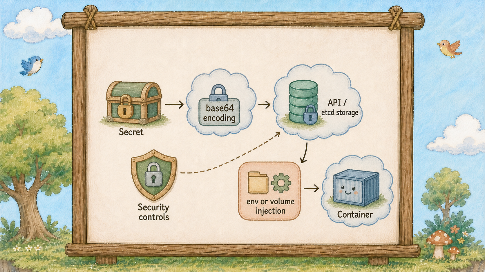
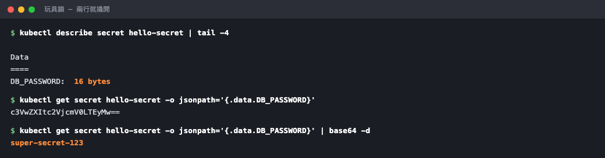

# Day 20：上鎖的小盒子 Secret，它其實沒那麼安全


## Secret 安全嗎？

資料庫密碼不能放便條本（ConfigMap），那該放哪？
K8s 有個叫 Secret 的東西，名字聽起來很安全。


上鎖的小盒子（Secret）上頭那把是玩具鎖，旁邊的小鳥（Container）用爪子輕輕一撥就打開了。


## Secret 使用編碼保存資料



今天最重要的一句話先講：**Secret 的 `data` 欄位使用 base64 編碼，預設不代表加密。**

base64 是**編碼**，拿到內容的人可以直接還原。
編碼的目的是讓資料能安全地在文字系統裡傳輸，任何人拿到都能還原，不需要密碼、不需要金鑰。
`base64 -d` 一行就解開了，等一下會親手做一次。

所以那把鎖只是**玩具鎖**。
它讓人不會不小心一眼看到密碼，不只你在終端機能解開，**當你把 Secret 寫進 YAML 並套用到叢集裡時，Kubernetes 底層的（etcd）預設也是用明文 Base64 編碼直接儲存它**。

這是新手對 K8s 最大的誤解，而且後果很嚴重：以為東西放進 Secret 就安全了，於是把 Secret 的 YAML 直接推上公開的 git repo。
**那跟把密碼用明文推上去，實質上是同一件事。**

## 那 Secret 到底有什麼用

它跟便條本（ConfigMap）的差別在三個地方。

**第一，它不會被隨手印出來**
`kubectl describe` 一份 Secret，值的位置只會顯示 `8 bytes`。
demo 時不會手滑把密碼投影到螢幕上。

**第二，它的權限可以獨立管理**
島上可以設定「這個人讀得到 ConfigMap，但讀不到 Secret」。
這是實務上 Secret 最大的價值：**安全性取決於存取權限、傳輸與儲存加密設定。**

**第三，K8s 對它比較小心**
Secret volume 通常以記憶體型態掛載，但 Secret 仍會儲存在 API／etcd，應用程式、診斷與備份流程也可能把它暴露出來。
Kubernetes 的一般狀態輸出不會直接顯示 value，但不能把它當成完整保護。


左邊便條本（ConfigMap）的內容全部攤開可見，右邊小盒（Secret）的內容被一塊布蓋住，只露出形狀。

用法上，Secret 跟 ConfigMap **幾乎一模一樣**：一樣可以當環境變數，一樣可以掛成檔案，YAML 結構只差 `kind` 和幾個欄位名。
昨天學的東西今天全部能用，這是好消息。

那真正要安全該怎麼做？
方法不止一種，三個方向，叢集層級開啟 etcd 加密、用雲端業者的金鑰管理服務、或是把密文存在 git 用工具在叢集內解密。
今天只要記住**預設狀態下它不安全**這件事就夠了。

## 動手 5 分鐘

之前文章我們有一本明文的便條本（ConfigMap）。
今天建一個小盒（Secret），然後親手把它撬開。

最快的建法是用指令，K8s 會自動幫你做 base64：

```bash
kubectl create secret generic hello-secret \
  --from-literal=DB_PASSWORD=super-secret-123
kubectl get secret
```

TYPE 是 `Opaque`（就是「一般用途」的意思），DATA 是 1。

先看看它「看起來」多安全：

```bash
kubectl describe secret hello-secret
```

```
Data
====
DB_PASSWORD:  16 bytes
```

**只有長度，沒有內容。** 看起來很專業對吧。

現在撬開它：

```bash
kubectl get secret hello-secret -o jsonpath='{.data.DB_PASSWORD}'
```

印出 `c3VwZXItc2VjcmV0LTEyMw==`。一串看不懂的東西。再一步：

```bash
kubectl get secret hello-secret -o jsonpath='{.data.DB_PASSWORD}' | base64 -d
```

```
super-secret-123
```

**兩行指令就能還原內容。** 這個實驗呈現的是 base64 的性質；實際存取仍受 Kubernetes 權限控制。



`describe` 只給你長度，看起來很專業；下一行就把它還原成明文了。

反過來確認 base64 真的只是編碼：

```bash
echo -n "super-secret-123" | base64
```

跟上面那串一模一樣。任何人在任何地方都能算出來。

現在寫成 YAML 檔案。建立 `hello-secret.yaml`：

```yaml
apiVersion: v1
kind: Secret
metadata:
  name: hello-secret
type: Opaque
stringData:
  DB_PASSWORD: super-secret-123
```

用 `stringData` 可以直接寫入明文，K8s 會幫你編碼；**這個檔案絕對不能進 git。** 把它加進 `.gitignore`：

```bash
echo "hello-secret.yaml" >> .gitignore
```

套用（會覆蓋剛剛指令建的那個）：

```bash
kubectl apply -f hello-secret.yaml
```

接到泡泡（Pod）上。改 `hello-deployment.yaml`，在 `envFrom` 底下多加兩行：

```yaml
          envFrom:
            - configMapRef:
                name: hello-config
            - secretRef:
                name: hello-secret
```

跟昨天的 `configMapRef` 排在一起，結構完全對稱。

```bash
kubectl apply -f hello-deployment.yaml
kubectl rollout status deployment/hello
kubectl exec deploy/hello -- env | grep DB_PASSWORD
```

`DB_PASSWORD=super-secret-123`。小鳥（Container）拿到密碼了。

最後看一個容易被忽略的地方 ── 密碼在泡泡（Pod）裡也是明文：

```bash
kubectl exec deploy/hello -- printenv DB_PASSWORD
```

能 `exec` 進掛載 Secret 的 container 的人，通常就能讀取它；實際範圍還取決於掛載位置與權限。**因此要嚴格管理誰能 `exec` 與讀取 Secret。**

這個 Secret 留著，Day 23 我們的資料庫密碼就用它。

順帶認識一下小盒（Secret）的型號。你剛剛建的是 `Opaque`，也就是「隨便你放什麼」。另外兩種你之後一定會遇到：

```bash
kubectl get secrets -A --field-selector type!=Opaque | head -5
```

`kubernetes.io/tls` 是放 HTTPS 憑證的，Day 16 提過的 `spec.tls` 就是指向這種小盒（Secret）；`kubernetes.io/dockerconfigjson` 是放私有 registry 帳密的，你的 image 拉不下來、`describe` 顯示 `unauthorized` 的時候，缺的就是它。

型號的意義在於**它規定了裡面必須有哪些 key**。填錯 key，櫃台會直接退件，不會等到用的時候才爆炸。

還有一個和昨天共通的坑要提醒：**改了 Secret，跑著的泡泡（Pod）一樣不會自動更新。** 
以環境變數注入的值不會因為 Secret 改變而自動更新，掛成檔案的會延遲更新但程式不知道。所以換密碼之後，記得補一行昨天學的：

```bash
kubectl rollout restart deployment/hello
```

這也是為什麼很多團隊會刻意把 Secret 的名字帶上版本號，雖然 Pod 會拿到新密碼，但新舊版本交替時可能會有短暫不一致。因此，業界更推薦的做法是 **「在 Secret 名字帶上版本號」**：

① **建立新版 Secret**（例如 `hello-secret-v2.yaml`）：

YAML

```
apiVersion: v1
kind: Secret
metadata:
  name: hello-secret-v2
type: Opaque
stringData:
  DB_PASSWORD: new-super-secret-456
```

② **修改 Deployment 參照**：
將 `secretRef.name` 從 `hello-secret` 改為 `hello-secret-v2`。
③ **套用更新**：執行 `kubectl apply -f`。

Kubernetes 就會自動進行滾動更新（Rolling Update），安全地換掉舊 Pod。改密碼就換一個新名字，Deployment 跟著改，版控乾淨又不會忘記重啟。

改密碼就換一個新名字，Deployment 跟著改，滾動更新自然就發生了，不會有人忘記重啟。

## 帶走一句話

**Secret 的保護力來自存取權限與加密設定。**

## 參考資源

- [Secrets](https://kubernetes.io/docs/concepts/configuration/secret/)
- [Secret Good Practices](https://kubernetes.io/docs/concepts/security/secrets-good-practices/)
