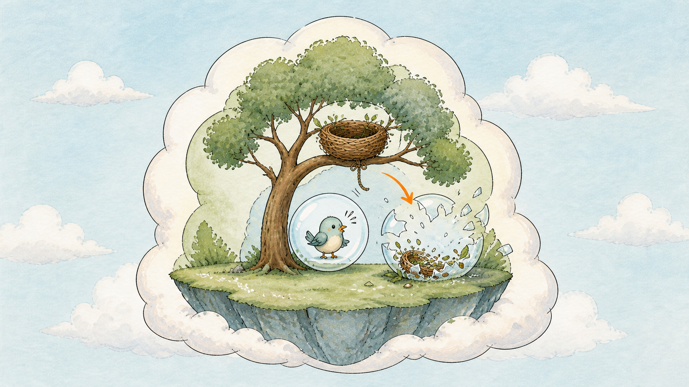
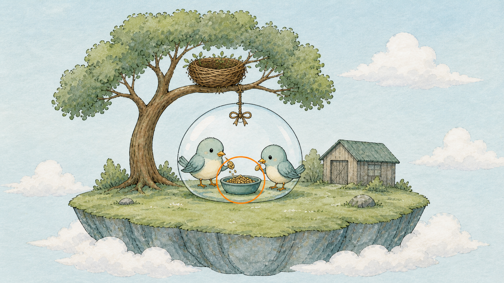

# Day 21：泡泡裡的食盆 ── 為什麼重啟之後資料就不見了

## 痛點

你的服務寫了一整天的上傳檔案，泡泡重啟一次，全部消失。你檢查了三遍程式，程式沒錯。



IMG: 一顆泡泡正在破掉，裡面那個食盆跟著碎成一地 ｜ 出場角色：泡泡、小鳥、泡泡裡的食盆 ｜ 亮橘重點：碎掉消失的那個食盆

程式沒錯，是你對容器的檔案系統有誤解。

**容器的檔案系統是暫時的。** 這件事在 Docker 時代就成立，只是你可能一直沒被咬到，因為你的容器很少重啟。到了 K8s，泡泡破掉是**日常**：滾動更新破、貓頭鷹補位破、節點資源不足被趕走也破。一天破幾十次都很正常。

每破一次，那隻小鳥寫在自己肚子裡的東西就全沒了。新的小鳥是從 image 重新長出來的，**image 是什麼樣，它就是什麼樣**。

所以想留住資料，得把資料放到「小鳥肚子外面」。第一種容器，就是圖上那個**食盆**。

食盆的正式名字叫 **emptyDir**，直翻是「空目錄」。它的行為完全照字面：

**泡泡建立時，K8s 開一個空目錄給它。泡泡刪掉時，這個目錄跟著刪掉。**

看圖上食盆的位置和它碎掉的方式 ── 食盆的命運跟泡泡綁在一起，不跟小鳥綁在一起。這個差別今天你會親眼驗證，而且它比你想的重要：

**小鳥重啟，食盆還在；泡泡刪掉，食盆才消失。**

所以你的容器 crash 了一百次，只要是同一顆泡泡在重啟容器，食盆裡的東西都活得好好的。這是很多人沒搞清楚的地方 ── **「重啟」有兩種**，一種是泡泡裡的小鳥重啟（RESTARTS 加一），一種是整顆泡泡被換掉（名字都變了）。前者不會掉資料，後者會。

那食盆有什麼用？既然反正會消失。

**用途一，同一顆泡泡裡的小鳥共用資料。** Day 6 的 sidecar 情境：主容器把日誌寫進食盆，旁邊的收集器從食盆讀出來往外送。兩隻小鳥吃同一盆，這是 emptyDir 最經典的用法。

**用途二，暫存空間。** 處理中的檔案、解壓縮的中繼產物、快取。這些東西本來就不需要活過泡泡。



IMG: 一顆泡泡裡兩隻小鳥共用中央一個食盆，左邊的往盆裡放東西、右邊的從盆裡拿走 ｜ 出場角色：泡泡、小鳥、泡泡裡的食盆 ｜ 亮橘重點：兩隻小鳥之間那個共用的食盆

真正要「泡泡破了資料還在」的東西，得放到泡泡外面去 ── 那是明天的倉庫。

## 動手 5 分鐘

前二十天我們的資料全部靠 image 和便條本供應，沒有任何東西是泡泡自己寫出來的。今天做一顆會寫東西的泡泡，然後看它怎麼弄丟資料。

建立 `demo-emptydir.yaml`，一顆泡泡兩隻小鳥共用一個食盆：

```yaml
apiVersion: v1
kind: Pod
metadata:
  name: demo-vol
spec:
  containers:
    - name: writer
      image: busybox:1.36
      command: ["sh", "-c", "while true; do date >> /data/log.txt; sleep 5; done"]
      volumeMounts:
        - name: bowl
          mountPath: /data
    - name: reader
      image: busybox:1.36
      command: ["sh", "-c", "sleep 3600"]
      volumeMounts:
        - name: bowl
          mountPath: /shared
  volumes:
    - name: bowl
      emptyDir: {}
```

看清楚結構：`volumes` 宣告一個叫 `bowl` 的食盆（`emptyDir: {}` 就是「給我一個空的」），兩隻小鳥各自用 `volumeMounts` 把它掛到**不同的路徑**上。同一個食盆，兩個名字。

```bash
kubectl apply -f demo-emptydir.yaml
kubectl get pod demo-vol
```

READY 是 `2/2` ── 一顆泡泡，兩隻小鳥。

等十五秒，看 writer 寫了什麼：

```bash
kubectl exec demo-vol -c writer -- cat /data/log.txt
```

（`-c` 是指定哪隻小鳥，一顆泡泡多隻小鳥時必須加。）三行時間戳。

現在從**另一隻**小鳥去讀同一份資料：

```bash
kubectl exec demo-vol -c reader -- cat /shared/log.txt
```

**一模一樣的內容。** 它們吃的是同一盆。

**實驗一：小鳥重啟，食盆還在嗎？**

```bash
kubectl exec demo-vol -c reader -- wc -l /shared/log.txt
kubectl exec demo-vol -c writer -- kill 1
kubectl get pod demo-vol
```

RESTARTS 變成 1，writer 被重啟了。但泡泡的名字沒變。等五秒再讀：

```bash
kubectl exec demo-vol -c reader -- wc -l /shared/log.txt
```

**行數比剛剛多，不是從零開始。** 舊資料還在，新的接在後面。食盆活過了容器重啟。

**實驗二：泡泡破掉，食盆還在嗎？**

先記下現在的行數：

```bash
kubectl exec demo-vol -c reader -- wc -l /shared/log.txt
```

刪掉整顆泡泡再建回來：

```bash
kubectl delete pod demo-vol
kubectl apply -f demo-emptydir.yaml
```

等十秒：

```bash
kubectl exec demo-vol -c reader -- cat /shared/log.txt
```

**只有一兩行，從頭開始。** 之前累積的全部消失了 ── 這就是圖上那個碎掉的食盆。

收工清掉：

```bash
kubectl delete pod demo-vol
```

最後補兩個 emptyDir 的實用設定。第一，**它預設吃的是那棵樹的硬碟，而且沒有上限** ── 你的程式寫爆了，整棵樹的硬碟會被塞滿，樹上其他泡泡跟著遭殃。所以正式環境要加水位線：

```yaml
    volumes:
      - name: bowl
        emptyDir:
          sizeLimit: 500Mi
```

超過就會被趕出去，至少不會拖累鄰居。

第二，食盆可以改放在記憶體裡：

```yaml
        emptyDir:
          medium: Memory
```

速度快很多，適合快取和暫存。但要記得它吃的是泡泡的記憶體額度 ── 這個額度是什麼、超過會怎樣，Day 25 會講。

## 帶走一句話

**小鳥重啟食盆還在，泡泡破了就沒了。**
