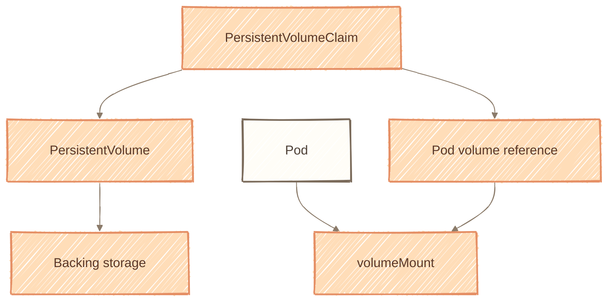
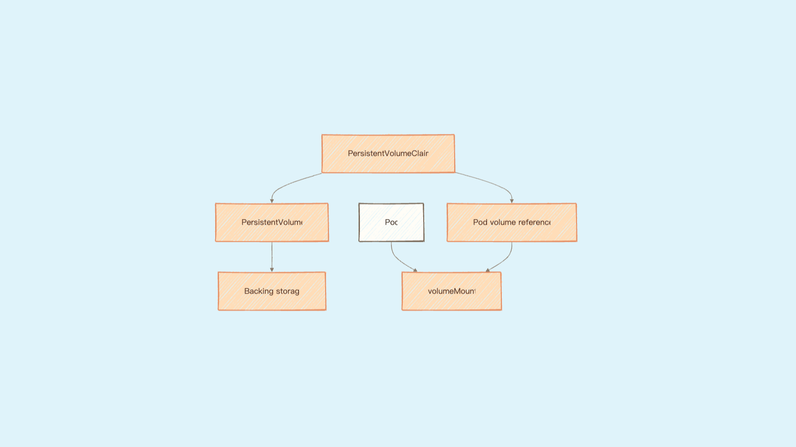
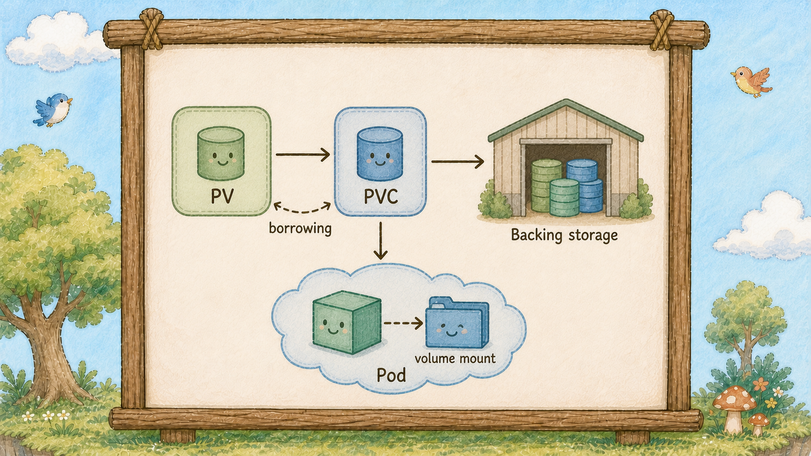
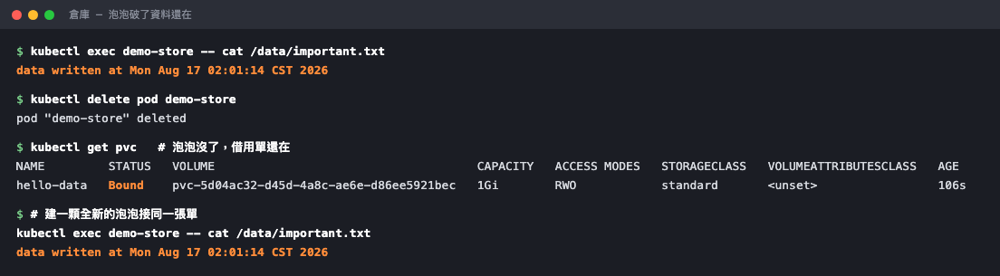

# Day 22：島上的倉庫與借用單 ── PV 與 PVC

## 痛點

昨天你證明了泡泡破掉資料就沒了。但你的資料庫不能這樣，它需要一個「泡泡死了東西還在」的地方。







IMG: 一座倉庫蓋在島的地面上，一張借用單把樹上的泡泡和地面的倉庫連起來 ｜ 出場角色：島上的倉庫、借用單、泡泡、小鳥、巢樹 ｜ 亮橘重點：倉庫蓋在地面上的位置

看圖上倉庫的位置。它**不在泡泡裡**，它蓋在地面上。這一個構圖差異就是今天的全部重點 ── 泡泡在樹上生生滅滅，倉庫在地上動都不動。

這裡有三個角色，各司其職：

**PV（島上的倉庫）── 對叢集可用的儲存資源抽象。** 它可能是雲端的一顆硬碟、機房的一台 NFS、或是你筆電上的一個資料夾。它是**島級**的東西，不屬於任何圍籬，也不屬於任何泡泡。你把泡泡刪光時，倉庫通常仍可保留；PVC 與 PV 的回收策略會決定底層資料是否繼續存在。

**PVC（借用單）── 一張「我要借多大、要怎麼用」的申請單。** 它才是屬於圍籬的東西，跟你的應用綁在一起。

**Pod ── 拿著借用單去用倉庫的人。** 注意：**在 PVC 的模型裡，泡泡通常不直接指定底層倉庫**，它只指定借用單。

泡泡裡看到的食盆是 **Volume Mount**；當它透過 PVC 接到 PV 時，泡泡可以被替換，但倉庫裡的資料仍可能保留。這和沒有外接持久儲存的 `emptyDir` 不同。

為什麼要多一張單子這麼麻煩？因為它把兩件事分開了：

**「有什麼倉庫」是管理員的事，「我要多大空間」是開發者的事。**

寫應用的人不需要知道公司用的是 AWS EBS 還是機房的 NFS，他只要說「我要 1 GB、可以讀寫」。單子送出去，K8s 自己去找一個符合條件的倉庫綁上。同一份 YAML 因此能跑在筆電、跑在測試機、跑在正式環境 ── 底下換成不同的儲存設備時，應用程式可維持使用 PVC，但 StorageClass、容量、權限與拓撲等環境設定仍可能需要調整。

這個「找到並綁上」的動作叫 **Binding**，一旦綁定就是**一對一**：這張單子綁走這個倉庫，別人不能再借。你會在狀態欄看到 `Bound` 這個字。


IMG: 一張借用單從樹上的泡泡垂下來，接到地面倉庫的門口，倉庫門上貼著「已借出」 ｜ 出場角色：借用單、島上的倉庫、泡泡、巢樹 ｜ 亮橘重點：倉庫門上「已借出」那張標籤

那誰來蓋倉庫？兩種做法：

**手動蓋（靜態）** ── 管理員先建一批 PV 放著，等人來借。

**自動蓋（動態）** ── 你送出借用單，由 StorageClass 指定的 provisioner 建立符合條件的儲存。StorageClass 只描述類別與參數，不是它自己建立底層 volume。雲端環境常用動態供應；但原生 Kind 不保證內建 StorageClass，今天為了讓步驟可重現，採用手動建立一個本機測試用 PV。

最後一個必須知道的行為：**刪掉借用單，倉庫不一定跟著刪。** 這由 PV 的回收策略決定，`Delete` 是連倉庫一起銷毀，`Retain` 是留著資料等人工處理。正式環境的資料庫請用 `Retain`，這是那種「錯一次就回不來」的設定。

## 動手 5 分鐘

昨天的食盆隨著泡泡一起碎掉。今天改用倉庫，做同一個實驗，看結果怎麼不一樣。

先看看島上是否有動態供應器（不同 Kind／版本結果可能不同）：

```bash
kubectl get storageclass
```

若沒有輸出，代表這座 Kind 沒有 StorageClass；今天不依賴它，改用明確的靜態 PV。若你看到 `standard (default)`，也不要把它當成 Kind 的通用保證。

建立 `hello-pv.yaml`：

```yaml
apiVersion: v1
kind: PersistentVolume
metadata:
  name: hello-pv
spec:
  capacity:
    storage: 1Gi
  accessModes:
    - ReadWriteOnce
  persistentVolumeReclaimPolicy: Retain
  hostPath:
    path: /var/local-path-provisioner/hello-data
    type: DirectoryOrCreate
```

這個 `hostPath` 是 Kind 節點容器裡的本機資料夾，只適合單節點練習；它不是跨節點高可用儲存，也不能當成正式資料庫的備份。

送出借用單。建立 `hello-pvc.yaml`：

```yaml
apiVersion: v1
kind: PersistentVolumeClaim
metadata:
  name: hello-data
spec:
  accessModes:
    - ReadWriteOnce
  resources:
    requests:
      storage: 1Gi
```

只有兩個重點欄位。`storage: 1Gi` 是要借多大；`accessModes` 是怎麼用，`ReadWriteOnce` 的意思是「同一時間只有一棵樹上的泡泡能讀寫」，這是最常見也最單純的模式。

```bash
kubectl apply -f hello-pv.yaml -f hello-pvc.yaml
kubectl get pvc
```

STATUS 變成 `Bound`，因為這張單的容量與存取模式能和 `hello-pv` 配對。若你改用已安裝的 StorageClass，才會由 provisioner 動態建立 PV。

現在建一顆用它的泡泡。建立 `demo-pvc-pod.yaml`：

```yaml
apiVersion: v1
kind: Pod
metadata:
  name: demo-store
spec:
  containers:
    - name: writer
      image: busybox:1.36
      command: ["sh", "-c", "sleep 3600"]
      volumeMounts:
        - name: store
          mountPath: /data
  volumes:
    - name: store
      persistentVolumeClaim:
        claimName: hello-data
```

跟昨天的結構**幾乎一樣**，只有 `volumes` 那段從 `emptyDir: {}` 換成 `persistentVolumeClaim`。泡泡指的是**借用單的名字**，不是倉庫。

```bash
kubectl apply -f demo-pvc-pod.yaml
kubectl get pvc,pv
```

現在 PVC 變成 `Bound`，而且**憑空多出一個 PV** ── 那座倉庫剛剛被自動蓋出來了。看 PV 的 CLAIM 欄，寫著 `default/hello-data`，一對一綁定。

寫點東西進去：

```bash
kubectl exec demo-store -- sh -c "echo 'data written at' \$(date) > /data/important.txt"
kubectl exec demo-store -- cat /data/important.txt
```

**現在做今天的關鍵實驗：把泡泡整顆刪掉。**

```bash
kubectl delete pod demo-store
kubectl get pvc,pv
```

泡泡沒了，但 **PVC 還是 `Bound`、PV 還在**。倉庫蓋在地面上，泡泡破了它不會跟著碎。

建一顆全新的泡泡來接同一張單：

```bash
kubectl apply -f demo-pvc-pod.yaml
kubectl exec demo-store -- cat /data/important.txt
```

**檔案還在，時間戳是舊的那個。** 這是全新的泡泡、全新的容器，讀到的是上一顆泡泡寫的資料。昨天的食盆做不到這件事。



前後兩次讀到的時間戳一模一樣 ── 中間那顆泡泡已經被整個刪掉重建了。

最後看一眼倉庫實際在哪：

```bash
kubectl get pv hello-pv -o jsonpath='{.spec.hostPath.path}{"\n"}'
```

印出樹上的一個路徑 ── 這次 Kind 的倉庫就是節點容器裡的一個資料夾。**正式環境通常會改用雲端磁碟或其他儲存後端，StorageClass、容量、存取模式與拓撲可能都要重新設計。**

收工，泡泡刪掉，倉庫留著明天用：

```bash
kubectl delete pod demo-store
```

## 帶走一句話

**泡泡指的是借用單，不是倉庫。**

## 參考資源

- [Persistent Volumes](https://kubernetes.io/docs/concepts/storage/persistent-volumes/)
- [Storage Classes](https://kubernetes.io/docs/concepts/storage/storage-classes/)
