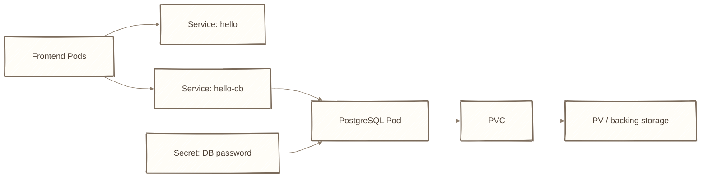
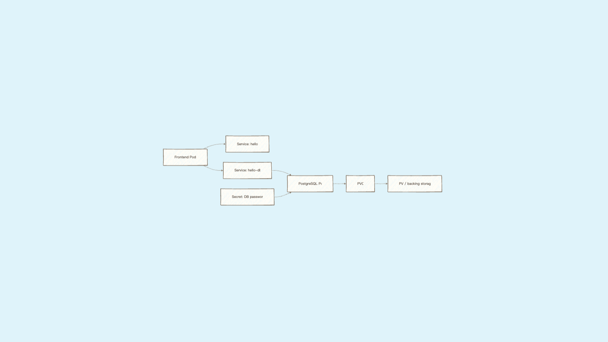
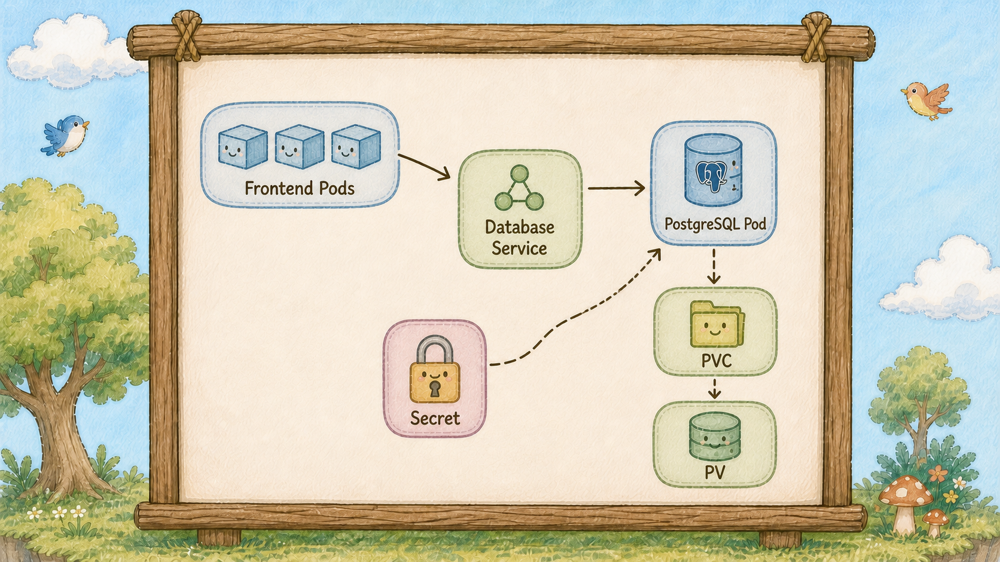
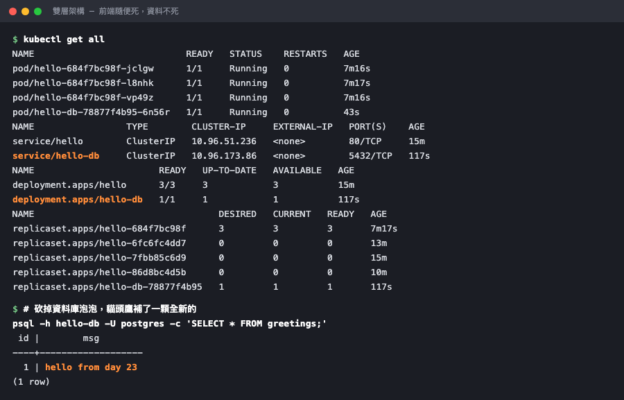

# Day 23：資料實戰 ── 幫 hello service 接上一個資料庫


## 痛點

你手上有前端、有柱子、有看板、有倉庫（PersistentVolume，PV）、有小盒。但它們到現在還是各自獨立的零件，沒有組成一個像樣的系統。







IMG: 雙層架構的島景，前端三顆泡泡（Pod）連到一根圖騰柱（Service），柱子後面一顆資料庫泡泡（Pod），泡泡（Pod）下方連著地面的倉庫（PersistentVolume，PV） ｜ 出場角色：泡泡（Pod）、小鳥（Container）、圖騰柱（Service）、島上的倉庫（PersistentVolume，PV）、借用單（PersistentVolumeClaim，PVC） ｜ 亮橘重點：資料庫泡泡（Pod）與地面倉庫（PersistentVolume，PV）之間那條連線

今天不學新東西，把第四幕的零件組成你的第一個真實架構。

從上往下看圖，這座島現在長這樣：

**前端層。** 三顆 hello 泡泡（Pod），可以隨便破、隨便擴、隨便換版本。它們**不存任何東西**，所以死一百次都無所謂。

**中間層。** 一根 `hello-db` 圖騰柱（Service）。這根柱子的存在，讓前端可以只認一個名字，不必知道資料庫泡泡（Pod）在哪棵樹、IP 是多少。

**資料層。** 一顆 Postgres 泡泡（Pod），接著地面上的倉庫（PersistentVolume，PV）。**它是最不能隨便處理的東西之一**，因為東西都在它手上。

三個關鍵的連接方式，每個都是前面學過的：

**第一，前端用名字找資料庫。** 前端的設定裡寫的是 `hello-db` 這五個字，不是 IP。這是 Day 14 那個內建 DNS 的價值 ── 資料庫泡泡（Pod）重建一百次、IP 換一百次，前端的設定一個字都不用改。

**第二，密碼從小盒來。** Postgres 的密碼不寫在 YAML 裡，用 `secretKeyRef` 從 Day 20 的小盒撈。這樣同一份 YAML 才能推上 git。

**第三，資料放在倉庫（PersistentVolume，PV）。** Day 22 的借用單（PersistentVolumeClaim，PVC）掛進資料庫泡泡（Pod）。泡泡（Pod）破了資料還在。


IMG: 前端一顆泡泡（Pod）朝著一根寫著名字的圖騰柱（Service）喊話，柱子後面連著資料庫泡泡（Pod） ｜ 出場角色：泡泡（Pod）、小鳥（Container）、圖騰柱（Service） ｜ 亮橘重點：柱子上那個被喊的名字

先誠實說一件事：**用 Deployment 跑資料庫，正式環境是不夠的。** 資料庫需要固定的身分和固定的倉庫（PersistentVolume，PV），那是 Day 27 那位「編號泡泡（StatefulSet Pod）管理員（StatefulSet）」的工作。今天先用你熟悉的東西把架構跑通，Day 27 再告訴你為什麼要換。

## 動手 5 分鐘

前二十二天我們有前端三件套加一座本機測試用倉庫（PersistentVolume，PV）。今天長出第二層；資料庫另外使用一個明確的本機 PV，避免把 Kind 是否內建 StorageClass 當成前提。

先把密碼放進 Day 20 那個小盒。編輯 `hello-secret.yaml`：

```yaml
apiVersion: v1
kind: Secret
metadata:
  name: hello-secret
type: Opaque
stringData:
  DB_PASSWORD: super-secret-123
  POSTGRES_PASSWORD: super-secret-123
```

```bash
kubectl apply -f hello-secret.yaml
```

資料庫要自己的倉庫（PersistentVolume，PV）。建立 `hello-db-pvc.yaml`：

```yaml
apiVersion: v1
kind: PersistentVolumeClaim
metadata:
  name: hello-db-data
spec:
  accessModes:
    - ReadWriteOnce
  resources:
    requests:
      storage: 1Gi
```

建立配對用的 `hello-db-pv.yaml`：

```yaml
apiVersion: v1
kind: PersistentVolume
metadata:
  name: hello-db-pv
spec:
  capacity:
    storage: 1Gi
  accessModes:
    - ReadWriteOnce
  persistentVolumeReclaimPolicy: Retain
  hostPath:
    path: /var/local-path-provisioner/hello-db-data
    type: DirectoryOrCreate
```

主角登場。建立 `hello-db-deployment.yaml`：

```yaml
apiVersion: apps/v1
kind: Deployment
metadata:
  name: hello-db
spec:
  replicas: 1
  selector:
    matchLabels:
      app: hello-db
  template:
    metadata:
      labels:
        app: hello-db
    spec:
      containers:
        - name: postgres
          image: postgres:16-alpine
          ports:
            - containerPort: 5432
          env:
            - name: POSTGRES_PASSWORD
              valueFrom:
                secretKeyRef:
                  name: hello-secret
                  key: POSTGRES_PASSWORD
            - name: PGDATA
              value: /var/lib/postgresql/data/pgdata
          volumeMounts:
            - name: db-store
              mountPath: /var/lib/postgresql/data
      volumes:
        - name: db-store
          persistentVolumeClaim:
            claimName: hello-db-data
```

三個地方值得停下來看。`replicas: 1` ── 資料庫不能像前端那樣隨便多開，兩顆同時寫同一個倉庫（PersistentVolume，PV）會壞掉。`secretKeyRef` 是從小盒撈**單一一把鑰匙**（Day 20 的 `secretRef` 是整盒倒進去）。`PGDATA` 指到子目錄，這是 Postgres 掛外部儲存時的標準做法，不加它初始化會失敗。

最後一根柱子。建立 `hello-db-service.yaml`：

```yaml
apiVersion: v1
kind: Service
metadata:
  name: hello-db
spec:
  selector:
    app: hello-db
  ports:
    - port: 5432
      targetPort: 5432
```

**沒有 `type`，所以是 ClusterIP。** 這是刻意的 ── 資料庫絕對不該對島外開門。

一次全部套上去：

```bash
kubectl apply -f hello-db-pv.yaml -f hello-db-pvc.yaml -f hello-db-deployment.yaml -f hello-db-service.yaml
kubectl get pods,svc,pvc
```

等三十秒，`hello-db` 泡泡（Pod）變成 `Running`。第一次啟動要初始化資料庫，慢一點正常。

確認它真的起來了：

```bash
kubectl logs deploy/hello-db | tail -3
```

看到 `database system is ready to accept connections`。

**現在做今天最重要的驗證：從島內用名字連進去。**

```bash
kubectl run psql-client --rm -it --image=postgres:16-alpine --env="PGPASSWORD=super-secret-123" -- psql -h hello-db -U postgres
```

注意 `-h hello-db` ── **你打的是柱子的名字**。提示字元變成 `postgres=#`，你連上了。

寫點資料進去：

```sql
CREATE TABLE greetings (id serial primary key, msg text);
INSERT INTO greetings (msg) VALUES ('hello from day 23');
SELECT * FROM greetings;
```

一行資料。打 `\q` 離開，客人泡泡（Pod）自動消失。

**驗證資料真的活在倉庫（PersistentVolume，PV）裡。把資料庫泡泡（Pod）整顆砍掉：**

```bash
kubectl delete pod -l app=hello-db
kubectl get pods -l app=hello-db
```

貓頭鷹立刻補了一顆全新的泡泡（Pod），名字不一樣了。等它 `Running`，再連一次：

```bash
kubectl run psql-client --rm -it --image=postgres:16-alpine --env="PGPASSWORD=super-secret-123" -- psql -h hello-db -U postgres -c "SELECT * FROM greetings;"
```

**`hello from day 23` 還在。** 新泡泡（Pod）、新 IP、新容器，這次 demo 中資料仍然存在，因為它寫在地面上的倉庫（PersistentVolume，PV）；PVC 提供持久化位置，但不等於備份或資料一致性保證。



前端一組、資料庫一組，各有各的柱子；資料庫泡泡（Pod）換過一輪，資料原封不動。

最後把整座島看一遍：

```bash
kubectl get all
```

前端部署管家（Deployment）、前端柱子、資料庫部署管家（Deployment）、資料庫柱子。**這是你第一個像樣的架構。**

順便驗證一件很重要的事：資料庫確實只有島內看得到。

```bash
kubectl get svc hello-db
curl --max-time 5 http://localhost/hello
```

`hello-db` 的 EXTERNAL-IP 是 `<none>`，島外沒有它的位址；而看板上也沒有任何一條規則指向它。**你的資料庫沒有透過這組 Ingress／對外 Service 暴露。** 這不等於所有網路路徑都不可達，真正的隔離仍要搭配網路與權限政策。

最後把今天的檔案整理一下，你的專案目錄現在應該長這樣：

```bash
ls *.yaml
```

前端四個（deployment、service、ingress、configmap）、資料庫四個（deployment、service、pvc、pv）、共用一個 secret，加上蓋島用的 kind-config。**十個檔案，一座完整的島。** 換一台電腦，`kind create cluster` 加上 `kubectl apply` 就能整套重現 ── 這才是這二十三天真正做出來的東西。

記得 `hello-secret.yaml` 不進 git，其他八個都該進。

## 帶走一句話

**前端隨便死，資料庫的倉庫（PersistentVolume，PV）不能死。**

## 參考資源

- [Stateful Applications](https://kubernetes.io/docs/tasks/run-application/run-single-instance-stateful-application/)
- [Persistent Volumes](https://kubernetes.io/docs/concepts/storage/persistent-volumes/)
