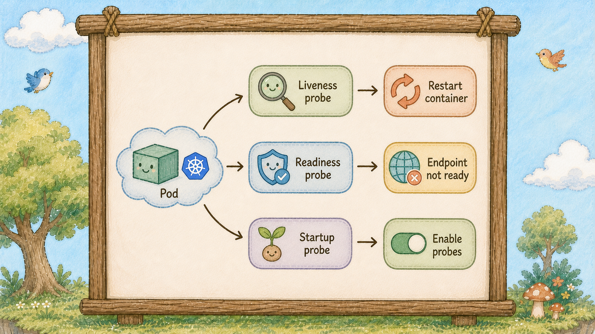
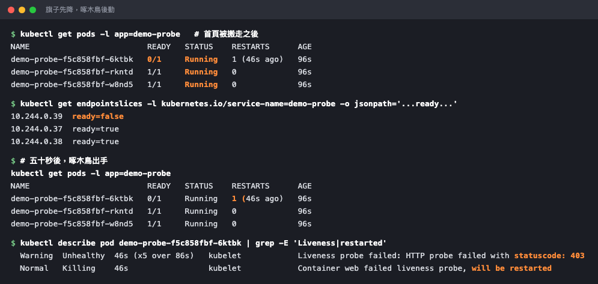

# Day 24：K8s 三種探針 Probe，存活檢查鈴 Liveness Probe 與小旗子 Readiness Probe、Startup


## K8s Probe

Pod 的狀態是 `Running`，但服務其實已經死了。
K8s 顯示一切正常，使用者卻在對你尖叫。


泡泡（Pod）外掛著存活檢查鈴（Liveness Probe），頂上插著一面旗子（Readiness Probe），鈴響起就是一次檢查動作。


## Running 不等於還能用



`Running` 代表 Pod 至少有一個主要容器正在執行，不能單獨證明服務可以接收請求。

程序還在，不等於服務還能用。
連線池滿了、死結卡住了、記憶體漏光在做無效的 GC，程序都還活著，但它已經不會回應任何請求了。
K8s 看不出這種死法，除非我們教它怎麼看。

教它的方式就是**探針（Probe）**。三種，各管一件事。

**存活檢查鈴（Liveness Probe）：你還活著嗎？沒回應就重啟**

管家松鼠（kubelet）定期替泡泡（Pod）做存活檢查（Liveness Probe）；連續失敗達到設定門檻時，就會重啟裡面的小鳥（Container）。
它管的是「**救不救**」。

**小旗子（Readiness Probe）：你準備好了嗎？沒好就不給流量**

看圖上那面旗子（Readiness Probe）。旗子升起來，柱子（Service）才把它加進名單（Endpoints）；旗子降下來，柱子立刻把它從名單移除，**通常不會重啟它**。
它管的是「**給不給客人**」。

**Startup（啟動緩衝）：你還在開機嗎？開機期間其他兩隻先別吵**

有些服務啟動要花兩分鐘（載模型、跑 migration）。
Startup 探針（Probe）成功之前，liveness 和 readiness 通常不會開始執行；startup 自己失敗到門檻時仍可能造成重啟。
它管的是「**什麼時候開始檢查**」。

三者的分工用一句話講死：**Liveness 決定生死，Readiness 決定流量，Startup 決定何時開始問。**


## 最貴的設定錯誤


三顆泡泡（Pod）並排：第一顆的存活檢查鈴（Liveness Probe）警示後重生，第二顆旗子（Readiness Probe）降下但泡泡（Pod）完好、旁邊的圖騰柱（Service）把它跳過，第三顆掛著一個沙漏。

最常見也最貴的錯誤是：**Liveness 設太敏感，造成無限重啟。**

服務只是暫時變慢（尖峰、GC、下游卡住），存活檢查連續失敗達到門檻，管家松鼠就會重啟它。
重啟要三十秒，這三十秒的流量壓到其他泡泡（Pod）上，其他泡泡（Pod）也變慢，也被重啟，**整組服務被自己的探針（Probe）殺光。**
明明只是慢，結果變成全滅。

所以記住兩條保命原則。

**第一，Liveness 要設得比 Readiness 寬鬆很多。**
慢的時候先把旗子（Readiness Probe）降下來，暫停導入流量，給服務恢復時間。

**第二，Liveness 只檢查「這個程序自己」。**
千萬不要在 Liveness 裡去 ping 資料庫，資料庫抖一下，整組前端可能都被管家松鼠重啟，而重啟一百次也救不了資料庫。
**那種檢查放 Readiness。**

三種探針（Probe）的檢查方式都一樣有三種：`httpGet`（打一個網址看狀態碼）、`tcpSocket`（連得上就算活）、`exec`（在容器裡跑指令看回傳值）。
網頁服務用第一種就好。

## 動手 5 分鐘

前二十三天我們的前端泡泡（Pod）沒有任何健康檢查，K8s 只知道程序還在。今天幫它裝上探針（Probe），再故意弄壞給你看。

改 `hello-deployment.yaml`，在 `ports` 底下加這兩段：

```yaml
          readinessProbe:
            httpGet:
              path: /
              port: 80
            initialDelaySeconds: 2
            periodSeconds: 3
            failureThreshold: 2
          livenessProbe:
            httpGet:
              path: /
              port: 80
            initialDelaySeconds: 10
            periodSeconds: 10
            failureThreshold: 5
```

**注意兩組數字的差距。** Readiness 三秒問一次、錯兩次就降旗（六秒內反應）；Liveness 十秒問一次、錯五次才動手（五十秒才重啟）。這就是「寬鬆很多」的實際樣子。

```bash
kubectl apply -f hello-deployment.yaml
kubectl rollout status deployment/hello
kubectl get pods
```

三顆 `1/1`。**那個 `1/1` 的第一個數字，就是「旗子（Readiness Probe）升起來的容器數」** ── 你看了二十三天的欄位，今天才知道它的意思。

看探針（Probe）的設定生效了沒：

```bash
kubectl describe pod -l app=hello | grep -E "Liveness|Readiness"
```

會印出 `http-get http://:80/ delay=10s timeout=1s period=10s #success=1 #failure=5` 這種摘要。

**現在弄壞一顆給你看。** 這裡要另外開一組拋棄式的泡泡（Pod），原因很實際：你的 hello 泡泡（Pod）從 Day 19 起，首頁是 ConfigMap **唯讀掛載**進去的，改不動。

建立 `demo-probe.yaml`，一根柱子（Service）加三顆帶探針（Probe）的泡泡（Pod）：

```yaml
apiVersion: v1
kind: Service
metadata:
  name: demo-probe
spec:
  selector:
    app: demo-probe
  ports:
    - port: 80
      targetPort: 80
---
apiVersion: apps/v1
kind: Deployment
metadata:
  name: demo-probe
spec:
  replicas: 3
  selector:
    matchLabels:
      app: demo-probe
  template:
    metadata:
      labels:
        app: demo-probe
    spec:
      containers:
        - name: web
          image: nginx:1.27-alpine
          ports:
            - containerPort: 80
          readinessProbe:
            httpGet: {path: /, port: 80}
            initialDelaySeconds: 2
            periodSeconds: 3
            failureThreshold: 2
          livenessProbe:
            httpGet: {path: /, port: 80}
            initialDelaySeconds: 10
            periodSeconds: 10
            failureThreshold: 5
```

```bash
kubectl apply -f demo-probe.yaml
kubectl rollout status deployment/demo-probe
```

把其中一顆的首頁搬走，讓它對 `/` 回 403：

```bash
POD=$(kubectl get pods -l app=demo-probe -o jsonpath='{.items[0].metadata.name}')
kubectl exec $POD -- mv /usr/share/nginx/html/index.html /tmp/
```

立刻盯著看：

```bash
kubectl get pods -l app=demo-probe -w
```

**先看到的是 READY 從 `1/1` 變成 `0/1`，但 STATUS 還是 `Running`。** 這就是小旗子（Readiness Probe）降下來了 ── 泡泡（Pod）活著，只是不接客。

同時去看柱子（Service）的名單（Endpoints），但**要看對地方**：

```bash
kubectl get endpointslices -l kubernetes.io/service-name=demo-probe
```

奇怪，`ENDPOINTS` 那欄還是三個位址，一個都沒少。

這裡有個很多人會誤會的細節：**EndpointSlice 不會把未就緒的泡泡（Pod）從名單（Endpoints）上刪掉，它是掛一個 `ready: false` 的標記。** 表格那一欄是不分就緒與否全部列出來的，所以你得往裡面看：

```bash
kubectl get endpointslices -l kubernetes.io/service-name=demo-probe \
  -o jsonpath='{range .items[*].endpoints[*]}{.addresses[0]}{"  ready="}{.conditions.ready}{"\n"}{end}'
```

```
10.244.0.39  ready=false
10.244.0.37  ready=true
10.244.0.38  ready=true
```

**降旗的那顆變成 `ready=false`。** 道路管理員（kube-proxy）只會把流量送給 `ready=true` 的，所以它確實已經不接客了 ── 只要還有健康的泡泡（Pod）在，使用者不會感覺到這件事（長連線、或三顆同時倒下時仍可能中斷）。

繼續等。五十秒後回到 `-w` 那個畫面：

```
demo-probe-xxx   1/1   Running   1 (5s ago)
```

**RESTARTS 變成 1** ── 管家松鼠依照 Liveness Probe 的結果重啟了容器。重啟後容器從 image 重新長出來，index.html 回來了，READY 變回 `1/1`，那個位址也變回 `ready=true`。`Ctrl+C` 離開。



`0/1` 但 `Running` 是旗子（Readiness Probe）降下來；五十秒後 RESTARTS 變 1，代表管家松鼠依 Liveness Probe 重啟了容器。兩者差了整整一個數量級的時間。

看 kubelet 記錄的探針事件：

```bash
kubectl describe pod $POD | grep -E "Liveness probe failed|will be restarted"
```

Events 裡明明白白寫著 `Liveness probe failed: HTTP probe failed with statuscode: 403`，接著 `Container web failed liveness probe, will be restarted`。（403 不是 404 ── 目錄還在，只是沒有首頁可以給，Nginx 預設不列目錄。）

**整個過程你什麼都沒做，服務也沒有中斷。** 這就是今天要換到的東西。

驗收完把拋棄式那組清掉：

```bash
kubectl delete -f demo-probe.yaml
```

至於你真正的 hello 服務，把那兩段 `readinessProbe` / `livenessProbe` 加進 `hello-deployment.yaml` 的 `ports` 底下再 apply 就好，設定完全一樣。

## 帶走一句話

**管家松鼠（kubelet）用 Readiness Probe 管流量資格、用 Liveness Probe 判斷是否重啟；別搞反。**

## 參考資源

- [Liveness, Readiness and Startup Probes](https://kubernetes.io/docs/concepts/configuration/liveness-readiness-startup-probes/)
- [Probe Configuration](https://kubernetes.io/docs/tasks/configure-pod-container/configure-liveness-readiness-startup-probes/)
