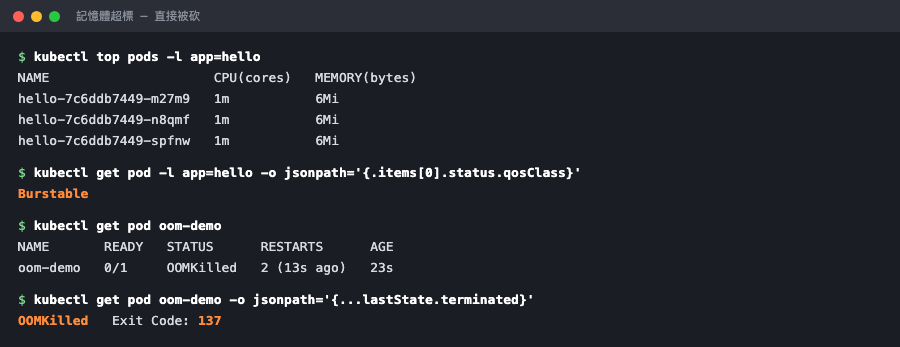

# Day 25：飯碗上的水位線 ── Request 與 Limit

## 痛點

某天有個服務吃光了整台機器的記憶體，旁邊三個不相干的服務跟著陪葬。你想問：K8s 怎麼會讓這種事發生？


IMG: 一個飯碗上畫著上下兩條水位線，一隻小鳥吃到飯滿出碗外正被拉走 ｜ 出場角色：飯碗上的水位線、小鳥、泡泡 ｜ 亮橘重點：飯從碗裡滿出來的那一刻

因為你沒有畫線。**不設限制的泡泡，預設可以吃光整棵樹。**

看圖上那個飯碗，兩條線各有名字：

**Request（下面那條線）── 我保證要吃到這麼多。**

這條線是給**引路鳥**看的。Day 4 講過引路鳥決定新泡泡掛哪棵樹，它憑什麼決定？就憑這條線。它把每棵樹上所有泡泡的 Request 加起來，跟樹的總容量比一比，還放得下才把新泡泡掛上去。

**這是今天最容易被誤解的地方：一般資源 fit 判斷主要看 Request，而不是即時實際用量；但排程還會考慮 affinity、taint、topology 等條件。** 一棵樹上的泡泡實際只用了 10% 的 CPU，但 Request 加起來已經滿了，引路鳥就是不會再放新泡泡進去 ── 你會得到一顆 `Pending` 的泡泡（Day 12 那三種狀態之一）。

**Limit（上面那條線）── 最多只准吃到這麼多。**

這條線是給**管家松鼠**看的，它負責在樹上執行。超過會怎樣？**CPU 和記憶體的下場完全不同，這個差別非常重要：**

**CPU 超過 → 被限速（throttle）。** CPU 是可壓縮資源，通常會被限速；但程式仍可能因 timeout、probe failure 或其他錯誤退出。

**記憶體超過 → 直接被砍（OOMKilled）。** 記憶體是不可壓縮的，沒辦法「少給一點」。超過 Limit 那一刻，容器直接被殺，然後重啟。

所以你會在 `kubectl get pods` 看到 `OOMKilled`，而不是一個對稱的 `CPUKilled`；CPU 壓力仍可能間接造成服務失敗。


IMG: 兩個飯碗並排，左邊的小鳥被一條繩子拉慢動作但還在吃，右邊的小鳥直接被抓走、碗留在原地 ｜ 出場角色：飯碗上的水位線、小鳥、泡泡 ｜ 亮橘重點：右邊那隻被抓走的小鳥

那不設會怎樣？兩件事都很糟：

**第一，引路鳥完全不知道你要多少**，只好當你不佔空間，於是把一堆泡泡塞到同一棵樹上，最後大家一起餓死。

**第二，你的泡泡可以吃光整棵樹**，連累鄰居 ── 就是開頭那個慘案。

最後給你一個實務上的起手式：**Request 應依監控、壓測與容量目標設定；Limit 則要依服務的 burst 特性與失敗代價評估，沒有通用的兩倍規則。** 然後記憶體的 Request 和 Limit 建議設成**一樣**，因為記憶體超標的代價是被砍，不是變慢，你不會想賭那個空間。

## 動手 5 分鐘

前二十四天我們的泡泡沒畫任何線，愛吃多少吃多少。今天把碗畫上去。

先看看現在的樹被佔用了多少：

```bash
kubectl describe node hello-control-plane | grep -A6 "Allocated resources"
```

CPU Requests 和 Memory Requests 都很低，而且你的 hello 泡泡**一份都沒佔**。引路鳥眼中它們是零。

改 `hello-deployment.yaml`，在 `image` 底下加這段：

```yaml
          resources:
            requests:
              cpu: 50m
              memory: 64Mi
            limits:
              cpu: 200m
              memory: 64Mi
```

`50m` 是 0.05 顆 CPU（`m` 是千分之一顆），`64Mi` 是 64 MiB。**記憶體的 request 和 limit 設一樣**，照上面那個建議。

```bash
kubectl apply -f hello-deployment.yaml
kubectl rollout status deployment/hello
kubectl describe node hello-control-plane | grep -A6 "Allocated resources"
```

數字上去了。**引路鳥現在知道你佔多少位子。**

看看它怎麼被記錄的：

```bash
kubectl get pod -l app=hello -o jsonpath='{.items[0].spec.containers[0].resources}{"\n"}'
```

裝 metrics-server 才看得到實際用量。這也是明天 HPA 要用的東西，今天先裝：

```bash
kubectl apply -f https://github.com/kubernetes-sigs/metrics-server/releases/latest/download/components.yaml
kubectl patch deployment metrics-server -n kube-system --type=json \
  -p='[{"op":"add","path":"/spec/template/spec/containers/0/args/-","value":"--kubelet-insecure-tls"}]'
kubectl wait --for=condition=available --timeout=90s deployment/metrics-server -n kube-system
```

那個 `patch` 是 Kind 專用的：Kind 的樹用自簽憑證，不加這個參數 metrics-server 會一直連不上。

等三十秒讓它收集第一批數據，然後：

```bash
kubectl top nodes
kubectl top pods
```

**實際用量出來了。** 你會發現 hello 泡泡的 CPU 幾乎是 `0m`、記憶體大概 `4Mi` ── 遠低於你設的 Request。這很正常，Request 是預留的位子，不是實際的消耗。

**現在做那個經典實驗：把記憶體撐爆。** 建立 `oom-demo.yaml`，一顆故意吃太多的泡泡：

```yaml
apiVersion: v1
kind: Pod
metadata:
  name: oom-demo
spec:
  containers:
    - name: oom-demo
      image: polinux/stress
      command: ["stress"]
      args: ["--vm", "1", "--vm-bytes", "250M", "--vm-hang", "1"]
      resources:
        requests:
          memory: "64Mi"
        limits:
          memory: "64Mi"
```

`stress` 這個工具唯一的作用就是把資源吃滿，`--vm-bytes 250M` 是「配置 250 MB 記憶體」。它的 Limit 只有 64Mi，所以一定會撞牆。

```bash
kubectl apply -f oom-demo.yaml
```

盯著看：

```bash
kubectl get pod oom-demo -w
```

幾秒後：

```
oom-demo   0/1   OOMKilled   0
oom-demo   0/1   CrashLoopBackOff   1
```

**OOMKilled。** 不是變慢，是直接被砍。`Ctrl+C` 離開。

看死因：

```bash
kubectl get pod oom-demo -o jsonpath='{.status.containerStatuses[0].lastState.terminated.reason}{"  "}{.status.containerStatuses[0].lastState.terminated.exitCode}{"\n"}'
```

`OOMKilled  137`。（要看 `lastState` 而不是 `state`，因為它已經被重啟了，現在這一輪還活著 ── 死因記錄在「上一輪」。）



實際用量遠低於 Request（6Mi vs 64Mi）很正常；下面那顆撞到上限的，死因寫得清清楚楚。

**137 這個數字記起來**，它就是「被 SIGKILL 砍掉」的意思，你之後查問題會一直遇到它。

收工：

```bash
kubectl delete -f oom-demo.yaml
```

最後認識一個你不設也會被貼上的標籤。K8s 會依你怎麼畫線，把泡泡分成三個等級：

```bash
kubectl get pod -l app=hello -o jsonpath='{.items[0].status.qosClass}{"\n"}'
```

印出 `Burstable`。三個等級是這樣分的：**Request 和 Limit 完全相等是 `Guaranteed`（最不容易被犧牲）、有設但不相等是 `Burstable`、什麼都沒設是 `BestEffort`（最先被犧牲）**。

這個等級決定了一件事：當一棵樹真的快撐不住的時候，管家松鼠會**從最低等級開始趕泡泡下車**。所以「什麼都不設」不只是放任你的服務吃光資源，同時也讓它變成第一個被踢的人 ── 兩邊都吃虧。

你今天的設定是 `Burstable`（CPU 的兩條線不一樣）。想升到 `Guaranteed`，把 CPU 的 request 和 limit 也設成相同的值就好。

## 帶走一句話

**CPU 超標會變慢，記憶體超標會被砍。**

## 參考資源

- [Resource Management](https://kubernetes.io/docs/concepts/configuration/manage-resources-containers/)
- [Pod QoS Classes](https://kubernetes.io/docs/concepts/workloads/pods/pod-qos/)
