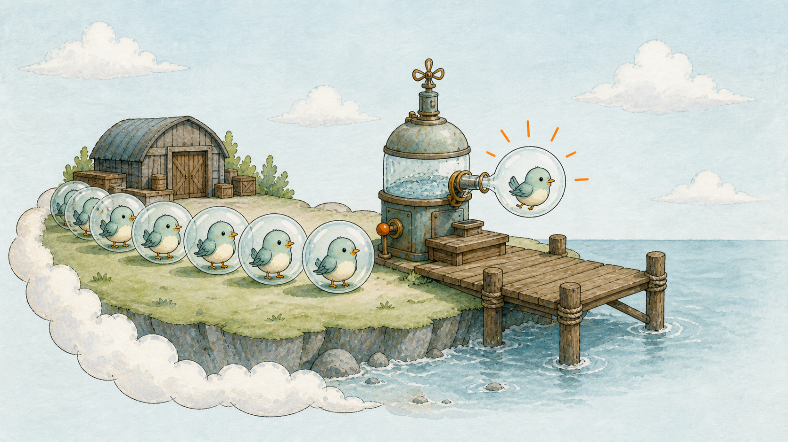
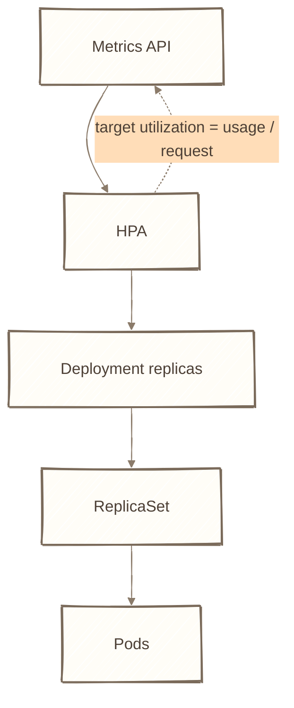
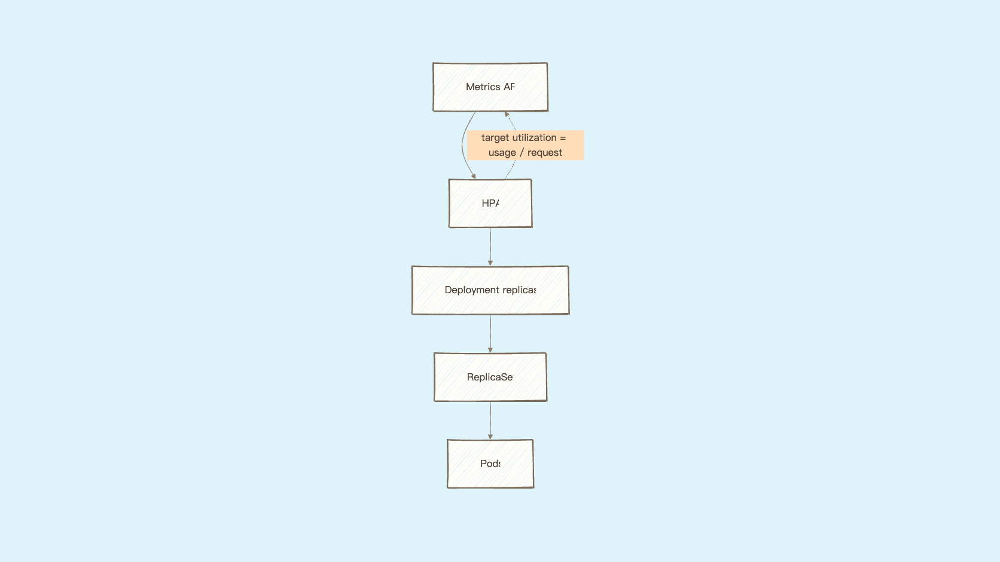
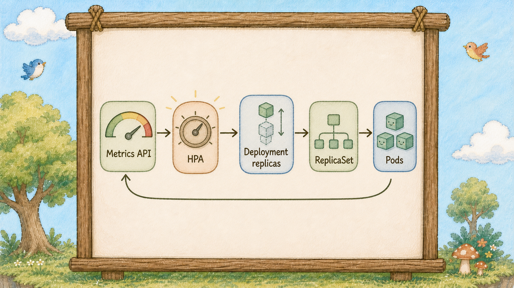
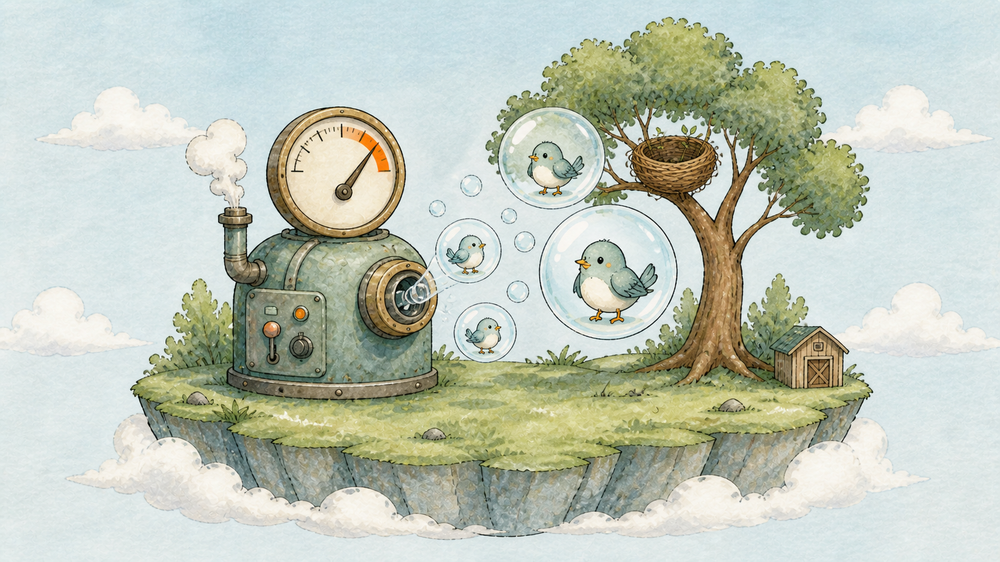
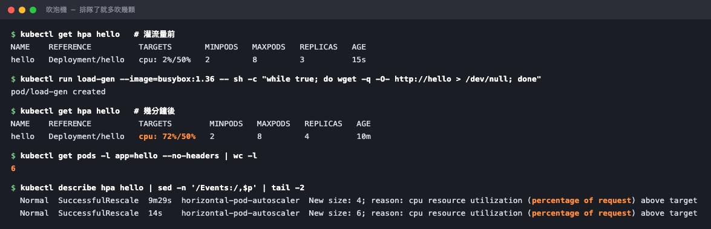

# Day 26：自動調節旋鈕（HPA） HPA ── 碼頭排隊了就調高期望數量


## 痛點

流量尖峰在半夜三點來，你不可能守在電腦前面打 `kubectl scale`。而白天沒人的時候，那些閒置的泡泡（Pod）還在燒錢。








IMG: 碼頭邊排著長長的人龍，自動調節旋鈕（HPA）把部署管家（Deployment）手上的期望副本數調高，右側的控制器再補出一顆新泡泡（Pod） ｜ 出場角色：自動調節旋鈕（HPA）、部署管家（Deployment）、數泡泡（Pod）的貓頭鷹、海邊碼頭、泡泡（Pod）、小鳥（Container） ｜ 亮橘重點：旋鈕（HPA）指向期望副本數的橘色連線

昨天你畫了飯碗的水位線，今天那條線終於有第二個用途。

**自動調節旋鈕（HPA）做的事情，是根據指標調整目標工作負載的期望副本數。** 它盯著現有泡泡（Pod）的資源使用率，跟你設的目標值比一比，修改 Deployment 或 StatefulSet 的 `replicas`；接著由 ReplicaSet 或 StatefulSet 控制器建立、刪除 Pod。HPA 不直接建立 Pod。

注意這個關鍵字：**使用率**，不是使用量。自動調節旋鈕（HPA）算的是這個：

**實際用量 ÷ Request = 使用率**

看清楚分母，**是 Request，不是 Limit**。所以昨天那條下面的線，今天變成了自動調節旋鈕（HPA）的計算基準。這也帶出一個直接的後果：**使用 CPU／記憶體 utilization 指標時，沒設 Request 的泡泡（Pod）通常無法計算使用率** ── 分母是零，算不出來。你會看到目標值那欄顯示 `<unknown>`。

計算公式很單純，你可以自己心算：

**需要的泡泡（Pod）數 = 現有泡泡（Pod）數 × (目前使用率 ÷ 目標使用率)**

三顆泡泡（Pod）、目前平均 90%、目標 50%，那就是 3 × (90 ÷ 50) = 5.4，通常會朝 6 顆調整；實際還會受 tolerance、上下限、缺失指標與 stabilization 影響。



IMG: 自動調節旋鈕（HPA）旁有一個指針錶，錶面指向高處，橘色箭頭指向部署管家（Deployment）手上的副本數牌，右側才由數泡泡（Pod）的貓頭鷹補出泡泡（Pod） ｜ 出場角色：自動調節旋鈕（HPA）、部署管家（Deployment）、數泡泡（Pod）的貓頭鷹、泡泡（Pod）、小鳥（Container） ｜ 亮橘重點：超過標線的指針與副本數牌之間的連線

有兩件事今天一定要記住，不然你會以為它壞了：

**第一，自動調節旋鈕（HPA）要靠 metrics-server 才能運作。** 它自己不會量任何東西，它只是去問「現在用多少」。昨天你已經裝好了，所以今天能直接玩 ── 但正式環境上如果沒人裝，HPA 就是一塊木頭，可能顯示 `<unknown>`，也可能在 HPA Events 或 controller log 裡看到 metrics API 錯誤。

**第二，擴容不是瞬間的，縮容更慢。** 中間有好幾層延遲：metrics-server 每十五秒收一次數據、自動調節旋鈕（HPA）每十五秒看一次、新泡泡（Pod）要拉 image 要啟動要等 Readiness 旗子升起來。**從流量進來到新泡泡（Pod）真的能接客，抓一分鐘上下很正常。**

縮容則是刻意設計成更慢的 ── 預設要**連續五分鐘**確認用量真的降下來了才會開始收泡泡（Pod）。這叫穩定窗口，目的是防止流量一抖動就瘋狂擴縮，那比不擴容還糟。

所以 HPA 不是給你擋瞬間尖峰用的。**它適合處理持續一段時間的負載變化，不是保證接住三秒鐘的爆量。** 這類尖峰要靠事先保留容量、佇列或其他流量控制策略。

## 動手 5 分鐘

昨天我們畫好了飯碗的線、也裝好了 metrics-server。今天裝自動調節旋鈕（HPA），然後灌流量給它看。

先確認 metrics-server 還活著：

```bash
kubectl top pods
```

有數字就繼續。（顯示 error 的話回昨天重跑一次那三行安裝指令。）

裝自動調節旋鈕（HPA）。建立 `hello-hpa.yaml`：

```yaml
apiVersion: autoscaling/v2
kind: HorizontalPodAutoscaler
metadata:
  name: hello
spec:
  scaleTargetRef:
    apiVersion: apps/v1
    kind: Deployment
    name: hello
  minReplicas: 2
  maxReplicas: 8
  metrics:
    - type: Resource
      resource:
        name: cpu
        target:
          type: Utilization
          averageUtilization: 50
```

`scaleTargetRef` 是「我要調整哪個部署管家（Deployment）」。`minReplicas` / `maxReplicas` 是上下界 ── **實務上應該設 max，避免流量異常讓副本數無限制成長並放大成本。**

```bash
kubectl apply -f hello-hpa.yaml
kubectl get hpa
```

TARGETS 欄一開始可能顯示 `<unknown>/50%`，等三十秒讓它收到第一筆數據：

```bash
kubectl get hpa
```

變成 `0%/50%`、REPLICAS 是 3。沒流量，什麼都不用做。

**現在灌流量。** 開一顆一直打你柱子的泡泡（Pod）：

```bash
kubectl run load-gen --image=busybox:1.36 -- sh -c "while true; do wget -q -O- http://hello > /dev/null; done"
```

盯著自動調節旋鈕（HPA）看，這行會每五秒更新一次：

```bash
kubectl get hpa hello --watch
```

（另開一個終端機同時看泡泡（Pod）：`kubectl get pods -l app=hello -w`）

一分鐘內你會看到 TARGETS 那欄的第一個數字往上爬，超過 50% 之後 REPLICAS 開始增加：

```
NAME    TARGETS     MINPODS   MAXPODS   REPLICAS
hello   0%/50%      2         8         3
hello   85%/50%     2         8         3
hello   85%/50%     2         8         6
hello   42%/50%     2         8         6
```

**控制器依照新的期望數量補出泡泡（Pod）。** 而且注意最後一行 ── 泡泡（Pod）變多之後，平均使用率自動降回目標值以下，系統穩定了。這就是它的工作原理。



兩次 `SuccessfulRescale`：先擴到 4，再擴到 6。

實測補一句：**一顆 load-gen 可能推不動它。** 你的泡泡（Pod） CPU Request 只有 50m，但一個 busybox 迴圈打出來的量，往往只夠讓它擴到 4 顆就停住。想看到更明顯的效果，多開幾顆壓力泡泡（`load-gen-2`、`load-gen-3`…）再等一分鐘。

看自動調節旋鈕（HPA）自己怎麼說：

```bash
kubectl describe hpa hello | sed -n '/Events:/,$p'
```

`New size: 6; reason: cpu resource utilization (percentage of request) above target`。**括號裡那句「percentage of request」，就是前面說的分母。**

現在把流量關掉：

```bash
kubectl delete pod load-gen load-gen-2 load-gen-3
kubectl get hpa hello --watch
```

TARGETS 幾乎立刻掉回 `0%/50%`，但 **REPLICAS 卡在 6 不動**。等五分鐘，它才會開始一階一階往下收，最後停在 `minReplicas` 設的 2。

**這個「掉得快、收得慢」的不對稱，是刻意的，不是壞掉。** 看到這個畫面不要以為 HPA 失效了。

收工前把它留著，明天不影響。

最後提醒一個常被忘記的搭配問題：**HPA 和 Deployment 的 `replicas` 會打架。**

你的 `hello-deployment.yaml` 裡還寫著 `replicas: 3`。現在自動調節旋鈕（HPA）把它調成 6，你如果手滑再 apply 一次那個檔案，數字會被拉回 3，然後自動調節旋鈕（HPA）又把它推上去 ── 兩邊互相覆蓋。

正確做法是：**服務交給 HPA 管之後，就把 Deployment 裡的 `replicas` 那一行刪掉。** 沒寫的話 K8s 不會去動現有的數量，自動調節旋鈕（HPA）說了算。

## 帶走一句話

**HPA 看的是用量除以 Request，調整的是期望副本數；真正增減 Pod 的是工作負載控制器。**

## 參考資源

- [Horizontal Pod Autoscaling](https://kubernetes.io/docs/concepts/workloads/autoscaling/horizontal-pod-autoscale/)
- [HPA Walkthrough](https://kubernetes.io/docs/tasks/run-application/horizontal-pod-autoscale-walkthrough/)
