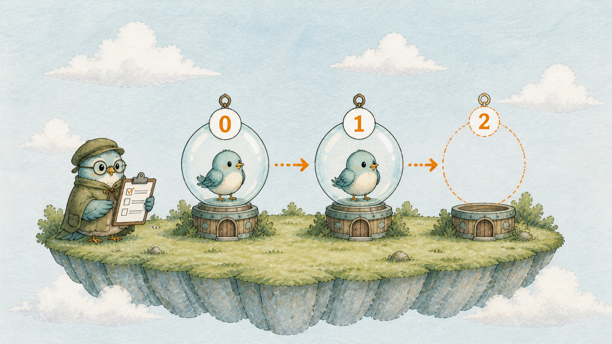
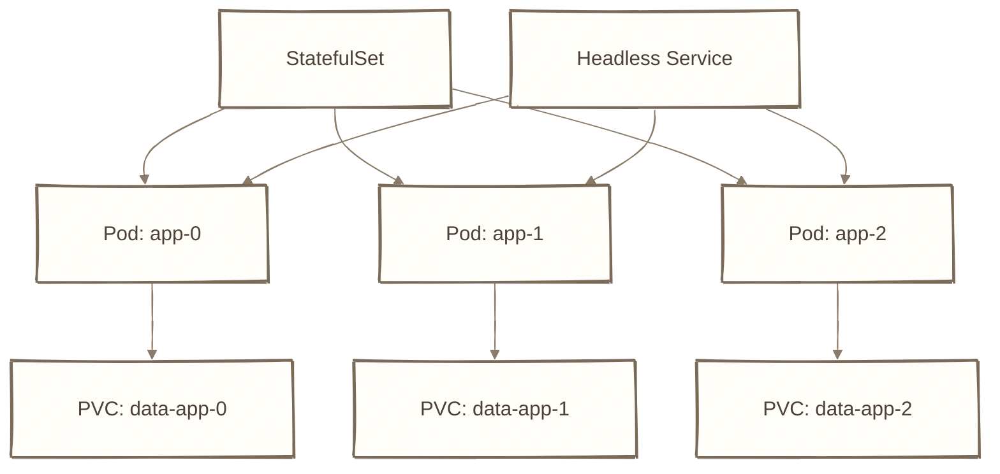
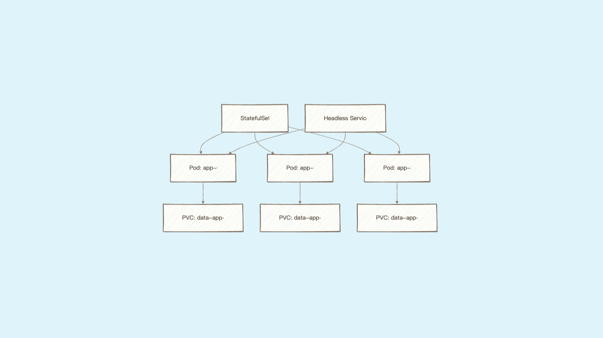
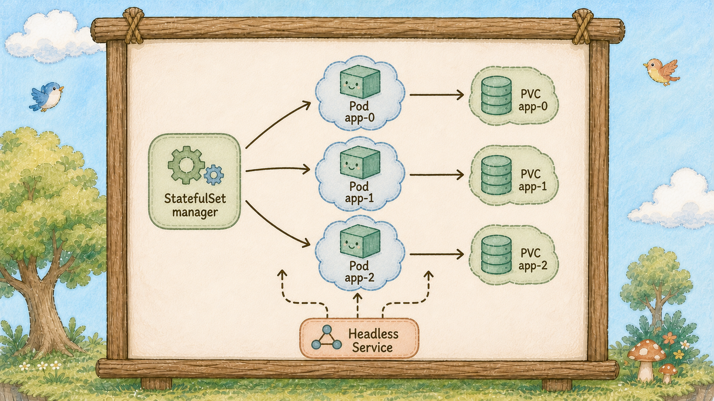
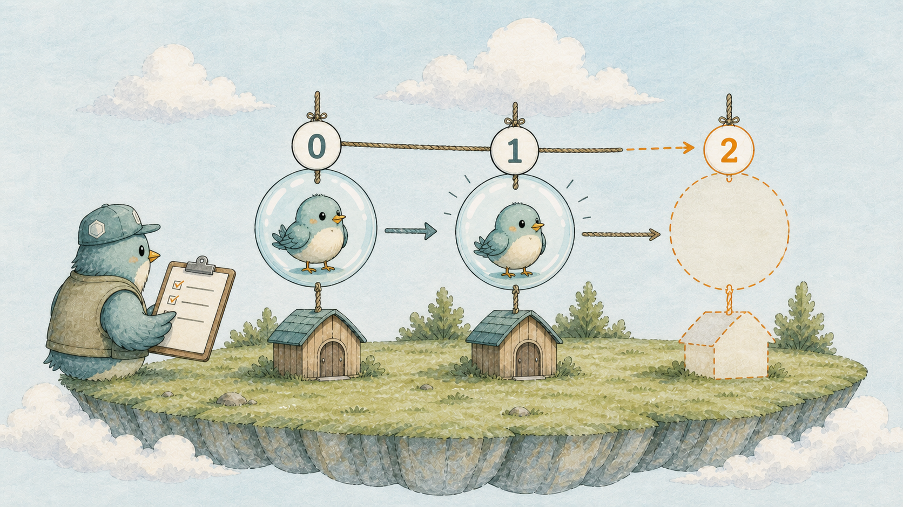
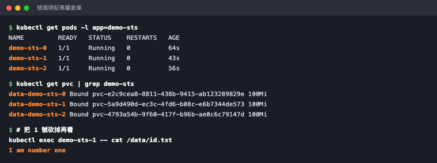

# Day 27：編號泡泡管理員 StatefulSet ── 資料庫為什麼不能用 Deployment

## 痛點

Day 23 你的資料庫是用 Deployment 跑的，也跑得好好的。那為什麼大家都說資料庫要用 StatefulSet？








IMG: 三顆泡泡各自掛著 0、1、2 號碼牌，泡泡裡各有一隻小鳥，泡泡下方各連著一座專屬的倉庫 ｜ 出場角色：編號泡泡管理員、泡泡、小鳥、島上的倉庫、借用單 ｜ 亮橘重點：泡泡外壁上的 0、1、2 號碼牌

因為 Deployment 手下的泡泡是**可拋棄的**，而資料庫**不能被拋棄**。

回想貓頭鷹的個性（Day 9）：它只數數字，不認得哪顆是哪顆。所以 Deployment 的泡泡有三個特徵：

**名字隨機** ── `hello-7d4b8c-xk2p9`，重建一次就換一串。
**沒有順序** ── 三顆同時吹出來，誰先誰後不一定。
**共用倉庫** ── 大家掛同一張借用單。

這三件事對前端來說完全沒問題，反而是優點。但對資料庫來說，三件全是災難。看圖上泡泡外壁的號碼牌，StatefulSet 把三件事一次改掉：

**第一，固定的名字。** 泡泡叫 `hello-db-0`、`hello-db-1`、`hello-db-2`，在泡泡外掛著號碼牌。刪掉 `hello-db-1`，補回來的還是叫 `hello-db-1`，不是換一串亂碼。

**第二，一鳥一倉庫。** 每個編號各自綁一張自己的借用單、一座自己的倉庫。`hello-db-1` 重建之後，接回去的是**它原本那座倉庫**，資料原封不動。這是整個 StatefulSet 最核心的價值。

**第三，預設的 OrderedReady 策略有順序。** 啟動通常是 0 → 1 → 2，一顆就緒才建立下一顆；關閉則反向進行。若設定 `podManagementPolicy: Parallel`，就不必等待這個順序。資料庫的主從架構、分散式系統的初始化，全都靠這個順序。



IMG: 三顆帶著 0、1、2 號碼牌的泡泡由左到右依序建立，1 號還沒 Ready 時 2 號尚未開始 ｜ 出場角色：編號泡泡管理員、泡泡、小鳥 ｜ 亮橘重點：尚未建立的 2 號位置

還有一個必配的東西：**Headless Service（無頭的圖騰柱）。**

一般的柱子有自己的 IP，會幫你隨機挑一顆泡泡（Day 18 那條地道）。但你連資料庫的主節點時，**你要的就是那一顆，不要隨機挑**。

所以 StatefulSet 配一根特別的柱子：`clusterIP: None`。它沒有自己的 IP、不做任何轉發，它只提供 DNS ── 讓你可以直接用 `hello-db-0.hello-db` 這種**帶編號的地址**叫到指定的那顆泡泡。

一句話總結今天：**Deployment 管的是「三個一樣的東西」，StatefulSet 管的是「三個不一樣、而且分得出誰是誰的東西」。**

那什麼時候該用？判準只有一條：**這顆泡泡有沒有「只屬於它自己」的資料或身分？** 有穩定身份、順序或每顆 Pod 專屬儲存需求時，才考慮 StatefulSet；資料庫、訊息佇列與分散式快取還要看應用程式和 Operator 的需求。沒有就用 Deployment，那是九成的情況。

## 動手 5 分鐘

前二十六天我們示範的工作負載都是 Deployment。今天讓編號泡泡管理員建立一組帶號碼牌的泡泡，把三個差異一次看完。

建立 `demo-statefulset.yaml`：

```yaml
apiVersion: v1
kind: Service
metadata:
  name: demo-sts
spec:
  clusterIP: None
  selector:
    app: demo-sts
  ports:
    - port: 80
---
apiVersion: apps/v1
kind: StatefulSet
metadata:
  name: demo-sts
spec:
  serviceName: demo-sts
  replicas: 3
  selector:
    matchLabels:
      app: demo-sts
  template:
    metadata:
      labels:
        app: demo-sts
    spec:
      containers:
        - name: web
          image: nginx:1.27-alpine
          volumeMounts:
            - name: data
              mountPath: /data
  volumeClaimTemplates:
    - metadata:
        name: data
      spec:
        accessModes: ["ReadWriteOnce"]
        resources:
          requests:
            storage: 100Mi
```

三個 Deployment 沒有的東西：`clusterIP: None`（無頭柱子）、`serviceName`（指定配哪根柱子）、`volumeClaimTemplates`（**借用單的模板** ── 不是一張單子，是「每個編號各發一張」）。

`---` 是 YAML 的分隔線，一個檔案裡放兩份資源。

```bash
kubectl apply -f demo-statefulset.yaml
kubectl get pods -l app=demo-sts -w
```

**盯著看，這是今天最好看的地方。** 泡泡是**一顆一顆**出現的：`demo-sts-0` 先 `Running`，然後 `demo-sts-1` 才開始 `ContainerCreating`，最後才是 `demo-sts-2`。Deployment 是三顆同時冒出來的，差別一眼可見。`Ctrl+C` 離開。

**差異一，名字：**

```bash
kubectl get pods -l app=demo-sts
```

`demo-sts-0`、`demo-sts-1`、`demo-sts-2`。**沒有一串亂碼。**

**差異二，一鳥一倉庫：**

```bash
kubectl get pvc
```

`data-demo-sts-0`、`data-demo-sts-1`、`data-demo-sts-2` ── **三張借用單，各綁各的倉庫**。你只寫了一份模板。

寫點只屬於 1 號的資料進去：

```bash
kubectl exec demo-sts-1 -- sh -c "echo 'I am number one' > /data/id.txt"
kubectl exec demo-sts-1 -- cat /data/id.txt
```

**現在做關鍵實驗，把 1 號砍掉：**

```bash
kubectl delete pod demo-sts-1
kubectl get pods -l app=demo-sts
```

補回來的泡泡**還是叫 `demo-sts-1`**。等它 `Running`，然後：

```bash
kubectl exec demo-sts-1 -- cat /data/id.txt
```

**`I am number one` 還在。** 這次 demo 中它接回了自己原本那座倉庫；前提是 PVC、PV 與掛載流程都正常。這件事 Deployment 做不到 ── 因為貓頭鷹補出來的是一顆名字完全不同的新泡泡，不知道該接哪座倉庫。



三顆泡泡的名字是 0、1、2，三張借用單也是 0、1、2 ── 一一對應。

**差異三，帶編號的地址：**

```bash
kubectl run dns-test --rm -it --image=busybox:1.36 -- \
  nslookup demo-sts-1.demo-sts.default.svc.cluster.local
```

印出那顆泡泡的 IP。**你叫得到指定的那一顆。**

（這裡要寫完整位址。busybox 的 `nslookup` 不太會用叢集的搜尋網域，只打 `demo-sts-1.demo-sts` 會拿到 `NXDOMAIN` ── 但你的**程式**在泡泡裡用短名稱是通的，那是 busybox 這個工具的問題，不是 DNS 的問題。）

至於你的 `hello-db`，要換過去其實只有四個地方要改：`kind` 換成 `StatefulSet`、加 `serviceName`、把 `volumes` 那段改成 `volumeClaimTemplates`、柱子加 `clusterIP: None`。今天先不動它，知道怎麼換就好。

收工，這組會留下借用單，記得一起清：

```bash
kubectl delete -f demo-statefulset.yaml
kubectl get pvc
kubectl delete pvc data-demo-sts-0 data-demo-sts-1 data-demo-sts-2
```

**注意最後這行。** 刪掉 StatefulSet **不會**連借用單一起刪 ── 這是刻意的保護，免得你手滑砍掉資料。所以清場的時候要多這一步，不然倉庫會一直留在島上。

再補一個很多人會忽略的差別：**在預設 RollingUpdate 策略下，StatefulSet 通常照編號倒著更新。** 更新時從編號最大的開始換，一顆就緒才動下一顆；`OnDelete` 或其他設定會改變這個行為。所以更新一組五顆的資料庫會明顯比更新前端慢，這是正常的，不要中途以為卡住就去手動干預。

## 帶走一句話

**號碼牌配專屬倉庫，這才是 StatefulSet。**

## 參考資源

- [StatefulSets](https://kubernetes.io/docs/concepts/workloads/controllers/statefulset/)
- [StatefulSet Basics](https://kubernetes.io/docs/tutorials/stateful-application/basic-stateful-set/)
