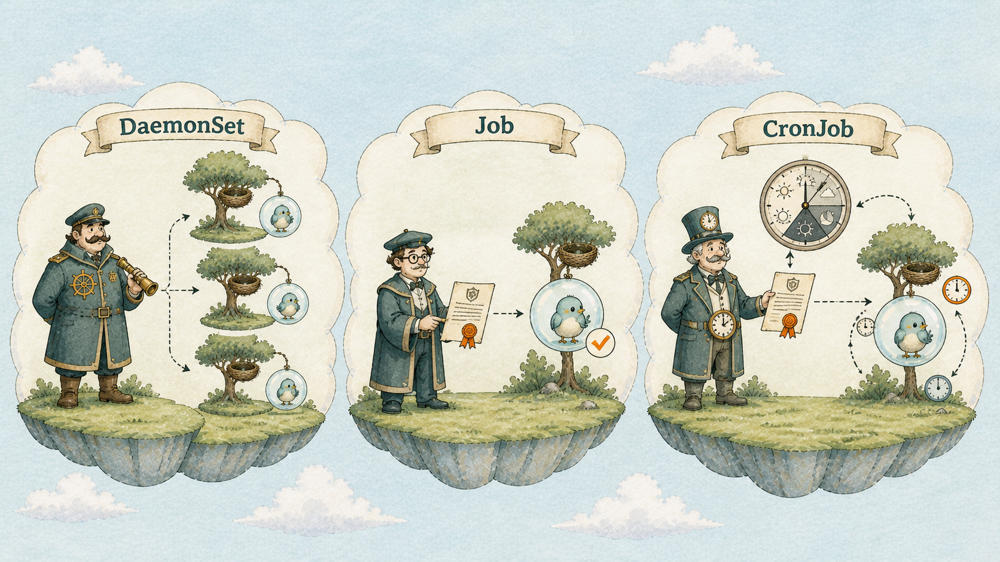
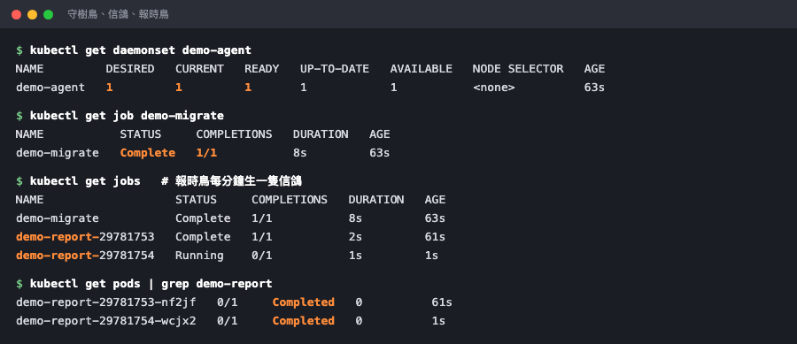

# Day 28：三個管理者一次認識 ── 守樹隊長、一次性任務委託單、定時任務鐘

## 痛點

不是所有工作都長得像網站。有些要每台機器跑一份，有些跑完就該結束，有些要每天半夜自己醒來。



IMG: 一張三格並排的圖，左格一位守樹隊長在每棵巢樹旁派駐工作，中格一張一次性任務委託單旁有一顆完成後停止的泡泡，右格定時任務鐘在時間到時送出委託單 ｜ 出場角色：守樹隊長、一次性任務委託單、定時任務鐘、巢樹、泡泡、小鳥 ｜ 亮橘重點：三格之間的分隔線

到目前為止你學的隊長、貓頭鷹、編號泡泡管理員，管的都是**長時間活著的服務**。今天這三位管理者管的是另外三種形狀的工作。

**守樹隊長（DaemonSet）── 每棵樹派駐一份，不多不少。**

它不看你要幾顆，它看島上有幾棵樹。三棵樹就派駐三個 Pod，你加第四棵樹，它自動在新樹上補一個；樹拔掉了，那個 Pod 也跟著消失。管理者是 DaemonSet，Pod 裡的小鳥仍然只代表 Container。

用在什麼地方？**凡是「跟機器綁定」而不是「跟服務綁定」的工作。** 最常見的三種：日誌收集（要讀那台機器上所有容器的日誌）、監控代理（要量那台機器的 CPU 和硬碟）、網路元件。

其實你早就見過它了 ── Day 18 每棵樹底下都有的郵差鼴鼠，就是由 DaemonSet 管理的 Pod。

**一次性任務委託單（Job）── 跑完就結束，而且要確認成功。**

Job 跟前面所有東西最大的差別：**它會結束，而且結束是正常的。** 泡泡跑完變成 `Completed`，沒有人會去重啟它。

這件事看起來平凡，但很重要 ── 如果你用 Deployment 跑一個一分鐘就跑完的腳本，隊長會以為它一直死掉，然後無限重啟，你會得到一個 `CrashLoopBackOff`（Day 12 那個狀態）。**一次性、需要由 Kubernetes 追蹤完成狀態的工作，通常用 Job；定期工作則考慮 CronJob。**

Job 還幫你處理兩件事：失敗會重試（`backoffLimit` 決定幾次），以及可以要求「總共要成功幾次」、「可以同時跑幾個」。資料遷移、批次匯入、一次性的修補腳本，都是它的守備範圍。

**定時任務鐘（CronJob）── 到時間建立一份 Job。**

CronJob 自己不做事，它只做一件事：**時間到了通常會建立一個 Job，但 `concurrencyPolicy`、suspend、錯過排程與 deadline 設定都可能改變行為。** 語法就是你熟悉的那五個欄位 `分 時 日 月 週`。


IMG: 定時任務鐘在時間到時送出一張一次性任務委託單，委託單再建立一顆裡面有小鳥的泡泡 ｜ 出場角色：定時任務鐘、一次性任務委託單、泡泡、小鳥 ｜ 亮橘重點：委託單由時鐘送出的那一刻

三者的關係很好記：**CronJob 建立 Job，Job 再建立 Pod。** 這裡的任務委託單是資源，不是小鳥；真正執行工作的 Container 仍然待在 Pod 裡。

備份、報表、清理過期資料、對帳 ── 這些以前你寫在 crontab 裡的東西，全部搬到這裡。搬過來的好處是：它跑在叢集上，不綁死在某一台機器；那台機器掛了，工作照跑。

## 動手 5 分鐘

前二十七天我們的島上只有長時間活著的服務。今天讓三種新形狀的工作各跑一次。

**守樹隊長。** 建立 `demo-daemonset.yaml`：

```yaml
apiVersion: apps/v1
kind: DaemonSet
metadata:
  name: demo-agent
spec:
  selector:
    matchLabels:
      app: demo-agent
  template:
    metadata:
      labels:
        app: demo-agent
    spec:
      containers:
        - name: agent
          image: busybox:1.36
          command: ["sh", "-c", "while true; do echo \"agent alive on $NODE\"; sleep 30; done"]
          env:
            - name: NODE
              valueFrom:
                fieldRef:
                  fieldPath: spec.nodeName
```

**沒有 `replicas` 這個欄位** ── 這是 DaemonSet 最好認的特徵，數量不是你決定的。（`fieldRef` 是個實用小技巧：讓泡泡知道自己站在哪棵樹上。）

```bash
kubectl apply -f demo-daemonset.yaml
kubectl get daemonset
kubectl get pods -l app=demo-agent -o wide
```

DESIRED 是 1、CURRENT 是 1 ── 因為你的島上只有一棵樹。**這個數字是島上的樹數，不是你寫的。**

```bash
kubectl logs -l app=demo-agent --tail=2
```

印出 `agent alive on hello-control-plane`。

順便看看島上原本就有的守樹隊長：

```bash
kubectl get daemonset -n kube-system
```

`kube-proxy` 在裡面 ── 你的老朋友郵差鼴鼠。

**一次性任務委託單。** 建立 `demo-job.yaml`：

```yaml
apiVersion: batch/v1
kind: Job
metadata:
  name: demo-migrate
spec:
  backoffLimit: 3
  template:
    spec:
      restartPolicy: OnFailure
      containers:
        - name: migrate
          image: busybox:1.36
          command: ["sh", "-c", "echo 'migrating...'; sleep 5; echo 'done'; exit 0"]
```

`apiVersion` 是 `batch/v1` ── 新的家族。`restartPolicy` **必填**，只能是 `OnFailure` 或 `Never`，不能是預設的 `Always`（那是「永遠活著」的意思，跟一次性任務委託單的本質衝突）。

```bash
kubectl apply -f demo-job.yaml
kubectl get pods -w
```

看著它 `Running` 五秒，然後變成 **`Completed`** ── 不是 `Error`，不是 `CrashLoopBackOff`，是**正常結束**。`Ctrl+C` 離開。

```bash
kubectl get job demo-migrate
kubectl logs job/demo-migrate
```

COMPLETIONS 是 `1/1`。日誌留著，泡泡不會被自動清掉，你隨時可以回來看它做了什麼。

**定時任務鐘。** 建立 `demo-cronjob.yaml`：

```yaml
apiVersion: batch/v1
kind: CronJob
metadata:
  name: demo-report
spec:
  schedule: "*/1 * * * *"
  successfulJobsHistoryLimit: 3
  jobTemplate:
    spec:
      template:
        spec:
          restartPolicy: OnFailure
          containers:
            - name: report
              image: busybox:1.36
              command: ["sh", "-c", "date; echo 'daily report generated'"]
```

`*/1 * * * *` 是每分鐘一次（正式環境不會這樣設，這裡只是不想等）。注意結構是**三層巢狀**：CronJob 包 jobTemplate、jobTemplate 包 pod template ── 就是「CronJob 建立 Job、Job 建立 Pod」的 YAML 版本。

```bash
kubectl apply -f demo-cronjob.yaml
kubectl get cronjob
```

等一分鐘：

```bash
kubectl get jobs
kubectl get pods
```

**憑空多出一個 Job 和一個 `Completed` 的泡泡。** 再等一分鐘，又多一組。`successfulJobsHistoryLimit: 3` 是說只留最近三次的紀錄，不然跑一個月你會有四萬個泡泡。



DaemonSet 的 DESIRED 是島上的樹數；Job 是 `Complete`；報時鳥生出來的 Job 名字後面帶著時間戳。

收工，三個一起清：

```bash
kubectl delete -f demo-daemonset.yaml -f demo-job.yaml -f demo-cronjob.yaml
```

最後補一個 CronJob 專屬的坑：**上一輪還沒跑完，下一輪時間就到了，會怎樣？**

預設是**兩個一起跑**。如果你的工作是「掃描整個資料表」這種不能重疊的東西，就會出事。要擋掉的話加一行 `spec.concurrencyPolicy: Forbid`，上一輪沒結束就跳過這一輪；設成 `Replace` 則是砍掉舊的換新的。這一行在你把 crontab 搬過來的時候，記得順手加上。

## 帶走一句話

**CronJob 建立 Job，Job 再建立 Pod；小鳥仍然待在泡泡裡。**

## 參考資源

- [DaemonSet](https://kubernetes.io/docs/concepts/workloads/controllers/daemonset/)
- [Job](https://kubernetes.io/docs/concepts/workloads/controllers/job/)
