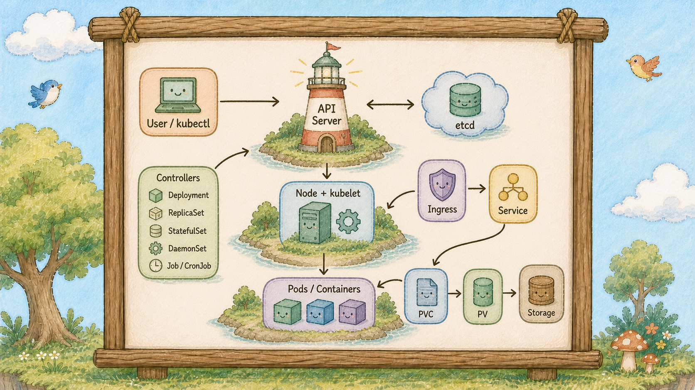

# Day 29： K8s Cluster 雲之島全圖，一張圖看完 K8s 怎麼運作


## Cluster 雲之島的全景大圖

二十八天下來認識了三十幾個角色。
現在把它們全部放進同一座島，你講得出誰在哪一站嗎？


所有角色各就各位：左上燈塔村的燈塔櫃台（API Server）、記憶樹（etcd）、選樹官（Scheduler）、巡邏隊長（Controller Manager），島中央的巢樹（Node）與泡泡（Pod），右側的大門地圖看板（Ingress）與圖騰柱（Service），地面上的倉庫（PersistentVolume，PV），樹底下的道路管理員（kube-proxy），五條路線串起全島。


## 全島只有五條線



今天話少一點，讓圖說話。全島只有五條線，每條線都親手做過。


**第一條線：下指令**

吹哨子（kubectl），話送到燈塔櫃台（API Server）。
櫃台驗完就把要的樣子寫進記憶樹（etcd），然後回一句「收到」。
**注意這裡就結束了**，櫃台不會等泡泡（Pod）真的建好才回話。
看到 `created` 的那一刻，島上可能什麼都還沒發生。
這就是 Day 4 那個宣告式：只負責描述結果，剩下的交給島。

**第二條線：燈塔村做決定**

巡邏隊長（Controller Manager）一直在比對「記憶樹 etcd 上寫的」跟「島上實際有的」。
發現要三顆但只有零顆，它就交代部署管家（Deployment）；部署管家（Deployment）交代貓頭鷹（ReplicaSet）；貓頭鷹（ReplicaSet）登記三顆泡泡（Pod）。
這三顆泡泡（Pod）此時還沒有家，選樹官（Scheduler）看每棵樹剩多少資源（就是 Day 25 畫的那條 Request 線），挑一棵，把答案寫回櫃台。

**控制面這條線主要是在協調與更新狀態；真正建立容器、掛載儲存和處理封包，則由 kubelet、Runtime、CSI、CNI 與資料平面元件執行。**

**第三條線：樹節點（Node）執行**

每棵樹上的管家松鼠（kubelet）盯著櫃台看有沒有自己這棵樹的活。
看到了就真的去拉 image、真的把泡泡（Pod）吹出來、真的把小鳥（Container）放進去。管家松鼠（kubelet）開始執行探針檢查，旗子（Readiness Probe）升起來。

**這是全島唯一真的動手的地方。**
決定和執行分開，所以燈塔村掛掉時，樹上跑著的服務不會跟著死。

**第四條線：流量進來**

訪客敲島的大門，地圖看板（Ingress）讀網址、挑一根圖騰柱（Service）。
柱子（Service）拿著貼紙（Label）去對名單（Endpoints），挑一顆貼著正確貼紙的泡泡（Pod）。
真正維護轉送規則的是樹底下的道路管理員（kube-proxy），它讓柱子（Service）那個虛擬 IP 的封包前往真實的泡泡 Pod IP。
封包穿過 Pod IP，交給裡面的小鳥（Container）。Day 18 那七站，就是這條線。

**第五條線：資料落地**

小鳥（Container）要寫東西。
寫在自己肚子裡，泡泡（Pod）一破就沒了；寫進泡泡（Pod）裡的共享食物桶（emptyDir），泡泡（Pod）一破也沒了。
所以真正要留的東西，順著借用單（PersistentVolumeClaim，PVC）寫到地面上的倉庫（PV）。

**看圖上倉庫（PV）的位置，它蓋在地上，不在樹上，這就是為什麼泡泡（Pod）破了它還在。**

五條線的分工，一句話各記一個動詞：**你說、村裡想、樹上做、道路管理員（kube-proxy）送、倉庫（PV）留。**


## 這座島如何協作

不同角色各自執行 reconciliation loop，透過 API Server、etcd、kubelet、Runtime、CNI 與 CSI 協作。
每個角色都會觀察狀態、採取動作，再重新觀察結果；某個角色故障時，影響範圍取決於它負責的環節。
二十八天來「刪掉泡泡（Pod）它自己長回來」的體驗，就來自這種持續調和機制。

## 動手 5 分鐘

今天不加東西，用一個指令把整張圖印出來。

```bash
kubectl get all -A -o wide
```

畫面很長，但現在每一行你都認得。對照著圖找找看：`kube-system` 裡的櫃台、記憶樹（etcd）、選樹官（Scheduler）、巡邏隊長（第二條線）、每棵樹一位的道路管理員（第四條線）、你的 hello 部署管家（Deployment）跟貓頭鷹（ReplicaSet）跟三顆泡泡（第三條線）。

再把你自己蓋的那部分單獨看一遍：

```bash
kubectl get deploy,rs,pod,svc,ingress,pvc,hpa
```

**這幾行就是你二十九天的成果**：前端部署管家（Deployment）帶著泡泡（Pod）、一根柱子（Service）、一塊看板（Ingress）、一個自動調節旋鈕（HPA）、資料庫和它的倉庫（PV）。


兩個部署管家（Deployment）、三根柱子（Service）、一塊看板（Ingress）、兩座倉庫（PV）、一個自動調節旋鈕（HPA） ── 全部是你自己蓋的。

最後跑一次完整的驗收，五條線各測一站：

```bash
kubectl get --raw='/readyz' && echo
kubectl get nodes
curl -s -o /dev/null -w "外部入口 %{http_code}\n" http://localhost/hello
kubectl get endpointslices -l kubernetes.io/service-name=hello
kubectl get pvc
```

櫃台 `ok`、樹 `Ready`、大門 `200`、名單（Endpoints）有人、倉庫（PV） `Bound`。**五條線全綠。**


一條線一個指令，五行就把整座島從頭到尾檢查完。

## 小結

**K8s 由多個持續調和的迴圈協作。**

## 參考資源

- [Kubernetes Components](https://kubernetes.io/docs/concepts/overview/components/)
- [Service Networking](https://kubernetes.io/docs/concepts/services-networking/)
