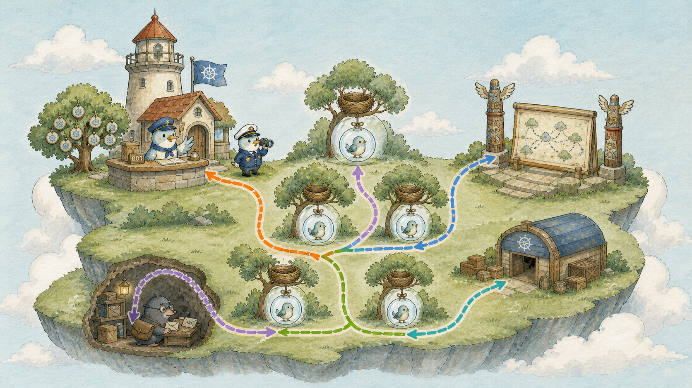
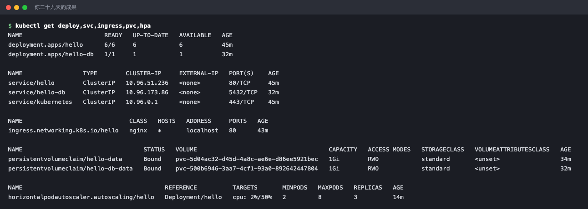
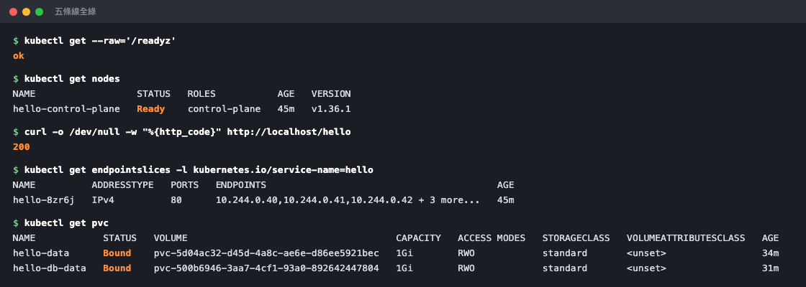

# Day 29：雲之島全圖 ── 一張圖看完 K8s 怎麼運作

## 痛點

二十八天下來你認識了三十幾個角色。現在把它們全部放進同一座島，你講得出誰在哪一站嗎？



IMG: 雲之島的全景大圖，所有角色各就各位：左上燈塔村（燈塔櫃台、記憶樹、引路鳥、巡邏隊長）、島中央的巢樹與泡泡、右側的大門地圖看板與圖騰柱、地面上的倉庫、樹底下的郵差鼴鼠，五條路線串起全島 ｜ 出場角色：雲之島、巢樹、泡泡、小鳥、燈塔櫃台、記憶樹、引路鳥、巡邏隊長、管家松鼠、哨子、圖騰柱、大門與地圖看板、郵差鼴鼠、島上的倉庫、借用單、隊長、數泡泡的貓頭鷹 ｜ 亮橘重點：貫穿全島的整體流向

今天話少一點，讓圖說話。全島只有五條線，每條線你都親手做過。

**第一條線：你下指令。**

你吹哨子，話送到燈塔櫃台。櫃台驗完就把你要的樣子寫進記憶樹，然後回你一句「收到」。**注意這裡就結束了** ── 櫃台不會等泡泡真的建好才回你。你看到 `created` 的那一刻，島上可能什麼都還沒發生。這就是 Day 4 那個宣告式：你只負責描述結果，剩下的交給島。

**第二條線：燈塔村做決定。**

巡邏隊長一直在比對「記憶樹上寫的」跟「島上實際有的」。發現你要三顆但只有零顆，它就交代隊長；隊長交代貓頭鷹；貓頭鷹登記三顆泡泡。這三顆泡泡此時還沒有家，引路鳥看每棵樹剩多少資源（就是你在 Day 25 畫的那條 Request 線），挑一棵，把答案寫回櫃台。**控制面這條線主要是在協調與更新狀態；真正建立容器、掛載儲存和處理封包，則由 kubelet、Runtime、CSI、CNI 與資料平面元件執行。**

**第三條線：巢樹執行。**

每棵樹上的管家松鼠盯著櫃台看有沒有自己這棵樹的活。看到了就真的去拉 image、真的把泡泡吹出來、真的把小鳥放進去。啄木鳥開始敲、旗子升起來。**這是全島唯一真的動手的地方。** 決定和執行分開，所以燈塔村掛掉時，樹上跑著的服務不會跟著死。

**第四條線：流量進來。**

訪客敲島的大門，地圖看板讀網址、挑一根圖騰柱。柱子拿著圍巾去對名單，挑一顆旗子升著的泡泡。真正搬運的是樹底下的郵差鼴鼠 ── 它把柱子那個虛擬 IP 翻成真實的泡泡 IP。封包穿過泡泡的門牌，交給裡面的小鳥。Day 18 那七站，就是這條線。

**第五條線：資料落地。**

小鳥要寫東西。寫在自己肚子裡，泡泡一破就沒了；寫進泡泡裡的食盆，泡泡一破也沒了。所以真正要留的東西，順著借用單寫到地面上的倉庫 ── **看圖上倉庫的位置，它蓋在地上，不在樹上，這就是為什麼泡泡破了它還在。**

五條線的分工，一句話各記一個動詞：**你說、村裡想、樹上做、鼴鼠送、倉庫留。**

最後看整張圖的節奏。**這座島不是一條由單一角色串起來的中央流水線。** 不同角色各自跑 reconciliation loop，但它們仍會依賴 API Server、etcd、kubelet、Runtime、CNI 或 CSI 等元件。 每一位都只做同一件事：看櫃台、比對、動作、再看櫃台。沒有中央的排程表、沒有誰指揮誰的呼叫鏈，只有一群各自盯著同一份紀錄的角色。

這就是 K8s 最核心、也最反直覺的設計：**它不是一條由中央指揮到底的流水線，而是一群彼此有依賴的 reconciliation loop。** 某個角色掛掉時，其他部分可能暫時繼續，但影響範圍取決於掛掉的是誰。

你二十八天來每一次「刪掉泡泡它自己長回來」的體驗，都是這個設計的副產品。

## 動手 5 分鐘

今天不加東西，用一個指令把整張圖印出來。

```bash
kubectl get all -A -o wide
```

畫面很長，但現在每一行你都認得。對照著圖找找看：`kube-system` 裡的櫃台、記憶樹、引路鳥、巡邏隊長（第二條線）、每棵樹一隻的郵差鼴鼠（第四條線）、你的 hello 隊長跟貓頭鷹跟三顆泡泡（第三條線）。

再把你自己蓋的那部分單獨看一遍：

```bash
kubectl get deploy,rs,pod,svc,ingress,pvc,hpa
```

**這幾行就是你二十九天的成果**：前端隊長帶著泡泡、一根柱子、一塊看板、一個自動調節旋鈕、資料庫和它的倉庫。



兩個隊長、三根柱子、一塊看板、兩座倉庫、一台吹泡機 ── 全部是你自己蓋的。

最後跑一次完整的驗收，五條線各測一站：

```bash
kubectl get --raw='/readyz' && echo
kubectl get nodes
curl -s -o /dev/null -w "外部入口 %{http_code}\n" http://localhost/hello
kubectl get endpointslices -l kubernetes.io/service-name=hello
kubectl get pvc
```

櫃台 `ok`、樹 `Ready`、大門 `200`、名單有人、倉庫 `Bound`。**五條線全綠。**



一條線一個指令，五行就把整座島從頭到尾檢查完。

## 帶走一句話

**K8s 不是流水線，是一群獨立的迴圈。**

## 參考資源

- [Kubernetes Components](https://kubernetes.io/docs/concepts/architecture/components/)
- [Service Networking](https://kubernetes.io/docs/concepts/services-networking/)
