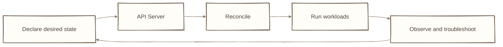
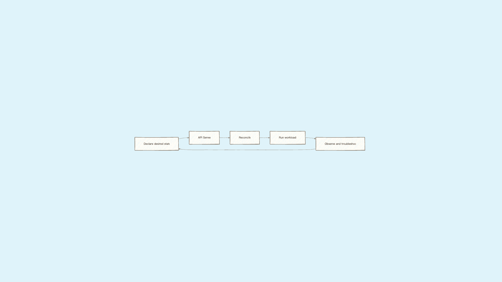

# Day 30：技能結算 ── 串起 Kubernetes 的核心機制

## 痛點

三十天走完，我們已經碰過不少 Kubernetes 物件與指令。最後一天不再加入新名詞，而是把這些零件重新串起來：一個工作負載如何被宣告、排程、連線、更新、擴縮，以及發生問題時該從哪裡查起。

IMG: 全系列角色在雲之島（Cluster）上排成一張合照，前排哨子（kubectl）、圖騰柱（Service）、泡泡（Pod）與泡泡（Pod）裡的小鳥（Container），後排燈塔櫃台（API Server）、記憶樹（etcd）、選樹官（Scheduler）、巡邏隊長（Controller Manager）、編號泡泡（StatefulSet Pod）管理員、守門員與自動調節旋鈕（HPA），地面放著倉庫（PersistentVolume，PV） ｜ 出場角色：雲之島（Cluster）、巢樹（Node）、泡泡（Pod）、小鳥（Container）、哨子（kubectl）、圖騰柱（Service）、大門與地圖看板、守門員、燈塔櫃台（API Server）、記憶樹（etcd）、選樹官（Scheduler）、巡邏隊長（Controller Manager）、島上的倉庫（PersistentVolume，PV）、部署管家（Deployment）、數泡泡（Pod）的貓頭鷹、編號泡泡（StatefulSet Pod）管理員、守樹隊長（DaemonSet）、一次性任務委託單（Job）、定時任務鐘（CronJob）、自動調節旋鈕（HPA） ｜ 亮橘重點：合照正中央的那顆泡泡（Pod）

今天整理三件事：這三十天完成的系統、五個核心技術問題，以及接下來的學習方向。

**第一件：這三十天完成了什麼。**

**我們用 Kind 建立了一座本機叢集，並在上面部署雙層架構的服務。** 前端是三副本的 Nginx，由 Deployment 管理版本、Service 提供穩定入口、Ingress 負責網域路由；設定抽成 ConfigMap，敏感資料放進 Secret。後端使用 Postgres，資料落在 PV 上，因此泡泡（Pod）重建後資料仍然保留。前端加入 Liveness 與 Readiness 探針（Probe）、設定 Request 與 Limit，再用 HPA 依 CPU 使用率調整期望副本數，由控制器實際增減 Pod。整套系統以十個 YAML 檔描述，可以用相同指令重建。

這套環境仍不是正式環境：它缺少跨機器的高可用架構、正式的儲存後端、完整的 RBAC 權限設計，以及監控、告警與備份機制。不過它已經把 Kubernetes 最重要的控制迴圈串了起來：提交期望狀態、由控制器持續調和，再透過觀測結果修正設定。

**第二件：用五個問題檢查核心觀念。**

**Q1：Pod 起不來你怎麼查？**
先 `get` 看狀態，再 `describe` 看 Events，最後才用 `logs` 檢查程式輸出。關鍵區分是：**Events 記錄 K8s 對這顆 Pod 做了什麼，logs 則是程式自己說了什麼；容器沒有啟動，就不會有程式 logs。** ImagePullBackOff 先看 Events、CrashLoopBackOff 可用 `logs --previous`、Pending 則找 FailedScheduling。（Day 12）

**Q2：Service 三種型態差在哪？**
它們是 Service 的不同 type，而且外層通常建立在內層之上：NodePort 同時具有 ClusterIP，LoadBalancer 通常也會配置 NodePort。原則是只暴露實際需要的範圍。LoadBalancer 會請雲端基礎設施配置外部負載平衡器，因此在沒有對應實作的本機環境中，EXTERNAL-IP 可能一直顯示 Pending。（Day 15）

**Q3：Deployment 怎麼做到零停機？**
Deployment 會為不同版本建立 ReplicaSet。滾動更新時，新版本增加一顆、舊版本減少一顆，而且**新的 Pod 沒通過 Readiness，更新就不會繼續推進**，因此錯誤版本通常會讓更新卡住，而不是立刻替換所有副本。`maxUnavailable` 控制更新期間最多可少多少可用副本，`maxSurge` 控制最多可額外建立多少副本。舊 ReplicaSet 會保留，`rollout undo` 可將版本切回去；若舊映像不在 Node 快取中，仍須重新拉取。（Day 10、11）

**Q4：PV 跟 PVC 是什麼關係？**
**PV 代表叢集中的儲存資源、PVC 是使用者提出的儲存需求，Pod 透過 PVC 使用儲存。** 這層抽象讓工作負載不必綁死 EBS、NFS 等底層實作。StorageClass 描述可動態供應的儲存類別，provisioner 負責建立底層 volume；回收策略則應依資料是否允許隨 PVC 刪除而選擇 `Delete` 或 `Retain`。（Day 22）

**Q5：三種探針（Probe）差在哪？**
**Liveness 決定是否重啟容器、Readiness 決定是否接收流量、Startup 決定何時開始執行另外兩種檢查。** Liveness 設得太敏感可能造成容器反覆重啟，也不應把外部資料庫是否可用當成 Liveness 條件；資料庫短暫異常時，重啟前端無法修復資料庫，反而會擴大故障。若服務暫時無法處理請求，可透過 Readiness 先停止導入流量。（Day 24）

這五個問題都指向同一件事：不要只記物件定義，要理解控制器在什麼條件下採取什麼動作，以及該從哪一層觀察結果。

**第三件：接下來學什麼。**

這一季刻意沒講五個東西，因為它們都建立在你剛學完的基礎上。現在你有基礎了，順序照這個排：

**Helm** ── YAML 的模板與套件管理，解決「同一份設定要生出 dev/staging/prod 三套」的問題。你現在有十個檔案就已經有點煩了，這是你的下一站。

**RBAC 與 ServiceAccount** ── 誰能對櫃台說什麼話。Day 20 說 Secret 的安全性來自「誰拿得到它」，這裡就是決定那件事的地方。

**Operator** ── 把你的維運知識寫成程式，讓島自己處理「資料庫要怎麼備份、怎麼升級」這種領域專屬的判斷。

**Service Mesh** ── 在圖騰柱（Service）之上再蓋一層，處理服務之間的加密、重試、流量切分與觀測。

**GitOps** ── 讓 git 成為唯一的真相來源，島自己去比對 git 上的設定跟現況。你會發現它就是 Day 4 那個宣告式，只是把記憶樹（etcd）換成了 git。

五個都不急。**先把這三十天的物件組合成一套能部署、更新、觀測與復原的系統，再逐步補上缺少的能力。**

最後，你還記得 Day 1 那個在三台機器之間搬容器、用 Excel 記哪個服務在哪台的人嗎？

三十天後，那張 Excel 變成了十個 YAML 檔。**而現在幫你記住這一切的，是記憶樹（etcd），不是你的腦袋。**

## 帶走一句話

**你不再記哪台跑什麼，島替你記。**

## 參考資源

- [Kubernetes Concepts](https://kubernetes.io/docs/concepts/)
- [Production Environment Considerations](https://kubernetes.io/docs/setup/production-environment/)
