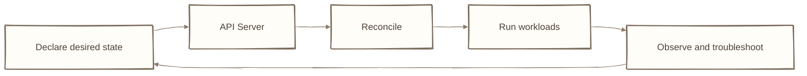

# Day 30：技能結算 ── 履歷怎麼寫、面試怎麼答、接下來學什麼

## 痛點

三十天結束了。但如果別人問你「你會 K8s 嗎」，你還是不知道該怎麼開口回答。

IMG: 全系列角色在雲之島上排成一張合照，前排哨子、圖騰柱、泡泡與泡泡裡的小鳥，後排燈塔櫃台、記憶樹、選樹官、巡邏隊長、編號泡泡管理員、守門員與自動調節旋鈕，地面放著倉庫 ｜ 出場角色：雲之島、巢樹、泡泡、小鳥、哨子、圖騰柱、大門與地圖看板、守門員、燈塔櫃台、記憶樹、選樹官、巡邏隊長、島上的倉庫、隊長、數泡泡的貓頭鷹、編號泡泡管理員、守樹隊長、一次性任務委託單、定時任務鐘、自動調節旋鈕 ｜ 亮橘重點：合照正中央的那顆泡泡

今天講三件事，都很實際。

**第一件：你這三十天實際做出了什麼。**

不要說「我學了 K8s」。說你做了什麼：

**你用 Kind 蓋了一座本機叢集，在上面部署了一個雙層架構的服務。** 前端是三副本的 Nginx，走 Deployment 管版本、Service 做穩定入口、Ingress 做網域路由。設定抽成 ConfigMap、密碼放 Secret。後端接了一個 Postgres，資料落在 PV 上，泡泡重建資料不掉。前端加了 Liveness 與 Readiness 探針、設了 Request 與 Limit，並用 HPA 依 CPU 使用率調整期望副本數，再由控制器增減 Pod。整套用十個 YAML 檔管理，任何一台電腦兩行指令就能重現。

**這段話可以直接寫進履歷，而且每一句你都真的做過、都能被追問。** 這比「熟悉 Kubernetes」有價值一百倍。

面試官如果問「你有正式環境經驗嗎」，誠實答沒有，然後接上這句：**「但我知道正式環境跟我做的差在哪 ── 多節點、真的儲存後端、RBAC 權限、以及有人維運的監控。」** 知道自己不會什麼，本身就是一種能力證明。

**第二件：五個高頻面試題，怎麼答。**

**Q1：Pod 起不來你怎麼查？**
答判讀順序，不要答指令：先 `get` 看狀態字串，再 `describe` 看 Events，最後才 `logs`。然後補一句關鍵區分：**Events 是 K8s 對這顆 Pod 做了什麼，logs 是程式自己說了什麼；容器沒起來就不會有 logs。** 再各給一個例子：ImagePullBackOff 看 Events、CrashLoopBackOff 用 `logs --previous`、Pending 看 FailedScheduling。（Day 12）

**Q2：Service 三種型態差在哪？**
重點不是背定義，是講出**它們是同一個 Service 的不同 type，並且外層通常建立在內層之上**：NodePort 通常同時有 ClusterIP，LoadBalancer 通常再建立 NodePort。原則是「能用內層就別開外層」。再補一句加分的：LoadBalancer 本身不做事，它是去請雲端業者開一台，所以本機環境會卡在 Pending。（Day 15）

**Q3：Deployment 怎麼做到零停機？**
講機制：一個版本一個 ReplicaSet，滾動更新是新的加一顆、舊的減一顆，而且**新的沒通過 Readiness 就不往下走**，所以壞版本可能卡住而不是全掛。再講兩個旋鈕：`maxUnavailable` 決定你敢掉多少，`maxSurge` 決定你願意多付多少資源換速度。最後補回滾：舊 ReplicaSet 留著，`rollout undo` 是把數字調回去；若舊 image 不在 Node 快取中，仍可能需要重新拉取。（Day 10、11）

**Q4：PV 跟 PVC 是什麼關係？**
一句話講完：**PV 是實際的儲存、PVC 是申請單、Pod 只認申請單不認儲存。** 然後講出這樣設計的理由 ── 讓開發者不必知道底層是 EBS 還是 NFS，同一份 YAML 才能跨環境。加分點：StorageClass 描述動態供應儲存的類別，provisioner 負責建立底層 volume；回收策略正式環境要用 `Retain`。（Day 22）

**Q5：三種探針差在哪？**
一句話各一個動詞：**Liveness 決定生死、Readiness 決定流量、Startup 決定何時開始檢查。** 然後主動講出那個經典錯誤：Liveness 設太敏感會造成雪崩式無限重啟，而且**千萬不要在 Liveness 裡檢查資料庫** ── 資料庫抖一下你的前端會被全部重啟，重啟一百次也救不了資料庫。那種檢查放 Readiness。（Day 24）

**這五題的共同答題策略：先講原理，再講一個你踩過的坑。** 坑才是你真的做過的證據。

**第三件：接下來學什麼。**

這一季刻意沒講五個東西，因為它們都建立在你剛學完的基礎上。現在你有基礎了，順序照這個排：

**Helm** ── YAML 的模板與套件管理，解決「同一份設定要生出 dev/staging/prod 三套」的問題。你現在有十個檔案就已經有點煩了，這是你的下一站。

**RBAC 與 ServiceAccount** ── 誰能對櫃台說什麼話。Day 20 說 Secret 的安全性來自「誰拿得到它」，這裡就是決定那件事的地方。

**Operator** ── 把你的維運知識寫成程式，讓島自己處理「資料庫要怎麼備份、怎麼升級」這種領域專屬的判斷。

**Service Mesh** ── 在圖騰柱之上再蓋一層，處理服務之間的加密、重試、流量切分與觀測。

**GitOps** ── 讓 git 成為唯一的真相來源，島自己去比對 git 上的設定跟現況。你會發現它就是 Day 4 那個宣告式，只是把記憶樹換成了 git。

五個都不急。**先把這三十天的東西真的用在一個你自己的專案上，比多學五個名詞有用得多。**

最後，你還記得 Day 1 那個在三台機器之間搬容器、用 Excel 記哪個服務在哪台的人嗎？

三十天後，那張 Excel 變成了十個 YAML 檔。**而現在幫你記住這一切的，是記憶樹，不是你的腦袋。**

## 帶走一句話

**你不再記哪台跑什麼，島替你記。**

## 參考資源

- [Kubernetes Concepts](https://kubernetes.io/docs/concepts/)
- [Production Environment Considerations](https://kubernetes.io/docs/setup/production-environment/)
