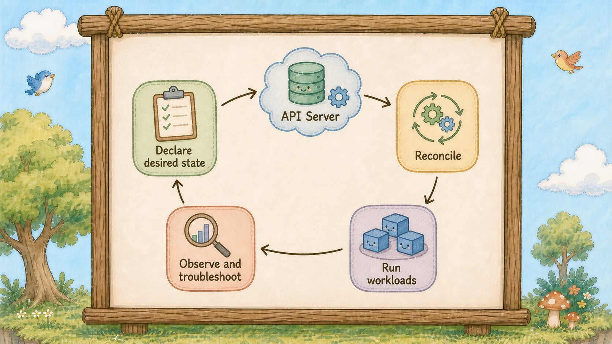

# Day 30：K8s 總結，串起 Kubernetes 的核心機制

## K8s 總結：雲之島 Cluster 大合照

我們已經碰過不少 Kubernetes 物件與指令。
最後一天把既有零件串起來：工作負載如何被宣告、排程、連線、更新、擴縮，以及如何查問題。

這張合照象徵三十天課程裡，我們一起認識的 Kubernetes 世界。島上的角色代表不同工作：有人提交設定、有人安排工作、有人維持服務運作，也有人觀察狀態與處理問題。

## K8s 控制迴圈

說明期望狀態如何經過 API Server、控制器與工作負載，形成持續運作的控制迴圈。
這張圖用一個簡化循環整理操作方式：先用 YAML 向 API Server 提交期望狀態；API Server 驗證並保存物件後，各控制器透過 API 觀察狀態並建立或調整相關物件，Node 上的 kubelet 再依已排程的 Pod 規格呼叫容器執行階段。接著觀察叢集回報的狀態，若結果不符合預期，就檢查原因並調整設定。圖中的箭頭表示概念流程，不代表單一控制器直接啟動容器；叢集也不一定會完全達到期望狀態。

今天整理三件事：這三十天完成的系統、五個核心技術問題，以及接下來的學習方向。

## 第一件：這三十天完成了什麼

**我們用 Kind 建立了一座本機叢集，並在上面部署雙層架構的服務。**

前端是三副本的 Nginx，由 Deployment 管理期望副本數與版本；Service 提供穩定的服務入口，Ingress 定義網域與路徑路由，並由 Ingress Controller 實際處理流量。一般設定放進 ConfigMap，敏感設定放進 Secret；Secret 本身不等於加密或完整的密鑰管理，仍須搭配適當的存取控制與叢集設定。

後端使用 Postgres，資料目錄透過 PVC 使用 PV。只要 Pod 重建時仍使用同一份 claim，且底層儲存與回收設定保留資料，資料就能在 Pod 重建後繼續使用；PV 這個 API 物件本身不保證底層資料一定不會遺失。

前端加入 Liveness 與 Readiness 探針（Probe）、設定 CPU/記憶體 Requests 與 Limits，再用 HPA 依 CPU 使用率調整 Deployment 的期望副本數。以 CPU 使用率作為指標時，相關容器必須設定 CPU Request，且叢集需要提供可用的資源指標 API；HPA controller 提出副本數調整，Deployment/ReplicaSet controllers 再建立或刪除 Pod。

整套系統以十個 YAML 檔描述，可以用相同指令重建。

這套環境仍是教學環境，還缺少跨機器高可用、正式儲存、RBAC、監控、告警與備份。

不過它已經把 Kubernetes 最重要的控制迴圈串了起來：提交期望狀態、由控制器持續調和，再透過觀測結果修正設定。

## 第二件：用五個問題檢查核心觀念

**Q1：Pod 起不來怎麼查？**

先用 `get` 看狀態，再用 `describe` 看物件細節與 Events，最後視容器狀態用 `logs` 檢查程式輸出。
關鍵區分是：**Events 是叢集元件針對物件所發出的事件，logs 是容器標準輸出與錯誤輸出；容器尚未啟動時，通常還沒有該容器的應用程式 logs。**
ImagePullBackOff 先看 Events；CrashLoopBackOff 可用 `logs --previous` 查看前一個已終止容器的日誌；Pending 則檢查排程條件與 FailedScheduling Events。（Day 12）

**Q2：Service 三種型態差在哪？**

它們是 Service 的不同 `type`。NodePort 會在 ClusterIP Service 的基礎上配置節點連接埠；LoadBalancer 通常也會配置 ClusterIP，並通常配置 NodePort，但可透過 `allocateLoadBalancerNodePorts: false` 關閉 NodePort，前提是負載平衡器實作不依賴 NodePort。
原則是只暴露實際需要的範圍。
LoadBalancer Service 需要叢集中有對應的負載平衡器實作；在沒有該實作的本機環境中，`EXTERNAL-IP` 可能一直顯示 `<pending>`。（Day 15）

**Q3：Deployment 怎麼做到零停機？**

Deployment 會為不同版本建立 ReplicaSet。
滾動更新時，新版本逐步增加、舊版本逐步減少；新的 Pod 未 Ready 時，可用副本數可能不足，更新會無法繼續前進。控制器會依 `progressDeadlineSeconds` 判定更新是否停滯並回報 `ProgressDeadlineExceeded`，但不會因此自動回滾。
`maxUnavailable` 控制更新期間最多可少多少可用副本，`maxSurge` 控制最多可額外建立多少副本。
舊 ReplicaSet 通常會在保留的修訂範圍內留下紀錄，`rollout undo` 可將 Deployment 回復到先前修訂；若舊映像不在 Node 快取中，仍須重新拉取。滾動更新設定提供更新策略，但不保證所有應用在任何故障情況下都零停機。（Day 10、11）

**Q4：PV 跟 PVC 是什麼關係？**

**PV 代表叢集中的儲存資源，PVC 是使用者提出的儲存需求，Pod 透過 PVC 使用儲存。**
這層抽象讓工作負載不必綁死 EBS、NFS 等底層實作。
StorageClass 描述儲存類別及其供應方式；動態供應時由對應 provisioner 建立底層 volume。PVC 釋放後，PV 的回收策略（例如 `Delete` 或 `Retain`）會影響 PV 和底層儲存的後續處理，應依資料保留需求設定。（Day 22）

**Q5：三種探針（Probe）差在哪？**

**Liveness 探針失敗達門檻時，kubelet 會終止該容器，後續是否重啟依 Pod 的 `restartPolicy`；Readiness 決定 Pod 是否可接收 Service 流量；Startup 成功前，kubelet 暫緩執行該容器的 Liveness 與 Readiness 探針。**
Liveness 過於敏感會造成反覆重啟；外部資料庫健康狀態應交給 Readiness，避免前端跟著重啟。
若服務暫時無法處理請求，可透過 Readiness 先停止導入流量。（Day 24）

這五個問題都指向同一件事：不要只記物件定義，要理解控制器在什麼條件下採取什麼動作，以及該從哪一層觀察結果。

## 第三件：接下來學什麼

接下來可以依這個順序補上五項能力：

**Helm**：YAML 模板與套件管理。

**RBAC 與 ServiceAccount**：管理誰能對櫃台執行哪些操作。

**Operator**：把領域維運知識寫成控制器。

**Service Mesh**：處理服務間的加密、重試、流量切分與觀測。

**GitOps**：讓 Git 成為設定來源，由系統持續比對 Git 與叢集現況。

五個都不急。**先把這三十天的物件組合成一套能部署、更新、觀測與復原的系統，再逐步補上缺少的能力。**

最後，還記得 Day 1 那個在三台機器之間搬容器、用 Excel 記哪個服務在哪台的人嗎？

三十天後，那張 Excel 變成了十個 YAML 檔；叢集狀態則由記憶樹（etcd）保存。

恭喜你獲得這個技能

你可以 **「使用 Kind 建立 Kubernetes 叢集，部署 Nginx/Postgres 雙層服務，完成 Service、Ingress、PVC、Probe 與 HPA 設定。」**

## 小結

**你不再記哪台跑什麼，島替你記。**

## 參考資源

- [Kubernetes Concepts](https://kubernetes.io/docs/concepts/)
- [Production Environment Considerations](https://kubernetes.io/docs/setup/production-environment/)
- [Deployments](https://kubernetes.io/docs/concepts/workloads/controllers/deployment/)
- [Service Types](https://kubernetes.io/docs/concepts/services-networking/service/)
- [Horizontal Pod Autoscaling](https://kubernetes.io/docs/concepts/workloads/autoscaling/horizontal-pod-autoscale/)
- [Liveness, Readiness, and Startup Probes](https://kubernetes.io/docs/concepts/configuration/liveness-readiness-startup-probes/)
